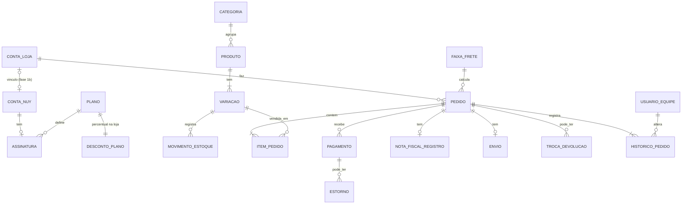
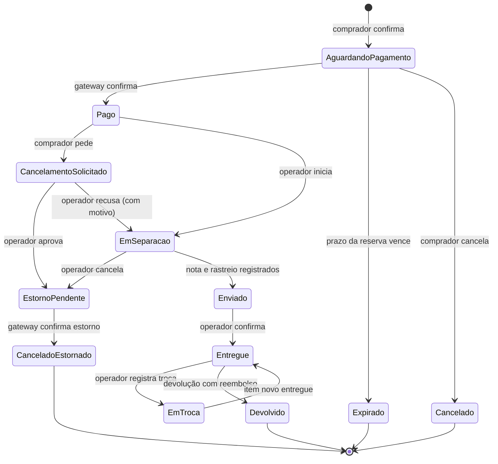

# Spec: Loja N.UY (vendas reais, site e app)

| Campo | Valor |
|---|---|
| Cliente | N.UY, app esportivo (parceiros de treino, quadras, eventos, especialistas, IA) |
| Versão | 0.2 |
| Status | Rascunho, com perguntas abertas ao cliente (seção 13) |
| Autor | arquiteto-specs · Data: 2026-11-14 |
| Aprovada por / em | (pendente) |
| Fontes | Decisões do desenvolvedor repassadas em 2026-11-14 (D1 a D5, ver ADR-0001 e ADR-0002); respostas do desenvolvedor em 2026-11-14 (P-01, P-02, P-04, D-01; ver ADR-0003); `BRIEFING.md`; `site/index.html` (seções Planos, Bônus, Loja); `site/conteudo/loja.json` e `planos.json` |

> Convenções: `CA-LOJ-xx` critério de aceite · `RN-LOJ-xx` regra de negócio · `RNF-xx` · `[PENDENTE: ...]` falta resposta · `[PREMISSA: ...]` assumido por nós, a confirmar.
> Esta spec define **o quê e o porquê**. Stack, banco, forma de integrar e telas são decisões de `dev-arquitetura` e dos especialistas (seção 15).

---

## 1. Visão geral

### 1.1 Problema
Hoje a "Loja N.UY" do site é só vitrine: dois cartões de categoria (Calçados; Roupas e acessórios) com o botão "Comprar no app", que leva à seção de download. Não existe venda de verdade, nem catálogo, estoque, pedido ou pagamento. O site promete "Assinante paga até 15% menos" e o desconto por plano aparece nos cartões de planos (Silver 5%, Gold 10%, Premium 15%), mas não há onde aplicá-lo.

### 1.2 Objetivo do negócio
Vender produtos esportivos (calçados, roupas, acessórios) com pagamento online, numa loja única acessível pelo site e pelo app, usando o desconto da loja como benefício que incentiva a assinatura dos planos pagos.

| Indicador | Hoje | Meta | Como medir |
|---|---|---|---|
| Pedidos pagos por mês | 0 | `[PENDENTE: meta do cliente]` | Relatório de pedidos pagos |
| Parte dos pedidos feita por assinantes pagos | 0 | `[PENDENTE]` | Pedidos com desconto de plano / total |
| Pedidos com erro de estoque (vendido sem ter) | n/a | 0 | Pedidos cancelados por falta de estoque |

### 1.3 Como é feito hoje
`[PENDENTE: a N.UY já vende esses produtos em algum canal (loja física, Instagram, WhatsApp, marketplace)? Tem estoque próprio hoje ou vai começar do zero?]` O site atual não vende.

### 1.4 Como ficará
1. O comprador abre a loja pelo site ou pelo app e navega no catálogo.
2. Escolhe produto e variação (ex.: tamanho), coloca no carrinho.
3. No checkout, compra como visitante (e-mail e dados de entrega) ou entra com a **conta da loja** (login próprio, separado da conta do app).
4. Informa endereço, vê o frete, paga com Pix ou cartão. No MVP, todos pagam o preço cheio; o desconto de assinante entra quando for possível ler o plano no app (ADR-0003).
5. A N.UY separa, emite a nota, envia e informa o rastreio; o comprador acompanha em "Meus pedidos".
6. Cancelamentos, estornos e trocas são tratados pelo operador da N.UY no painel da loja.

**Pedido × necessidade × desejo futuro**

| Item | Classe |
|---|---|
| Loja única para site e app, sistema próprio, N.UY vendedora | Pedido (decidido, ADR-0001) |
| Desconto automático pelo plano da conta N.UY | Pedido (decidido, ADR-0002); **suspenso no MVP** até confirmar como ler o plano no Base44 (ADR-0003) |
| Login próprio da loja, compra como visitante, loja web aberta pelo app | Pedido (respostas P-01, P-02, P-04) |
| Vender com pagamento online e estoque confiável | Necessidade |
| Desconto como alavanca de assinatura | Necessidade (inferida do site: "Assinante paga até 15% menos") |
| Telas nativas da loja dentro do app, cupons, frete por transportadora automático, NF-e automática | Desejo futuro (fases seguintes) |

---

## 2. Glossário

| Termo | Definição | Observação |
|---|---|---|
| Conta N.UY | Cadastro do usuário no app N.UY (app feito em Base44) | A loja **não** usa esta conta para login (ADR-0003) |
| Conta da loja | Cadastro próprio da loja (e-mail e senha ou outro método a definir pelo dev-auth), separado da conta N.UY | Vínculo com a conta N.UY: futuro, depende de ADR-0003 |
| Plano | Gratuito, Silver, Gold ou Premium, mensal ou anual | Preços provisórios (`planos.json`) |
| Plano vigente | Plano pago e ativo na data da compra | O que conta como "ativo" (teste grátis, atraso, cancelado ainda no período pago): `[PENDENTE: P-03]` |
| Desconto de assinante | Percentual de desconto da loja conforme o plano vigente | Gratuito 0%, Silver 5%, Gold 10%, Premium 15% (provisório) |
| Comprador visitante | Quem compra sem conta da loja, informando e-mail e dados de entrega | Permitido, preço cheio (P-04 respondida) |
| Comprador com conta | Quem compra entrando com a conta da loja | Preço cheio no MVP |
| Comprador assinante | Comprador com conta cujo plano N.UY foi verificado | Só existe quando a leitura do plano no Base44 estiver confirmada (ADR-0003) |
| Produto | Item vendido (ex.: "Tênis de corrida X") | |
| Variação | Combinação vendável de um produto (ex.: tamanho 40, cor preta), com estoque próprio | `[PENDENTE: P-12]` quais variações existem |
| Estoque disponível | Quantidade física menos o que está reservado em pedidos aguardando pagamento | |
| Reserva | Separação temporária de unidades para um pedido aguardando pagamento | RN-LOJ-09 |
| Pedido | Compra registrada, com itens, preços e descontos congelados | Estados na seção 8 |
| Troca | Devolução de um item com envio de outro (outro tamanho, outro produto) | Política: `[PENDENTE: P-10]` |
| Devolução / arrependimento | Devolução com reembolso | Regras legais com advogado (seção 12) |
| Estorno | Devolução do dinheiro pelo mesmo meio de pagamento | |

---

## 3. Usuários e papéis

| Papel | Quem é | O que pode fazer | O que NÃO pode |
|---|---|---|---|
| Comprador visitante | Qualquer pessoa, sem conta da loja | Ver catálogo, montar carrinho, comprar pelo preço cheio, acompanhar o pedido pelo link do e-mail | Receber desconto de assinante; ver pedidos de outros |
| Comprador com conta | Pessoa com conta da loja | Tudo do visitante + "Meus pedidos" com todos os pedidos dela + endereços salvos `[PREMISSA]` | Ver pedidos de outros; alterar preço ou desconto |
| Comprador assinante (fase dependente) | Comprador com conta e plano N.UY verificado | Tudo do comprador com conta + desconto do plano vigente | Idem |
| Operador de pedidos | Funcionário da N.UY | Ver e atualizar pedidos (separação, nota, envio, rastreio), registrar cancelamento, estorno e troca, dar entrada de estoque por devolução | Alterar preços, produtos, percentuais de desconto, frete; gerenciar usuários |
| Admin da loja | Responsável da N.UY | Tudo do operador + produtos, variações, fotos, preços, estoque (entrada e ajuste), frete, percentuais de desconto, usuários da equipe | Ver dados completos de cartão (nunca ficam na loja) |

`[PENDENTE: P-08]` Quantas pessoas operam e se operador pode estornar sozinho ou só com o admin. `[PREMISSA: estorno pode ser feito por operador e admin, com registro de quem fez]`.

**Matriz de permissões (resumo)**

| Ação / Recurso | Visitante | Com conta / assinante | Operador | Admin |
|---|---|---|---|---|
| Ver catálogo e preços | ✔ | ✔ | ✔ | ✔ |
| Comprar | ✔ (preço cheio) | ✔ | ✘ (no papel de equipe) | ✘ (no papel de equipe) |
| Desconto de assinante | ✘ | só assinante verificado, quando ADR-0003 for resolvido | ✘ | ✘ |
| Ver pedidos | próprio, pelo link do e-mail | próprio | todos | todos |
| Atualizar estado do pedido, nota, rastreio | ✘ | ✘ | ✔ | ✔ |
| Cancelar/estornar pedido | pedir (ver RN) | pedir (ver RN) | ✔ | ✔ |
| Produtos, preços, estoque, frete, % de desconto | ✘ | ✘ | ✘ | ✔ |
| Usuários da equipe | ✘ | ✘ | ✘ | ✔ |

---

## 4. Escopo

### 4.1 MVP (fase 1): o menor fluxo que vende de verdade
Justificativa: o valor está em **receber o primeiro pedido pago com estoque certo**. Tudo que não impede isso foi para depois. O desconto de assinante era parte do MVP, mas depende de uma integração com o Base44 ainda não confirmada (ADR-0003); para não travar a venda, ele vira a **fase 1b**.

1. Catálogo com produtos, variações, fotos, preço e disponibilidade (loja web responsiva).
2. Carrinho e checkout com Pix e cartão de crédito por um gateway de pagamento.
3. Compra como visitante (e-mail, nome, CPF, telefone e endereço) e conta própria da loja, opcional (P-01, P-04). Todos pagam o preço cheio.
4. Frete por tabela configurada pela N.UY (faixas de CEP/estado e valor), com área de entrega definida.
5. Estoque por variação, reserva durante o pagamento e baixa no pagamento confirmado.
6. "Meus pedidos" para o comprador e e-mails de pedido (recebido, pago, enviado com rastreio, cancelado).
7. Painel da loja: produtos, estoque, frete, % de desconto, pedidos (estados, número da nota, rastreio, cancelamento/estorno, troca registrada manualmente), usuários admin/operador.
8. Acesso pelo app: o app abre a loja como página web (sem telas nativas, P-02 respondida). O comprador entra com a conta da loja ou compra como visitante; não há login automático vindo do app.
9. Nota fiscal emitida **fora** do sistema, no emissor que a N.UY usar; o operador registra número/chave no pedido.
10. Ajuste do site: a seção Loja passa a levar à loja real (seção 5.8).

### 4.2 Fases seguintes

| Fase | Conteúdo | Depende de |
|---|---|---|
| 1b | Desconto de assinante: vínculo da conta da loja com a conta N.UY, leitura do plano vigente, percentuais no painel, HU-03 e CA-LOJ-04, 09 a 12, 42 | Confirmar como ler o plano no Base44 (PEND-B44, ADR-0003); P-03; C-01; revisão dos textos do site |
| 2 | Emissão de NF-e integrada ao emissor; cálculo de frete por transportadora/Correios; etiquetas de envio | MVP no ar; definição do emissor (P-09) e da logística (P-06) |
| 2 | Solicitação de troca/devolução pelo próprio comprador em "Meus pedidos" | Política de troca validada (P-10) |
| 2 | Destaques do catálogo puxados automaticamente para a seção Loja do site | API de catálogo do MVP |
| 2 | Relatórios (vendas por período, mais vendidos, desconto concedido por plano) e exportação | MVP |
| 3 | Telas nativas da loja no app (P-02: "por enquanto" página web) | Nova decisão do cliente e `dev-mobile` |
| 3 | Entrada única (mesma conta no app e na loja) | Viabilidade no Base44 |
| 3 | Cupons e promoções com regras de acumulação com o desconto de plano | RN-LOJ-05 confirmada |
| 3 | Parcelamento com juros, boleto, carteiras digitais | Gateway escolhido |

### 4.3 Fora de escopo
- Marketplace ou vendedores terceiros (D4: só a N.UY vende).
- Plataforma pronta (Nuvemshop, Shopify etc.) e migração para ela (D2).
- Venda ou cobrança dos **planos de assinatura** pela loja: os planos continuam no app.
- Emissão automática de NF-e no MVP (manual fora do sistema; ver 4.1 item 9).
- Cálculo automático de frete por transportadora no MVP.
- Cupons, programa de pontos, cashback, vale-presente, kits/combos, pré-venda, produto personalizado.
- Boleto; parcelamento além do que P-07 definir.
- Retirada em loja física `[PENDENTE: P-06, só entra se a N.UY tiver ponto físico]`.
- Avaliações de produto, lista de desejos, recomendação por IA, recuperação de carrinho abandonado.
- Integração com ERP, marketplaces (Mercado Livre etc.) ou loja física.
- Venda internacional, outras moedas, outros idiomas.
- Compra de fornecedores, custo médio e controle fiscal de entrada.
- Telas nativas da loja no app (fase 3); `dev-mobile` fora deste projeto por enquanto.
- Desconto de assinante no MVP (fase 1b, ADR-0003).
- Login com a conta do app N.UY e entrada única entre app e loja.
- Qualquer alteração no app N.UY (Base44) no MVP.

---

## 5. Requisitos funcionais

### 5.1 Catálogo

**HU-01 — Ver produtos.** Como **comprador**, quero ver os produtos com fotos, preço e tamanhos disponíveis, para escolher o que comprar. *Must · Fase 1*

| ID | Critério de aceite |
|---|---|
| CA-LOJ-01 | **Dado** um produto ativo com ao menos uma variação com estoque disponível, **quando** o comprador abre a loja, **então** o produto aparece com nome, foto, preço cheio e categoria. |
| CA-LOJ-02 | **Dado** um produto cujas variações têm todas estoque disponível 0, **quando** o comprador abre a página do produto, **então** o produto aparece como "Esgotado" e o botão de adicionar ao carrinho fica indisponível. |
| CA-LOJ-03 | **Dado** um produto com variação "40" esgotada e "41" disponível, **quando** o comprador escolhe a variação, **então** "40" aparece indisponível e só "41" pode ir ao carrinho. |
| CA-LOJ-04 *(fase 1b)* | **Dado** um comprador identificado com plano Gold vigente, **quando** vê um produto de R$ 399,90, **então** vê também "R$ 359,91 com seu plano Gold" (estimativa; confirmação no checkout, RN-LOJ-04). |
| CA-LOJ-05 | **Dado** um produto inativado pelo admin, **quando** alguém abre o endereço dele, **então** vê "Produto indisponível" e o produto não aparece em listagens. |

### 5.2 Carrinho e identificação

**HU-02 — Montar carrinho.** Como **comprador**, quero juntar produtos num carrinho, para pagar tudo de uma vez. *Must · Fase 1*

**HU-03a — Comprar sem conta.** Como **visitante**, quero comprar só informando meus dados, para não precisar criar cadastro. *Must · Fase 1*

**HU-03b — Ter conta na loja.** Como **comprador**, quero uma conta na loja, para ver todos os meus pedidos e não redigitar o endereço. *Must · Fase 1*

**HU-03 — Ganhar o desconto do meu plano.** Como **assinante**, quero que a loja reconheça meu plano N.UY, para pagar menos. *Must · **Fase 1b*** (depende de ADR-0003)

| ID | Critério de aceite |
|---|---|
| CA-LOJ-06 | **Dado** um carrinho com 2 unidades da variação X, **quando** o estoque disponível de X cai para 1, **então** ao abrir o carrinho ou ir ao checkout o comprador vê aviso "Só 1 disponível" e a quantidade é ajustada para 1 com a confirmação dele. |
| CA-LOJ-44 | **Dado** um visitante no checkout, **quando** informa e-mail, nome, CPF, telefone e endereço válidos e paga, **então** o pedido é criado sem conta, pelo preço cheio, e o e-mail de confirmação traz um link para acompanhar o pedido. |
| CA-LOJ-45 | **Dado** um visitante, **quando** deixa de preencher e-mail, CPF ou endereço, ou preenche e-mail/CEP/CPF em formato inválido, **então** o campo é apontado e o pedido não é confirmado. |
| CA-LOJ-46 | **Dado** um visitante cujo e-mail já tem conta na loja, **quando** chega ao checkout, **então** vê a sugestão "Entre para salvar este pedido na sua conta", mas pode seguir como visitante. |
| CA-LOJ-07 | **Dado** um comprador não identificado com itens no carrinho, **quando** entra (ou cria) a conta da loja com sucesso, **então** volta ao carrinho com os mesmos itens. |
| CA-LOJ-08 | **Dado** um comprador que tenta entrar e falha, **quando** a tentativa termina, **então** vê mensagem clara, o carrinho é mantido e ele pode tentar de novo ou seguir como visitante. |
| CA-LOJ-47 | **Dado** um visitante que fez pedidos com o e-mail X, **quando** cria depois uma conta da loja com o e-mail X e confirma esse e-mail, **então** os pedidos anteriores feitos com X aparecem em "Meus pedidos" `[PREMISSA: vínculo só após confirmação do e-mail; confirmar com cliente; dev-auth e dev-security validam]`. *Should* |
| CA-LOJ-09 *(fase 1b)* | **Dado** um comprador com plano N.UY Gratuito verificado, **quando** se identifica, **então** o carrinho mostra 0% de desconto de assinante e uma chamada para conhecer os planos `[PREMISSA: chamada para upgrade; confirmar com cliente]`. |

### 5.3 Checkout, desconto e pagamento

**HU-04 — Pagar.** Como **comprador**, quero pagar com Pix ou cartão, para concluir a compra. *Must · Fase 1*

| ID | Critério de aceite |
|---|---|
| CA-LOJ-48 | **Dado** o MVP (fase 1, desconto de assinante inexistente), **quando** qualquer comprador chega ao resumo do checkout, **então** vê subtotal, frete e total, sem linha de desconto de assinante, e o total cobrado é subtotal + frete. |
| CA-LOJ-10 *(fase 1b)* | **Dado** um comprador Silver vigente com itens de R$ 100,00 e R$ 49,90 e frete de R$ 20,00, **quando** chega ao resumo do checkout, **então** vê subtotal R$ 149,90, desconto Silver 5% de R$ 7,50 (R$ 5,00 + R$ 2,50, por item, RN-LOJ-06), frete R$ 20,00 e total R$ 162,40. |
| CA-LOJ-11 *(fase 1b)* | **Dado** um comprador cujo plano era Gold quando montou o carrinho e passou a Gratuito antes de confirmar, **quando** confirma o pedido, **então** o sistema refaz a verificação, mostra o novo total sem desconto e pede nova confirmação antes de cobrar. |
| CA-LOJ-12 *(fase 1b)* | **Dado** que a verificação do plano no serviço de contas N.UY falha no momento da confirmação, **quando** o comprador confirma, **então** nenhum desconto é aplicado sem verificação e o comprador vê a opção definida em RN-LOJ-07. |
| CA-LOJ-13 | **Dado** um pedido confirmado com Pix, **quando** o checkout termina, **então** o comprador vê o código Pix (copia e cola e QR) com o valor total e o prazo de expiração, e o pedido fica "Aguardando pagamento". |
| CA-LOJ-14 | **Dado** um pedido aguardando Pix, **quando** o gateway confirma o pagamento, **então** o pedido passa a "Pago" em até 1 minuto após a confirmação recebida, o comprador recebe e-mail e vê o novo estado em "Meus pedidos". |
| CA-LOJ-15 | **Dado** um Pix não pago até o fim do prazo da reserva, **quando** o prazo vence, **então** o pedido passa a "Expirado" e as unidades reservadas voltam ao estoque disponível. |
| CA-LOJ-16 | **Dado** um pagamento com cartão aprovado, **quando** o gateway responde, **então** o pedido fica "Pago" e o comprador vê a confirmação com o número do pedido. |
| CA-LOJ-17 | **Dado** um cartão recusado, **quando** o gateway responde, **então** o comprador vê "Pagamento não aprovado", pode tentar outro cartão ou Pix enquanto a reserva valer, e nada é cobrado. |
| CA-LOJ-18 | **Dado** que o gateway envia a mesma confirmação de pagamento duas vezes, **quando** o sistema a recebe, **então** o pedido continua com um único pagamento registrado, uma única baixa de estoque e um único e-mail de "pago". |
| CA-LOJ-19 | **Dado** um comprador que altera no navegador o preço ou o percentual de desconto enviado, **quando** confirma o pedido, **então** o total cobrado é o calculado pela loja (preço cadastrado e plano verificado), não o enviado. |
| CA-LOJ-20 | **Dado** um pedido pago, **quando** o admin muda depois o preço do produto ou o percentual do plano, **então** o pedido mantém os valores da compra. |

### 5.4 Frete e endereço

**HU-05 — Saber o frete.** Como **comprador**, quero ver o frete e o prazo antes de pagar, para decidir. *Must · Fase 1*

| ID | Critério de aceite |
|---|---|
| CA-LOJ-21 | **Dado** um CEP dentro de uma faixa cadastrada com frete R$ X e prazo N dias úteis, **quando** o comprador informa o CEP, **então** vê frete R$ X e prazo "até N dias úteis após o pagamento". |
| CA-LOJ-22 | **Dado** um CEP fora da área de entrega, **quando** o comprador informa o CEP, **então** vê "Ainda não entregamos neste CEP" e não consegue confirmar o pedido. |
| CA-LOJ-23 | **Dado** frete grátis configurado acima de R$ Y `[PENDENTE: P-06]`, **quando** o subtotal com desconto atinge R$ Y, **então** o frete fica R$ 0,00. |

### 5.5 Estoque

**HU-06 — Não vender o que não tem.** Como **admin da loja**, quero que o estoque baixe sozinho com as vendas, para não vender produto que acabou. *Must · Fase 1*

| ID | Critério de aceite |
|---|---|
| CA-LOJ-24 | **Dado** variação com estoque disponível 1 e dois compradores confirmando pedido dela ao mesmo tempo, **quando** os dois confirmam, **então** só um pedido é criado com reserva; o outro vê "Acabou de esgotar" e o estoque nunca fica negativo. |
| CA-LOJ-25 | **Dado** variação com estoque 10, **quando** um pedido de 2 unidades é confirmado, **então** o disponível passa a 8 (reserva); **quando** o pagamento é confirmado, a reserva vira baixa definitiva; **quando** o pedido expira ou é cancelado antes do envio, o disponível volta a 10. |
| CA-LOJ-26 | **Dado** contagem física diferente do sistema, **quando** o admin registra ajuste com motivo, **então** o saldo é corrigido e o ajuste aparece no histórico da variação com data, quantidade, motivo e quem fez. |
| CA-LOJ-27 | **Dado** uma devolução recebida em bom estado, **quando** o operador marca "item recebido e apto para venda", **então** a unidade volta ao estoque com registro de origem "devolução do pedido N". |

### 5.6 Pedidos (comprador e operação)

**HU-07 — Acompanhar meu pedido.** Como **comprador**, quero ver o estado do pedido e o rastreio, para saber quando chega. *Must · Fase 1*

**HU-08 — Operar pedidos.** Como **operador**, quero ver os pedidos pagos, registrar nota e rastreio e mudar o estado, para entregar sem planilha paralela. *Must · Fase 1*

| ID | Critério de aceite |
|---|---|
| CA-LOJ-28 | **Dado** um comprador com conta identificado, **quando** abre "Meus pedidos", **então** vê só os pedidos dele, com número, data, itens, total, estado e código de rastreio quando houver. |
| CA-LOJ-29 | **Dado** um comprador que tenta abrir pelo endereço um pedido de outra pessoa (inclusive trocando o número do pedido no link do visitante), **quando** a página carrega, **então** vê "Pedido não encontrado" e nenhum dado do pedido. |
| CA-LOJ-49 | **Dado** um visitante com o link de acompanhamento recebido por e-mail, **quando** o abre, **então** vê só aquele pedido (estado, itens, total, rastreio) e pode pedir cancelamento conforme RN-LOJ-14; CPF e endereço completos não aparecem nessa página `[PREMISSA: dev-security define validade e formato do link]`. |
| CA-LOJ-30 | **Dado** pedidos em vários estados, **quando** o operador abre a lista, **então** pode filtrar por estado e data e ver os pagos mais antigos primeiro. |
| CA-LOJ-31 | **Dado** um pedido "Em separação" sem número de nota registrado, **quando** o operador tenta marcar "Enviado", **então** o sistema pede número/chave da nota e código de rastreio antes de permitir `[PREMISSA: nota antes do envio; validar com contador, RN-LOJ-15]`. |
| CA-LOJ-32 | **Dado** um pedido "Enviado" com rastreio, **quando** o operador salva, **então** o comprador recebe e-mail com o código e o vê em "Meus pedidos". |
| CA-LOJ-33 | **Dado** qualquer mudança de estado, **quando** é salva, **então** o histórico do pedido mostra estado anterior, novo estado, data/hora e quem fez (sistema, comprador ou nome do usuário da equipe). |

### 5.7 Cancelamento, estorno e troca

**HU-09 — Cancelar.** Como **comprador**, quero cancelar um pedido que ainda não foi enviado, para receber meu dinheiro de volta. *Must · Fase 1*

**HU-10 — Trocar ou devolver.** Como **comprador**, quero trocar um tamanho ou devolver, conforme a política da loja. *Must (registro manual) · Fase 1; autoatendimento na fase 2*

| ID | Critério de aceite |
|---|---|
| CA-LOJ-34 | **Dado** pedido "Aguardando pagamento", **quando** o comprador cancela, **então** o pedido passa a "Cancelado", o Pix/cobrança pendente é invalidado e a reserva volta ao estoque. |
| CA-LOJ-35 | **Dado** pedido "Pago" ainda não "Em separação", **quando** o comprador pede cancelamento, **então** o pedido vai para "Cancelamento solicitado" e o operador vê o pedido destacado na lista `[PREMISSA: cancelamento após pagamento passa pelo operador; confirmar P-10]`. |
| CA-LOJ-36 | **Dado** um cancelamento aprovado de pedido pago, **quando** o operador confirma o estorno, **então** o estorno total é solicitado ao gateway, o pedido fica "Cancelado e estornado" quando o gateway confirmar, a baixa de estoque é desfeita e o comprador recebe e-mail. |
| CA-LOJ-37 | **Dado** que o gateway recusa ou falha no estorno, **quando** o operador tenta, **então** o pedido fica "Estorno pendente" com o motivo visível e não é marcado como estornado. |
| CA-LOJ-38 | **Dado** um pedido "Entregue", **quando** o operador registra uma troca (itens devolvidos, itens novos, motivo), **então** o pedido fica "Em troca", a variação nova é reservada e, ao confirmar o recebimento do item devolvido, segue CA-LOJ-27. |
| CA-LOJ-39 | **Dado** um pedido "Entregue", **quando** o operador registra devolução com reembolso total ou parcial (valor ≤ total pago), **então** o estorno é solicitado ao gateway pelo valor informado e o pedido fica "Devolvido" com o valor reembolsado visível. |

### 5.8 Painel da loja e impacto no site atual

**HU-11 — Gerir catálogo e regras.** Como **admin**, quero cadastrar produtos, preços, estoque, frete e percentuais de desconto, para operar a loja sem depender do desenvolvedor. *Must · Fase 1*

| ID | Critério de aceite |
|---|---|
| CA-LOJ-40 | **Dado** um admin, **quando** cria um produto com nome, categoria, descrição, fotos, preço e ao menos uma variação com estoque, **então** o produto aparece na loja após ser marcado como ativo. |
| CA-LOJ-41 | **Dado** um código de variação (SKU) já existente, **quando** o admin tenta repeti-lo, **então** o sistema recusa e mostra o item existente. |
| CA-LOJ-42 *(fase 1b)* | **Dado** o admin muda o desconto do Gold de 10% para 12%, **quando** salva, **então** a mudança vale para pedidos confirmados a partir daí, e o histórico registra valor anterior, novo, data e quem mudou `[PENDENTE: P-05, onde vive o percentual: loja ou app]`. |
| CA-LOJ-43 | **Dado** um operador, **quando** tenta abrir produtos, preços, frete, descontos ou usuários, **então** vê "Sem permissão". |

**Impacto sobre o painel `/admin` (Sveltia CMS) e a seção Loja do site (D5)**

- O painel `/admin` continua dono do **conteúdo de vitrine**: textos, planos (cartões), Explore, Novidades e os cartões editoriais da seção Loja (`site/conteudo/loja.json`: rótulo, títulos, cartões de categoria com foto e texto).
- **Produtos vendáveis, preços, estoque, frete, descontos e pedidos passam a viver só no sistema da loja** (RN-LOJ-18). O `loja.json` nunca terá preço nem estoque, para não existirem duas fontes.
- No MVP, a seção Loja do site muda pouco: os cartões continuam editoriais, o botão deixa de ser "Comprar no app" (que leva ao download) e passa a levar à categoria correspondente na loja. O texto do botão e o destino são campos de conteúdo `[PREMISSA: o link vira campo do cartão no painel; implementação é do dev de front, texto do copywriter]`. Com a P-02 respondida (página web), o título "Equipado sem sair do app" depende de como o Base44 abre o link (PEND-B44b); revisar com `copywriter`.
- Na fase 2, a seção Loja pode mostrar destaques puxados do catálogo; aí os cartões de produto saem do `loja.json`.
- **Divergência a vigiar:** `planos.json` tem o texto "Desconto na loja: 5%/10%/15%" escrito à mão nos itens de cada plano, e a seção Bônus diz "Até 15% de desconto em todos os produtos da loja". Se o percentual mudar na loja (ou no app), esses textos precisam ser atualizados também. Ver RISCO-05 e a contradição C-01.
- O painel atual entra com token do GitHub e edita um repositório **público**: a gestão da loja exige um painel com login próprio da equipe e dados fora do Git (pedidos e dados pessoais nunca vão para o repositório).
- **Onde fica o código (D-01 respondida):** neste mesmo repositório, branch `loja`, numa pasta própria (ex.: `loja/`), separada de `site/`. O `site/` e o painel `/admin` não passam a depender da loja; a ligação entre eles é só o link dos cartões. Nome exato da pasta e forma de publicar: `dev-arquitetura` e `dev-devops`.
- **Promessa de desconto no site enquanto a fase 1b não chega:** a seção Bônus ("Até 15% de desconto em todos os produtos da loja"), o cartão "Roupas e acessórios" ("Assinante paga até 15% menos"), o cartão Explore ("Equipamento com desconto de assinante") e os itens "Desconto na loja" dos planos prometem algo que o MVP não entrega. Ver RISCO-09: decidir com o cliente se esses textos mudam no lançamento da loja (copywriter).

---

## 6. Regras de negócio

| ID | Regra | Origem | Exceções |
|---|---|---|---|
| RN-LOJ-01 | Uma única loja (catálogo, estoque, pedidos) atende site e app. Um pedido feito no app aparece no mesmo painel e em "Meus pedidos" no site, e vice-versa. | Desenvolvedor (D1) | — |
| RN-LOJ-02 | A N.UY é a única vendedora: o pedido, a nota fiscal, a entrega e a troca são da N.UY. | Desenvolvedor (D4) | — |
| RN-LOJ-03 | Preço em reais, cadastrado por variação (ou por produto, herdado pelas variações). O total é sempre calculado pela loja, nunca aceito do navegador/app. | `[PREMISSA]` (boa prática; ver dev-security) | — |
| RN-LOJ-04 *(fase 1b)* | Desconto de assinante por plano vigente: Gratuito 0%, Silver 5%, Gold 10%, Premium 15% (provisório). O plano é **verificado no momento da confirmação do pedido**, consultando a fonte oficial da assinatura (app N.UY). O valor mostrado no catálogo e no carrinho é estimativa. Se o plano mudou, vale RN-LOJ-04 com nova confirmação do comprador (CA-LOJ-11). | Desenvolvedor (D3) + percentuais do site; momento da verificação `[PREMISSA]` | Contradição C-01 (desconto só no anual?) |
| RN-LOJ-05 | O desconto de assinante incide sobre o preço dos produtos, **não** sobre o frete. Não acumula com outros descontos no MVP (não há cupons). Se houver produto em promoção, `[PENDENTE: P-05b aplica o desconto de plano sobre o preço promocional, não aplica, ou aplica o maior]`. Produtos excluídos do desconto: `[PENDENTE: P-05b]` (o site diz "todos os produtos"). | `[PREMISSA]` / Pendente | — |
| RN-LOJ-06 | Cálculo: desconto por item = preço unitário × percentual, arredondado ao centavo (meio centavo para cima), multiplicado pela quantidade. Ex.: R$ 399,90 × 10% = R$ 39,99 → R$ 359,91. R$ 49,90 × 5% = R$ 2,495 → R$ 2,50. | `[PREMISSA]` (validar com contador: desconto destacado na nota) | — |
| RN-LOJ-07 *(fase 1b)* | Se não for possível verificar o plano na confirmação (serviço de contas fora do ar), **nenhum desconto é concedido sem verificação**. `[PENDENTE: P-03b oferecer seguir sem desconto, ou bloquear a compra e pedir para tentar depois]`. `[PREMISSA: oferecer as duas opções ao comprador]`. | `[PREMISSA]` | — |
| RN-LOJ-08 | Valores do pedido (preços, percentual e plano usados, frete, total) ficam congelados no pedido. Mudanças posteriores de preço, percentual ou plano não alteram pedidos já confirmados. | `[PREMISSA]` | Troca/devolução ajusta por movimentos próprios, sem reescrever o pedido |
| RN-LOJ-09 | Carrinho não reserva estoque. A reserva acontece na confirmação do pedido e dura: Pix até a expiração do código `[PREMISSA: 30 minutos]`; cartão até a resposta do gateway, com nova tentativa permitida dentro do mesmo prazo. | `[PREMISSA]` | — |
| RN-LOJ-10 | Estoque disponível nunca fica negativo; não existe venda sob encomenda no MVP. | `[PREMISSA]` | — |
| RN-LOJ-11 | Estoque só muda por movimentação registrada (entrada, ajuste com motivo, reserva, baixa, devolução); ninguém edita o saldo diretamente. | Padrão do catálogo (estoque) | — |
| RN-LOJ-12 | Pagamentos aceitos no MVP: Pix e cartão de crédito, por gateway. Parcelamento: `[PENDENTE: P-07]`. Dados de cartão nunca ficam guardados na loja. | Pedido do desenvolvedor (Pix e cartão) + `[PREMISSA]` | — |
| RN-LOJ-13 | Uma confirmação de pagamento repetida não gera segundo pagamento, segunda baixa nem segundo e-mail. | `[PREMISSA]` | — |
| RN-LOJ-14 | Cancelamento: o comprador cancela sozinho enquanto "Aguardando pagamento"; depois de pago e antes de "Em separação", pede o cancelamento e o operador aprova e estorna; depois de enviado, só por devolução/arrependimento. | `[PREMISSA]`, validar com advogado e P-10 | Arrependimento legal (seção 12) |
| RN-LOJ-15 | Nota fiscal: emitida pela N.UY (CNPJ próprio) para todo pedido pago `[PENDENTE: P-09, momento da emissão e documento correto com o contador]`. No MVP a emissão é feita fora do sistema e o operador registra número/chave. `[PREMISSA: o pedido só vai a "Enviado" com nota registrada]`. | Desenvolvedor (D4) + `[PREMISSA]` | Cancelamento/devolução após a nota pode exigir nota de devolução/cancelamento: contador |
| RN-LOJ-16 | Frete por tabela da N.UY: faixas de CEP (ou estado) com valor e prazo; CEP fora das faixas não é atendido. Frete grátis acima de um valor, se o cliente quiser. | `[PREMISSA]`, P-06 | — |
| RN-LOJ-17 | Troca/devolução: prazo, condições do produto e quem paga o frete de volta conforme política da N.UY `[PENDENTE: P-10]`, respeitando o mínimo legal (advogado). | Pendente | — |
| RN-LOJ-18 | Fonte única: produto vendável, preço, estoque, frete, percentuais e pedidos vivem só no sistema da loja; o painel de conteúdo (`/admin`) não guarda nenhum deles. | Desenvolvedor (D5) | — |
| RN-LOJ-19 | Alterações de preço, percentual de desconto, estoque, estado de pedido e estorno ficam registradas com quem, quando, valor anterior e novo. | `[PREMISSA]` | — |
| RN-LOJ-21 | A loja tem login próprio; a conta da loja é separada da conta do app N.UY. Nenhuma senha ou dado de login do app passa pela loja. | Desenvolvedor (P-01, ADR-0003) | — |
| RN-LOJ-22 | Compra como visitante é permitida, sempre pelo preço cheio. Dados obrigatórios do visitante: e-mail, nome, CPF, telefone e endereço de entrega `[PREMISSA: CPF por causa da nota fiscal e do gateway; telefone para a entrega; confirmar com contador e cliente]`. | Desenvolvedor (P-04) + `[PREMISSA]` | — |
| RN-LOJ-23 | No MVP não existe desconto de assinante: o total é soma dos preços cheios + frete. O desconto só passa a existir quando houver forma confirmada e segura de ler o plano vigente no app (ADR-0003); até lá, a loja não concede desconto por declaração do comprador nem por print. `[PREMISSA: o MVP não constrói o cálculo do desconto "desligado"; ele entra junto com a fase 1b. Alternativa aceitável, se o desenvolvedor preferir: construir com uma chave liga/desliga, desligada]`. | Desenvolvedor (P-01) + `[PREMISSA]` | — |
| RN-LOJ-20 | Regras de risco do pagamento (antifraude): `[PENDENTE: usar a análise de risco do gateway? teto por pedido? limite de tentativas de cartão por pedido/comprador?]`. `[PREMISSA: até 3 tentativas de cartão recusadas por pedido; depois só Pix]`. | Pendente | — |

---

## 7. Requisitos não funcionais

| ID | Categoria | Requisito | Observação |
|---|---|---|---|
| RNF-01 | Volume | Até 500 variações ativas e até 50 pedidos/dia; pico de 5× em datas especiais (Black Friday, Natal) | `[PREMISSA]`, P-11 |
| RNF-02 | Desempenho (comprador) | Páginas de catálogo e produto com maior conteúdo visível em até 2,5 s no celular em 4G (percentil 75) | `[PREMISSA]`; medição com dev-performance-seo |
| RNF-03 | Desempenho (checkout) | Do toque em "Confirmar" até ver o código Pix ou a resposta do cartão: até 5 s no percentil 95, incluindo gateway (e, na fase 1b, a verificação do plano); enquanto espera, indicação de progresso e botão bloqueado contra clique duplo | `[PREMISSA]` |
| RNF-04 | Disponibilidade | Loja e checkout 99,5% ao mês; manutenção planejada entre 0h e 6h, avisada | `[PREMISSA]` |
| RNF-05 | Degradação | Falha no serviço de contas: RN-LOJ-07. Falha no gateway: pedido não é cobrado, mensagem clara, nada duplicado. Confirmação de pagamento atrasada: pedido fica "Aguardando pagamento" e é conferido com o gateway antes de expirar | `[PREMISSA]` |
| RNF-06 | Dispositivos | Celular primeiro (Android e iOS, no navegador e aberta como página web pelo app N.UY), também computador. Comportamento do app ao abrir a página (navegador interno ou externo, botão voltar) a verificar no Base44 `[PENDENTE: PEND-B44b]`. Painel da loja: computador e celular | `[PREMISSA]` |
| RNF-07 | Acessibilidade | Telas do comprador: WCAG 2.1 AA (contraste, teclado, leitor de tela, rótulos de formulário) | `[PREMISSA]` |
| RNF-08 | Segurança de pagamento | Cartão digitado só em componente do gateway; a loja nunca recebe nem guarda o número do cartão | `[PREMISSA]`; dev-security |
| RNF-09 | Backup e recuperação | Perda máxima de dados de pedidos/pagamentos (RPO) de 1 h; loja de volta em até 4 h (RTO) após falha grave | `[PREMISSA]`, a acordar com o cliente; dev-infra |
| RNF-10 | Retenção | Pedidos, notas e registros financeiros guardados pelo prazo legal `[PENDENTE: contador]`; dados de conta conforme política de privacidade (lgpd-specialist) | — |
| RNF-11 | Auditoria | RN-LOJ-19 consultável no painel pelo admin | — |
| RNF-12 | Fuso, idioma, moeda | America/Sao_Paulo; pt-BR; BRL com 2 casas | — |
| RNF-13 | Segredos e dados | Nenhuma chave de gateway, do Base44, de e-mail ou de banco no repositório, e nenhum dado de cliente, pedido ou exportação versionado: o repositório `nuyvi` é público e a loja mora nele (pasta própria, branch `loja`) | dev-security, dev-devops |

---

## 8. Modelo de domínio (conceitual)



- `CONTA_LOJA` é da loja (login próprio, RN-LOJ-21). `CONTA_NUY`, `ASSINATURA` e `PLANO` são do app N.UY no Base44 (fonte da verdade fora da loja) e só entram na fase 1b, via vínculo a definir (ADR-0003). Nesse momento, a loja guarda a referência da conta N.UY e uma **fotografia** no pedido (plano e percentual usados). Onde vive `DESCONTO_PLANO`: P-05.
- Comprador visitante faz pedido sem `CONTA_LOJA`, com e-mail, nome, CPF, telefone e endereço (RN-LOJ-22).
- Nunca apagar: `PEDIDO`, `ITEM_PEDIDO`, `PAGAMENTO`, `ESTORNO`, `MOVIMENTO_ESTOQUE`, `HISTORICO_PEDIDO`, `NOTA_FISCAL_REGISTRO`. Produto e variação são inativados, não apagados, se já venderam.

**Estados do pedido**



`[PENDENTE]` Devolução ou cancelamento de pedido "Enviado" (extravio, recusa na entrega): tratamento a definir com o cliente (P-10).

---

## 9. Fluxos e telas

### 9.1 Fluxo de compra com desconto (fase 1b)

No MVP o fluxo é o mesmo **sem** o passo de consulta ao app: a loja recalcula preços cheios e frete, reserva o estoque e cria a cobrança. A forma de consultar o plano no Base44 está em aberto (ADR-0003).

```mermaid
sequenceDiagram
  actor C as Comprador
  participant L as Loja
  participant A as Contas/planos N.UY (app)
  participant G as Gateway
  C->>L: Confirmar pedido (itens, CEP, pagamento)
  L->>A: Qual o plano vigente desta conta?
  alt plano verificado
    A-->>L: Plano Gold vigente
    L->>L: Recalcula preços, desconto, frete; reserva estoque
  else serviço fora do ar
    A-->>L: erro
    L-->>C: RN-LOJ-07 (seguir sem desconto ou tentar depois)
  end
  L->>G: Criar cobrança (Pix ou cartão)
  G-->>L: Código Pix / resposta do cartão
  L-->>C: Pedido N, aguardando pagamento ou pago
  G-->>L: Confirmação de pagamento (pode repetir)
  L->>L: Pago (uma vez só), baixa estoque, e-mail
```

### 9.2 Telas

| Tela | Quem acessa | Objetivo | Estados importantes |
|---|---|---|---|
| Catálogo / categoria | Todos | Navegar e filtrar produtos | Vazio (categoria sem produtos) · Carregando · Erro · Esgotado |
| Produto | Todos | Escolher variação, ver preço e preço de assinante | Variação esgotada · Produto indisponível · Estimativa de desconto |
| Carrinho | Comprador | Revisar itens, entrar com conta ou seguir como visitante | Vazio · Quantidade ajustada por estoque · Falha ao entrar |
| Entrar / criar conta / recuperar senha | Comprador | Conta da loja (detalhes do método: dev-auth) | Erro de credencial · E-mail já cadastrado · E-mail não confirmado |
| Checkout | Comprador | Dados do visitante ou da conta, endereço, frete, pagamento, resumo | Campos inválidos · CEP fora da área · Cartão recusado · Processando · (fase 1b: plano mudou, verificação indisponível) |
| Pix / confirmação | Comprador | Pagar e ver número do pedido | Aguardando · Pago · Expirado |
| Meus pedidos / detalhe | Comprador com conta; visitante pelo link do e-mail (só o pedido dele) | Acompanhar e pedir cancelamento | Vazio · Link inválido ou vencido · Não encontrado |
| Painel: pedidos | Operador, admin | Lista, filtros, detalhe, estados, nota, rastreio, cancelamento, estorno, troca | Vazio · Estorno pendente · Cancelamento solicitado destacado |
| Painel: produtos e estoque | Admin | Cadastro, variações, fotos, entradas e ajustes, histórico | Sem permissão (operador) · SKU repetido |
| Painel: frete, descontos, equipe | Admin | Configurações | Sem permissão (operador) |

---

## 10. Integrações externas

| Integração | Para quê | Dados que entram/saem | Se falhar | Dono da conta |
|---|---|---|---|---|
| Planos do app N.UY (Base44), **fase 1b** | Saber o plano vigente de um comprador com conta da loja vinculada | Entra: plano e situação da assinatura. Como o vínculo e a leitura acontecem: `[PENDENTE: PEND-B44]` | RN-LOJ-07; compra sem desconto continua | N.UY |
| Gateway de pagamento | Pix, cartão, estorno, análise de risco | Sai: valor, dados do comprador exigidos pelo gateway. Entra: situação do pagamento | Sem cobrança; mensagem clara; confirmação conferida antes de expirar; nada duplicado | N.UY (CNPJ) `[PENDENTE: P-07]` |
| E-mail transacional | Avisos de pedido | Sai: e-mail, nome, número e estado do pedido | Pedido segue; envio é tentado de novo; falha visível ao operador | N.UY `[PENDENTE]` |
| Emissor de NF-e | Nota fiscal | Fase 1: nenhuma (manual). Fase 2: dados do pedido | Fase 1: n/a | N.UY / contador `[PENDENTE: P-09]` |
| Frete | Cálculo | Fase 1: tabela interna. Fase 2: transportadora/Correios | Fase 2: cair na tabela interna `[PREMISSA]` | N.UY |
| App N.UY (abrir a loja) | Acesso pelo app (D1) | Um link/botão no app abre a loja como página web; nenhum dado de login é passado (P-02, RN-LOJ-21) | Comprador abre a loja pelo navegador | N.UY (quem edita o app no Base44) |

> Preços, taxas e limites de gateways, e-mail e emissores mudam: conferir na fonte oficial na hora de escolher (não fixados aqui). Se o app N.UY estiver publicado nas lojas de aplicativo, conferir na documentação vigente da Apple e do Google as regras para um app que abre página de venda de produto físico. Hipótese não verificada: produto físico não usa a compra integrada da loja de apps. Com `dev-mobile` fora, quem confere é o desenvolvedor, antes de pôr o botão no app.
>
> **Base44:** não temos informação verificada sobre o que o Base44 permite expor (API, funções de backend, webhooks, leitura de dados do usuário por sistema externo). O desenvolvedor acredita que há limitações. Isso é a pergunta técnica PEND-B44 (seção 13), a responder na documentação oficial do Base44 ou testando no app.

---

## 11. Dados pessoais e sensíveis

| Dado | Categoria | Finalidade | Quem acessa | Retenção desejada |
|---|---|---|---|---|
| Nome, e-mail, telefone | Pessoal | Pedido, contato, avisos | Comprador (próprio), operador, admin | `[PENDENTE: lgpd-specialist]` |
| CPF | Pessoal | Nota fiscal, gateway | Operador, admin | Prazo fiscal `[PENDENTE: contador]` |
| Endereço de entrega | Pessoal | Envio | Operador, admin | Idem |
| Histórico de compras | Pessoal | Pedidos, atendimento | Comprador (próprio), equipe | Idem |
| Credenciais da conta da loja | Pessoal | Login próprio | Ninguém em claro (dev-auth) | Enquanto a conta existir |
| Plano de assinatura (vindo do app, fase 1b) | Pessoal | Calcular desconto | Sistema; equipe vê o plano usado no pedido | Junto com o pedido |
| Dados de cartão | Pessoal (financeiro) | Pagamento | Só o gateway | Nunca na loja |

**Sinalizações:**
- `lgpd-specialist`: dados de visitante (compra sem conta) e vínculo posterior de pedidos à conta (CA-LOJ-47); na fase 1b, compartilhamento de dados entre app e loja (mesma controladora? base legal), e-mails de marketing (fora do MVP; avisos de pedido são transacionais), política de privacidade e termos da loja, usuários menores de idade no app (`[PENDENTE: o app aceita menores? compra exige 18+?]`), retenção.
- `dev-security`: preço e desconto calculados no servidor (CA-LOJ-19), autorização "só o próprio pedido" (CA-LOJ-29) e link de acompanhamento do visitante (CA-LOJ-49), vínculo de pedidos por e-mail confirmado (CA-LOJ-47), confirmações do gateway autênticas e idempotentes, painel da equipe com login próprio, segredos fora do repositório público.

---

## 12. Onde precisa de especialista humano (sinalização, sem parecer)

| Assunto | Especialista | O que validar |
|---|---|---|
| Nota fiscal e tributos | **Contador da N.UY** | Documento fiscal correto para venda online de produto físico, momento da emissão (antes do envio?), regime tributário e impostos por estado de destino, como destacar o desconto de assinante, nota em cancelamento/devolução/troca, prazo de guarda |
| Desconto vinculado à assinatura | **Contador** | Se o desconto condicionado ao plano tem algum efeito fiscal ou contábil |
| Termos de compra, troca e arrependimento | **Advogado** | Termos de uso da loja, política de troca e devolução, direito de arrependimento em compra online (CDC), prazo de entrega informado, informações obrigatórias na página do produto e no checkout |
| Privacidade | `lgpd-specialist` + advogado | Política de privacidade da loja e do compartilhamento com o app |
| Antifraude e estorno/contestação de cartão | Gateway escolhido + advogado se necessário | Regras de contestação (chargeback) e responsabilidade |

---

## 13. Perguntas abertas ao cliente (priorizadas)

Prontas para enviar. **Alta** = bloqueia a spec ou muda arquitetura/custo. **Média** = dá para seguir com a premissa indicada.

**Respondidas em 2026-11-14 (pelo desenvolvedor)**
- ~~P-01~~ O app N.UY é feito em **Base44**; o desenvolvedor acredita que o Base44 tem limitações para expor endpoints. **Decisão:** a loja tem login próprio (RN-LOJ-21, ADR-0003). A leitura do plano virou a pergunta técnica PEND-B44.
- ~~P-02~~ No app, a loja abre como **página web**, por enquanto. Sem telas nativas; `dev-mobile` fora.
- ~~P-04~~ **Sim**, quem não tem conta compra pelo preço cheio (RN-LOJ-22).
- ~~D-01~~ A loja será construída **neste repositório**, branch `loja`, pasta própria separada de `site/`. Repositório público: RNF-13.

**Perguntas técnicas abertas (desenvolvedor, não vão ao cliente)**
- **PEND-B44 (alta para a fase 1b)** Como a loja pode saber, com segurança, o plano vigente de um usuário do app feito em Base44? Hipóteses a verificar, nenhuma confirmada: (a) API ou funções de backend do Base44 que um sistema externo chame com credencial de servidor; (b) vínculo da conta da loja à conta N.UY pelo mesmo e-mail **verificado** nos dois lados, e consulta do plano por esse e-mail; (c) o app enviar um aviso à loja quando o plano muda (webhook/automação), se o Base44 permitir; (d) alternativa sem integração, como exportação periódica (fraca: atraso e risco de desconto indevido). Fonte: documentação oficial do Base44 e teste no app. Dono: desenvolvedor com `dev-integrations` e `dev-auth`; registrar a escolha em ADR.
- **PEND-B44b (média)** Como o app em Base44 abre um link externo (navegador interno ou externo, volta ao app)? Afeta só a experiência, não o escopo.

**Sobre a conta N.UY e os planos (fase 1b)**
- **P-03 (alta para a fase 1b)** Quem conta como assinante para ter desconto: quem está em teste grátis? Quem está com pagamento atrasado? Quem cancelou mas ainda está no período pago?
- **P-03b (média)** Se por algum motivo não conseguirmos confirmar o plano na hora da compra, preferem deixar a pessoa comprar sem desconto ou pedir para tentar mais tarde? *Premissa: oferecer as duas opções.*
- **P-14 (alta)** No lançamento, a loja venderá sem o desconto de assinante (ele entra depois). Enquanto isso, o site continua prometendo "Assinante paga até 15% menos" e "Até 15% de desconto em todos os produtos". Preferem tirar ou ajustar esses textos até o desconto funcionar, ou adiar o lançamento da loja até ter o desconto?
- **P-05 (média)** Os percentuais (5%, 10%, 15%) são definidos por vocês no painel da loja ou já existem no app junto com o plano? *Premissa: no painel da loja.*
- **P-05b (média)** O desconto vale para todos os produtos? Vale em produto que já está em promoção? *Premissa: todos; sem promoções no início.*
- **C-01 (alta, contradição)** No site, os cartões dos planos dizem "Desconto na loja: 5%/10%/15%" (mensal ou anual), mas a seção "Pague por ano, ganhe mais" coloca "Até 15% de desconto em todos os produtos da loja" como vantagem do plano anual. O desconto da loja vale para quem paga por mês também, ou só no anual?

**Sobre a operação (alta)**
- **P-06 (alta)** Como vão entregar: Correios, transportadora, motoboy, retirada em algum endereço? Entregam no Brasil todo ou só em algumas cidades/estados? Querem frete grátis acima de algum valor?
- **P-08 (alta)** Quem vai cuidar dos pedidos no dia a dia (separar, embalar, emitir nota, postar)? Quantas pessoas? Quem pode devolver dinheiro ao cliente?
- **P-09 (alta)** A N.UY já emite nota fiscal hoje? Em qual sistema? Quem é o contador?
- **P-12 (alta)** Quantos produtos diferentes no início, mais ou menos? Têm tamanho e cor? Onde fica o estoque (um lugar só)? Já existe estoque ou será comprado?

**Sobre pagamento (média)**
- **P-07 (média)** Já têm conta em algum serviço de pagamento (Mercado Pago, Pagar.me, Stripe, Asaas, PagBank...)? Querem parcelar no cartão? Em quantas vezes e quem paga os juros? *Premissa: Pix e cartão à vista no início.*

**Sobre trocas (média)**
- **P-10 (média)** Qual a regra de troca: em quantos dias, em que condição o produto precisa estar, quem paga o frete de volta? Trocam só tamanho ou também por outro produto? E se o pacote extraviar ou voltar? *Premissa: troca e devolução registradas pelo operador, a pedido do cliente por um canal de atendimento.*
- **P-10b (média)** Por onde o cliente pede ajuda (WhatsApp, e-mail, chat do app)?

**Sobre números e prazo (média)**
- **P-11 (média)** Quantos pedidos por mês esperam no começo? E no melhor mês do ano? Tem data de lançamento ligada a algum evento?
- **P-13 (média)** Como vamos saber que a loja deu certo (vendas por mês, novos assinantes por causa do desconto)?

**Por que perguntamos (só para o desenvolvedor)**

| Pergunta | Se A | Se B |
|---|---|---|
| PEND-B44 | Há leitura confiável do plano: fase 1b cabe logo após o MVP | Não há: desconto automático inviável; voltar ao cliente com alternativas (ADR-0003) |
| P-03/C-01 | Regra simples (plano pago ativo) | Regras de período, teste, atraso, anual: a consulta ao app precisa trazer mais informação |
| P-14 | Ajustar textos: lançamento não espera o desconto | Esperar o desconto: o lançamento passa a depender da PEND-B44 |
| P-05 | Percentual na loja: configurável no painel | Percentual no app: a loja lê do app; uma fonte a menos de divergência |
| P-06 | Tabela própria por CEP: simples | Transportadora com cálculo por peso/medida: integração e cadastro de dimensões já no MVP |
| P-08 | Equipe pequena: painel enxuto | Terceiro logístico (fulfillment): integração com o operador logístico |
| P-09 | Já emite em sistema com API: integração na fase 2 | Não emite: contador precisa estruturar antes do lançamento (bloqueia vender) |
| P-12 | Poucos itens sem variação: modelo simples | Muitas variações: cadastro, estoque e importação maiores |
| P-07 | Gateway já contratado: usar o dele | Escolher do zero: ADR de gateway |
| P-11 | Volume baixo: infraestrutura mínima | Picos altos: teste de carga e cuidados com reserva de estoque |

**Perguntas ao desenvolvedor**
- **D-02** Você tem acesso de edição ao app no Base44 (para testar a PEND-B44 e pôr o botão da loja)?
- **D-03** Há orçamento/prazo definido? Se esta loja virar proposta ao cliente, acionar `orcamentos-propostas` com este escopo.

---

## 14. Premissas, riscos e dependências

**Premissas** (consolidadas; todas a confirmar)

| ID | Premissa | Impacto se estiver errada | Confirmar com |
|---|---|---|---|
| PREM-01 | Existe forma segura de ler o plano no Base44 (só para a fase 1b) | Desconto automático inviável; nova decisão com o cliente | Desenvolvedor (PEND-B44) |
| PREM-02 | Visitante informa CPF e telefone; pode vincular pedidos à conta criada depois, com e-mail confirmado | Muda checkout e CA-LOJ-47 | Cliente, contador |
| PREM-03 | O MVP não constrói o cálculo do desconto antes da fase 1b (RN-LOJ-23) | Se o desenvolvedor preferir chave desligada, o cálculo entra no MVP | Desenvolvedor |
| PREM-04 | Desconto não incide sobre frete e não acumula | Recalcular RN-LOJ-05/06 | Cliente |
| PREM-05 | Reserva de 30 min para Pix | Estoque preso demais ou de menos | Cliente |
| PREM-06 | Frete por tabela de CEP/estado | Integração de frete no MVP | Cliente (P-06) |
| PREM-07 | NF-e manual fora do sistema no MVP e nota antes do envio | Integração fiscal no MVP | Cliente + contador (P-09) |
| PREM-08 | Pix e cartão à vista | Parcelamento muda checkout e conciliação | Cliente (P-07) |
| PREM-09 | Volume e RNF de desempenho/disponibilidade/RPO-RTO da seção 7 | Infraestrutura sub ou superdimensionada | Cliente (P-11) |
| PREM-10 | Percentuais configurados no painel da loja | Fonte duplicada ou leitura do app | Cliente (P-05) |

**Riscos**

| ID | Risco | Prob. | Impacto | Mitigação |
|---|---|---|---|---|
| RISCO-01 | O Base44 não permitir ler o plano do usuário de fora com segurança | Média (o desenvolvedor já suspeita) | Alto para D3; nenhum para o MVP | MVP desacoplado (login próprio, sem desconto); PEND-B44 antes de prometer data da fase 1b |
| RISCO-02 | Nota fiscal não estruturada antes do lançamento | Média | Alto (não pode vender) | Contador envolvido já; P-09 |
| RISCO-03 | Venda do último item a duas pessoas | Média | Médio | CA-LOJ-24, teste de concorrência (dev-tests), proteção no banco (dev-database) |
| RISCO-04 | Desconto concedido sem plano válido (fraude ou falha) | Média | Médio | Verificação no servidor na confirmação (RN-LOJ-04/07), CA-LOJ-19 |
| RISCO-05 | Percentuais divergentes entre loja, app e textos do site (`planos.json`, seção Bônus) | Alta | Médio (promessa diferente do cobrado; CDC) | Fonte única (P-05) e checklist de atualização dos textos quando mudar |
| RISCO-06 | Regras das lojas de apps para um app que abre página de venda | Baixa | Alto | Desenvolvedor confere a documentação vigente da Apple e do Google antes de pôr o botão no app |
| RISCO-09 | Site promete desconto de assinante que o MVP não dá (expectativa frustrada, reclamação, CDC) | Alta | Médio/alto | P-14; copywriter ajusta os textos no lançamento; advogado se mantiver a promessa |
| RISCO-10 | Duas contas (app e loja) confundem o assinante ("por que outro cadastro?") | Média | Médio | Texto claro na tela de conta; vínculo na fase 1b |
| RISCO-07 | Escopo crescer para "loja completa" (cupons, transportadoras, NF automática) no MVP | Alta | Alto | Fases da seção 4; mudança passa por análise de impacto |
| RISCO-08 | Repositório público com segredos ou dados de clientes | Média | Alto | RNF-13; dados fora do Git; revisão do dev-security |

**Dependências**
- D3 (desconto, fase 1b) depende de PEND-B44, P-03 e C-01.
- Vender (MVP) depende de: gateway contratado no CNPJ da N.UY (P-07), emissão de nota estruturada (P-09), política de troca e termos validados (P-10, advogado), logística e área de entrega definidas (P-06), decisão sobre os textos de desconto do site (P-14).
- Construção depende da escolha de stack (`dev-arquitetura`); local já definido (pasta própria na branch `loja`).
- Ajuste da seção Loja do site depende da URL final da loja.

---

## 15. Plano da fase atual

Fase atual = **descoberta e decisões** (spec 0.x → 1.0). A construção (fase 1/MVP) só começa com a spec aprovada.

| # | Tarefa | Agente | CA cobertos | Depende de | Tamanho |
|---|---|---|---|---|---|
| 1 | Enviar ao cliente as perguntas abertas da seção 13 (C-01, P-03, P-06 a P-14) e responder D-02, D-03 | Desenvolvedor | — | — | P |
| 2 | Atualizar spec para 1.0 com as respostas | arquiteto-specs | todos | 1 | M |
| 3 | Escolher stack e arquitetura da loja (backend, banco, hospedagem, painel, pasta própria no repositório público, publicação separada do `site/`) com ADR técnico | dev-arquitetura | RNF-01 a 13 | — (pode começar) | M |
| 4 | Login próprio da loja (comprador e equipe), compra como visitante e link de acompanhamento | dev-auth + dev-security | CA-LOJ-07, 08, 29, 43 a 47, 49 | 3 | M |
| 4b | Escolha do gateway (ADR) | dev-integrations | CA-LOJ-13 a 18, 36, 37 | 1 (P-07), 3 | M |
| 4c | Investigar PEND-B44 (leitura do plano no Base44) e registrar ADR da fase 1b | Desenvolvedor + dev-integrations + dev-auth | CA-LOJ-04, 09 a 12, 42 (fase 1b) | D-02 | M |
| 5 | Orçamento/proposta do MVP, se for cobrado do cliente | orcamentos-propostas | — | 2 | M |
| 6 | Revisão de privacidade (dados entre app e loja, menores, retenção, política) | lgpd-specialist | — | 2 | P |
| 7 | Contador (NF-e/tributos) e advogado (termos, troca, arrependimento) | Cliente (humano) | RN-LOJ-15, 17 | 1 | — |

Ordem prevista da fase 1 (após aprovação), para referência: modelo de dados (`dev-database`) → login da equipe e identificação do comprador (`dev-auth`) → catálogo/estoque/painel (dev de aplicação) → checkout e gateway (`dev-integrations`) → e-mails (`dev-notifications`) → design das telas (`dev-uiux`) → testes (`dev-tests`, inclusive concorrência e idempotência) → auditoria (`dev-security`) → deploy (`dev-devops`, `dev-infra`) → aceite (`dev-qa`) → ajuste da seção Loja e textos (`copywriter`).

---

## 16. Decisões (ADR)

| ADR | Título | Status |
|---|---|---|
| [ADR-0001](../adr/ADR-0001-loja-propria-unica-n-uy-vendedora.md) | Loja própria e única para site e app, com a N.UY como vendedora | Aceito |
| [ADR-0002](../adr/ADR-0002-desconto-automatico-por-plano-n-uy.md) | Desconto de assinante automático pelo plano da conta N.UY | Aceito como objetivo; suspenso no MVP por ADR-0003 |
| [ADR-0003](../adr/ADR-0003-login-proprio-e-desconto-suspenso-no-mvp.md) | Login próprio da loja; desconto por plano suspenso até confirmar leitura no Base44 | Aceito |

---

## 17. Histórico de alterações

| Versão | Data | Alteração | Tipo | Seções afetadas | Aprovado por |
|---|---|---|---|---|---|
| 0.1 | 2026-11-14 | Rascunho inicial com perguntas abertas | — | todas | — |
| 0.2 | 2026-11-14 | Respostas P-01 (app em Base44, login próprio), P-02 (página web no app), P-04 (visitante compra), D-01 (pasta própria na branch `loja`). Desconto de assinante vira fase 1b (ADR-0003); novos CA-LOJ-44 a 49, RN-LOJ-21 a 23, PEND-B44, P-14, RISCO-09/10 | Mudança de escopo (rascunho, antes de 1.0) | 1, 2, 3, 4, 5, 6, 7, 8, 9, 10, 11, 13, 14, 15, 16 | Desenvolvedor |
