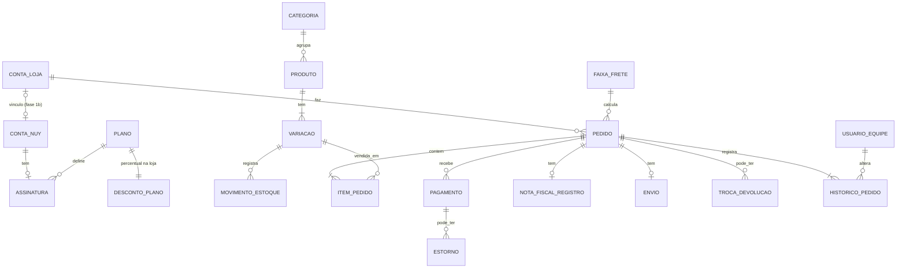
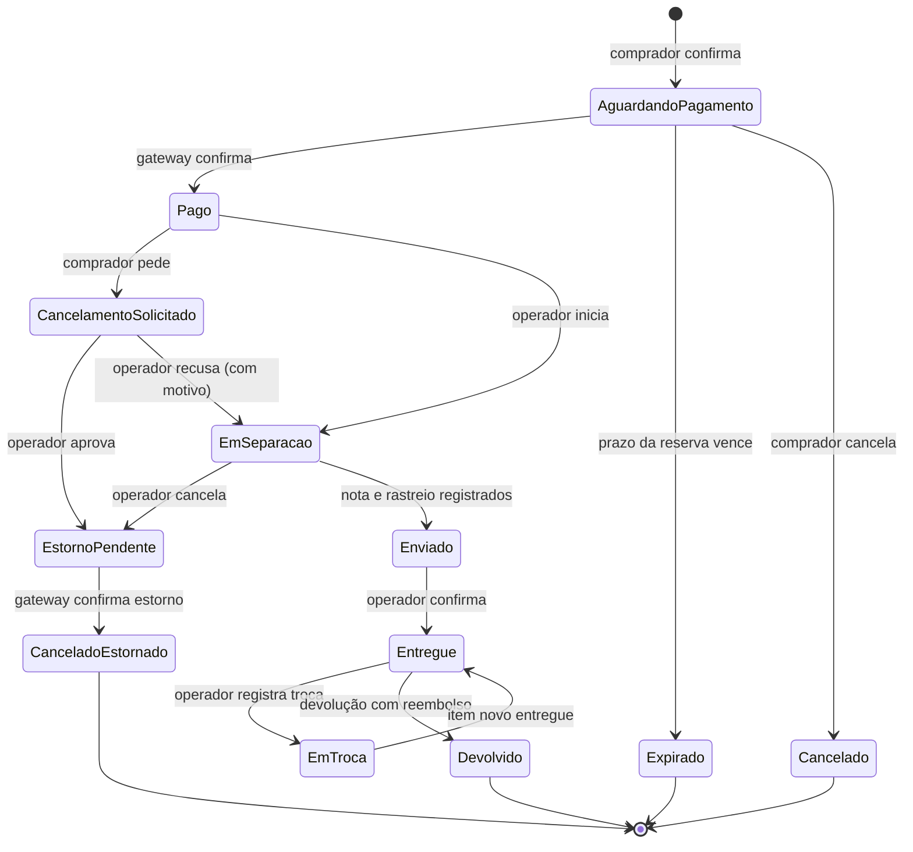

# Spec: Loja N.UY (vendas reais, site e app)

| Campo | Valor |
|---|---|
| Cliente | N.UY, app esportivo (parceiros de treino, quadras, eventos, especialistas, IA) |
| Versão | 0.8 |
| Status | Rascunho, com perguntas abertas ao cliente e ao desenvolvedor (seção 13) |
| Autor | arquiteto-specs · Data: 2026-11-16 |
| Aprovada por / em | (pendente) |
| Fontes | Decisões do desenvolvedor repassadas em 2026-11-14 (D1 a D5, ver ADR-0001 e ADR-0002); respostas do desenvolvedor em 2026-11-14 (P-01, P-02, P-04, D-01; ver ADR-0003); decisão do desenvolvedor em 2026-11-15: painel único (ADR-0005, substitui a D5 no ponto dos dois painéis), D-04 e ADR-0006 (onde vive o conteúdo do site); decisões do dono em 2026-11-15 sobre site, painel e loja num único app Next (registradas tecnicamente no ADR-0007); decisão do dono em 2026-11-16: "Entrar com Google" só para clientes (5.11, RN-LOJ-31, 32); `BRIEFING.md`; `site/index.html` (seções Planos, Bônus, Loja); `site/admin/config.yml` e `site/conteudo/*.json` (branch `painel`) |

> Convenções: `CA-LOJ-xx` critério de aceite · `RN-LOJ-xx` regra de negócio · `RNF-xx` · `[PENDENTE: ...]` falta resposta · `[PREMISSA: ...]` assumido por nós, a confirmar.
> Esta spec define **o quê e o porquê**. Stack, banco, forma de integrar e telas são decisões de `dev-arquitetura` e dos especialistas (seção 15).

---

## 1. Visão geral

### 1.1 Problema
Hoje a "Loja N.UY" do site é só vitrine: dois cartões de categoria (Calçados; Roupas e acessórios) com o botão "Comprar no app", que leva à seção de download. Não existe venda de verdade, nem catálogo, estoque, pedido ou pagamento. O site promete "Assinante paga até 15% menos" e o desconto por plano aparece nos cartões de planos (Silver 5%, Gold 10%, Premium 15%), mas não há onde aplicá-lo.

### 1.2 Objetivo do negócio
Vender produtos esportivos (calçados, roupas, acessórios) com pagamento online, numa loja única acessível pelo site e pelo app, usando o desconto da loja como benefício que incentiva a assinatura dos planos pagos.

| Indicador | Hoje | Meta | Como medir |
|---|---|---|---|
| Pedidos pagos por mês | 0 | `[PENDENTE: meta do cliente]` | Relatório de pedidos pagos |
| Parte dos pedidos feita por assinantes pagos | 0 | `[PENDENTE]` | Pedidos com desconto de plano / total |
| Pedidos com erro de estoque (vendido sem ter) | n/a | 0 | Pedidos cancelados por falta de estoque |

### 1.3 Como é feito hoje
`[PENDENTE: a N.UY já vende esses produtos em algum canal (loja física, Instagram, WhatsApp, marketplace)? Tem estoque próprio hoje ou vai começar do zero?]` O site atual não vende.

### 1.4 Como ficará
1. O comprador abre a loja (`/loja`, no mesmo endereço do site) pelo site ou pelo app e navega no catálogo.
2. Escolhe produto e variação (ex.: tamanho), coloca no carrinho.
3. No checkout, compra como visitante (e-mail e dados de entrega) ou entra com a **conta da loja** (login próprio, separado da conta do app).
4. Informa endereço, vê o frete, paga com Pix ou cartão. No MVP, todos pagam o preço cheio; o desconto de assinante entra quando for possível ler o plano no app (ADR-0003).
5. A N.UY separa, emite a nota, envia e informa o rastreio; o comprador acompanha em "Meus pedidos".
6. Cancelamentos, estornos e trocas são tratados pelo operador da N.UY no painel da loja.
7. A equipe da N.UY usa **um único painel** (`/admin`), com entrada própria da equipe (`/admin/login`; o cliente entra por `/login`, decisão do dono em 2026-11-15), para gerir a loja e editar **todo** texto, link e mídia visível do site e da página `/loja`, sem token do GitHub (ADR-0005). Site, painel e loja são um só sistema, no mesmo endereço; publicar no painel muda o site na hora (ADR-0007).

**Pedido × necessidade × desejo futuro**

| Item | Classe |
|---|---|
| Loja única para site e app, sistema próprio, N.UY vendedora | Pedido (decidido, ADR-0001) |
| Desconto automático pelo plano da conta N.UY | Pedido (decidido, ADR-0002); **suspenso no MVP** até confirmar como ler o plano no Base44 (ADR-0003) |
| Login próprio da loja, compra como visitante, loja web aberta pelo app | Pedido (respostas P-01, P-02, P-04) |
| Painel único, com o login da equipe, para conteúdo do site e loja | Pedido (desenvolvedor, 2026-11-15, ADR-0005) |
| Editar o site sem token do GitHub e com um só controle de acesso | Necessidade (inferida da decisão) |
| Vender com pagamento online e estoque confiável | Necessidade |
| Desconto como alavanca de assinatura | Necessidade (inferida do site: "Assinante paga até 15% menos") |
| Telas nativas da loja dentro do app, cupons, frete por transportadora automático, NF-e automática | Desejo futuro (fases seguintes) |

---

## 2. Glossário

| Termo | Definição | Observação |
|---|---|---|
| Conta N.UY | Cadastro do usuário no app N.UY (app feito em Base44) | A loja **não** usa esta conta para login (ADR-0003) |
| Conta da loja | Cadastro próprio da loja (e-mail e senha; cliente também pode entrar com Google, RN-LOJ-31), separado da conta N.UY | Vínculo com a conta N.UY: futuro, depende de ADR-0003 |
| Plano | Gratuito, Silver, Gold ou Premium, mensal ou anual | Preços provisórios (`planos.json`) |
| Plano vigente | Plano pago e ativo na data da compra | O que conta como "ativo" (teste grátis, atraso, cancelado ainda no período pago): `[PENDENTE: P-03]` |
| Desconto de assinante | Percentual de desconto da loja conforme o plano vigente | Gratuito 0%, Silver 5%, Gold 10%, Premium 15% (provisório) |
| Comprador visitante | Quem compra sem conta da loja, informando e-mail e dados de entrega | Permitido, preço cheio (P-04 respondida) |
| Comprador com conta | Quem compra entrando com a conta da loja | Preço cheio no MVP |
| Comprador assinante | Comprador com conta cujo plano N.UY foi verificado | Só existe quando a leitura do plano no Base44 estiver confirmada (ADR-0003) |
| Produto | Item vendido (ex.: "Tênis de corrida X") | |
| Variação | Combinação vendável de um produto (ex.: tamanho 40, cor preta), com estoque próprio | `[PENDENTE: P-12]` quais variações existem |
| Estoque disponível | Quantidade física menos o que está reservado em pedidos aguardando pagamento | |
| Reserva | Separação temporária de unidades para um pedido aguardando pagamento | RN-LOJ-09 |
| Pedido | Compra registrada, com itens, preços e descontos congelados | Estados na seção 8 |
| Troca | Devolução de um item com envio de outro (outro tamanho, outro produto) | Política: `[PENDENTE: P-10]` |
| Devolução / arrependimento | Devolução com reembolso | Regras legais com advogado (seção 12) |
| Estorno | Devolução do dinheiro pelo mesmo meio de pagamento | |
| Painel | O painel administrativo **único** da N.UY: gestão da loja e edição do conteúdo do site, com o login da equipe | ADR-0005. Não confundir com o `/admin` Sveltia (descartado, D-04) |
| Conteúdo do site (vitrine) | Todo texto, link e mídia (fotos e vídeos) visível no site (`/`) e os textos da página `/loja`, inclusive título e descrição para buscadores, menu, rodapé e palavras que trocam | Inventário na seção 5.9; regra na RN-LOJ-27. Nunca contém preço de produto, estoque, frete, percentuais ou pedidos (RN-LOJ-18). Estrutura, cores e animações não são conteúdo |
| Publicar | Tornar visível no site, para quem visita, o conteúdo editado no painel | Na hora (RNF-15). Prévia/rascunho antes de publicar: `[PENDENTE: P-17]` |
| Site | A página pública da N.UY no endereço principal (`/`), com o mesmo visual de hoje | Mesmo sistema do painel e da loja (ADR-0007) |
| Vitrine da loja | Página `/loja`: lista dos produtos ativos com o visual do site | Nesta entrega, sem carrinho nem checkout (seção 5.10) |
| Volta | O endereço da página onde a pessoa estava antes de ir para `/login`, para onde ela retorna depois de entrar | Só endereços do próprio site (RN-LOJ-29) |

---

## 3. Usuários e papéis

| Papel | Quem é | O que pode fazer | O que NÃO pode |
|---|---|---|---|
| Comprador visitante | Qualquer pessoa, sem conta da loja | Ver catálogo, montar carrinho, comprar pelo preço cheio, acompanhar o pedido pelo link do e-mail | Receber desconto de assinante; ver pedidos de outros |
| Comprador com conta | Pessoa com conta da loja | Tudo do visitante + "Meus pedidos" com todos os pedidos dela + endereços salvos `[PREMISSA]` | Ver pedidos de outros; alterar preço ou desconto |
| Comprador assinante (fase dependente) | Comprador com conta e plano N.UY verificado | Tudo do comprador com conta + desconto do plano vigente | Idem |
| Operador de pedidos | Funcionário da N.UY | Ver e atualizar pedidos (separação, nota, envio, rastreio), registrar cancelamento, estorno e troca, dar entrada de estoque por devolução | Alterar preços, produtos, percentuais de desconto, frete; gerenciar usuários; editar o conteúdo do site `[PREMISSA: P-15]` |
| Admin da loja | Responsável da N.UY | Tudo do operador + produtos, variações, fotos, preços, estoque (entrada e ajuste), frete, percentuais de desconto, usuários da equipe + **conteúdo do site** (seção 5.9) | Ver dados completos de cartão (nunca ficam na loja) |

`[PENDENTE: P-08]` Quantas pessoas operam e se operador pode estornar sozinho ou só com o admin. `[PREMISSA: estorno pode ser feito por operador e admin, com registro de quem fez]`.

`[PENDENTE: P-15]` Quem edita o conteúdo do site no painel único (ADR-0005). `[PREMISSA: só o admin, pelo princípio do menor acesso: o operador não mexe em nada que o público vê]`. Se a N.UY tiver alguém que **só** cuida do conteúdo (ex.: marketing) e não deve ver pedidos nem dados de clientes, será preciso um papel novo ("editor de conteúdo"), definido pelo `dev-auth`; não usar operador nem admin para essa pessoa.

Os papéis continuam três no sistema: **cliente** (comprador com conta), **operador** e **admin** (decisão do dono, 2026-11-15). O que cada um vê no cabeçalho do site e da loja está na RN-LOJ-28.

**Matriz de permissões (resumo)**

| Ação / Recurso | Visitante | Com conta / assinante | Operador | Admin |
|---|---|---|---|---|
| Ver catálogo e preços | ✔ | ✔ | ✔ | ✔ |
| Comprar | ✔ (preço cheio) | ✔ | ✘ (no papel de equipe) | ✘ (no papel de equipe) |
| Desconto de assinante | ✘ | só assinante verificado, quando ADR-0003 for resolvido | ✘ | ✘ |
| Ver pedidos | próprio, pelo link do e-mail | próprio | todos | todos |
| Atualizar estado do pedido, nota, rastreio | ✘ | ✘ | ✔ | ✔ |
| Cancelar/estornar pedido | pedir (ver RN) | pedir (ver RN) | ✔ | ✔ |
| Produtos, preços, estoque, frete, % de desconto | ✘ | ✘ | ✘ | ✔ |
| Usuários da equipe | ✘ | ✘ | ✘ | ✔ |
| Conteúdo do site (editar, fotos, publicar) | ✘ | ✘ | ✘ `[PREMISSA: P-15]` | ✔ |
| Nome e "Sair" no cabeçalho de `/` e `/loja` | ✘ (vê "Entrar") | ✔ | ✔ | ✔ |
| Link "Painel" no cabeçalho de `/` e `/loja` | ✘ | ✘ | ✔ | ✔ |
| Abrir `/admin` | vai para `/admin/login` | página não encontrada (404) | ✔ | ✔ |

---

## 4. Escopo

### 4.1 MVP (fase 1): o menor fluxo que vende de verdade
Justificativa: o valor está em **receber o primeiro pedido pago com estoque certo**. Tudo que não impede isso foi para depois. O desconto de assinante era parte do MVP, mas depende de uma integração com o Base44 ainda não confirmada (ADR-0003); para não travar a venda, ele vira a **fase 1b**.

1. Catálogo com produtos, variações, fotos, preço e disponibilidade (loja web responsiva).
2. Carrinho e checkout com Pix e cartão de crédito por um gateway de pagamento.
3. Compra como visitante (e-mail, nome, CPF, telefone e endereço) e conta própria da loja, opcional (P-01, P-04). Todos pagam o preço cheio.
4. Frete por tabela configurada pela N.UY (faixas de CEP/estado e valor), com área de entrega definida.
5. Estoque por variação, reserva durante o pagamento e baixa no pagamento confirmado.
6. "Meus pedidos" para o comprador e e-mails de pedido (recebido, pago, enviado com rastreio, cancelado).
7. Painel único (ADR-0005): produtos, estoque, frete, % de desconto, pedidos (estados, número da nota, rastreio, cancelamento/estorno, troca registrada manualmente), usuários admin/operador e **edição do conteúdo do site** (seção 5.9). A edição de conteúdo é o **primeiro módulo do painel**, entregue antes do resto (fase 1a, 4.2; D-04 respondida).
8. Acesso pelo app: o app abre a loja como página web (sem telas nativas, P-02 respondida). O comprador entra com a conta da loja ou compra como visitante; não há login automático vindo do app.
9. Nota fiscal emitida **fora** do sistema, no emissor que a N.UY usar; o operador registra número/chave no pedido.
10. Ajuste do site: a seção Loja passa a levar à loja real em `/loja` (seção 5.8, CA-LOJ-58).

### 4.2 Fases seguintes

| Fase | Conteúdo | Depende de |
|---|---|---|
| 1a (antes do resto do MVP) | Primeiro módulo do painel único: edição de **todo** o conteúdo visível do site (HU-12, HU-13, CA-LOJ-50 a 67), usando o login e os papéis da equipe que já existem. Na mesma entrega (ADR-0007): site, painel e loja num app só, sessão visível no cabeçalho (CA-LOJ-68 a 73), `/login` com volta (CA-LOJ-74 a 77) e vitrine básica `/loja` (CA-LOJ-78 a 80). Não depende de gateway, frete nem NF-e. Até ela entrar, o conteúdo do site continua sendo editado pelo desenvolvedor, como hoje | P-15, MFA da equipe antes de liberar contas de equipe em produção (mecanismo decidido no ADR-0006); hipóteses H1 a H4 do ADR-0007 verificadas antes do corte |
| 1b | Desconto de assinante: vínculo da conta da loja com a conta N.UY, leitura do plano vigente, percentuais no painel, HU-03 e CA-LOJ-04, 09 a 12, 42 | Confirmar como ler o plano no Base44 (PEND-B44, ADR-0003); P-03; C-01; revisão dos textos do site |
| 2 | Emissão de NF-e integrada ao emissor; cálculo de frete por transportadora/Correios; etiquetas de envio | MVP no ar; definição do emissor (P-09) e da logística (P-06) |
| 2 | Solicitação de troca/devolução pelo próprio comprador em "Meus pedidos" | Política de troca validada (P-10) |
| 2 | Destaques do catálogo puxados automaticamente para a seção Loja do site | API de catálogo do MVP |
| 2 | Conteúdo do site: prévia/rascunho antes de publicar e voltar a uma versão anterior, se o cliente pedir | P-17, P-18; decisão do `dev-arquitetura` sobre onde o conteúdo vive |
| 2 | Relatórios (vendas por período, mais vendidos, desconto concedido por plano) e exportação | MVP |
| 3 | Telas nativas da loja no app (P-02: "por enquanto" página web) | Nova decisão do cliente e `dev-mobile` |
| 3 | Entrada única (mesma conta no app e na loja) | Viabilidade no Base44 |
| 3 | Cupons e promoções com regras de acumulação com o desconto de plano | RN-LOJ-05 confirmada |
| 3 | Parcelamento com juros, boleto, carteiras digitais | Gateway escolhido |

### 4.3 Fora de escopo
- Marketplace ou vendedores terceiros (D4: só a N.UY vende).
- Plataforma pronta (Nuvemshop, Shopify etc.) e migração para ela (D2).
- Venda ou cobrança dos **planos de assinatura** pela loja: os planos continuam no app.
- Emissão automática de NF-e no MVP (manual fora do sistema; ver 4.1 item 9).
- Cálculo automático de frete por transportadora no MVP.
- Cupons, programa de pontos, cashback, vale-presente, kits/combos, pré-venda, produto personalizado.
- Boleto; parcelamento além do que P-07 definir.
- Retirada em loja física `[PENDENTE: P-06, só entra se a N.UY tiver ponto físico]`.
- Avaliações de produto, lista de desejos, recomendação por IA, recuperação de carrinho abandonado.
- Integração com ERP, marketplaces (Mercado Livre etc.) ou loja física.
- Venda internacional, outras moedas, outros idiomas.
- Compra de fornecedores, custo médio e controle fiscal de entrada.
- Telas nativas da loja no app (fase 3); `dev-mobile` fora deste projeto por enquanto.
- Desconto de assinante no MVP (fase 1b, ADR-0003).
- Login com a conta do app N.UY e entrada única entre app e loja.
- "Entrar com Google" para operador e admin (equipe entra só com e-mail e senha, RN-LOJ-31); outros provedores de entrada (Apple, Facebook etc.).
- Qualquer alteração no app N.UY (Base44) no MVP.
- Conteúdo do site: editar estrutura da página, cores, animações ou o número e o formato de blocos fixos (ex.: os 3 cartões de vídeo); criar ou reordenar seções; editor visual livre (arrastar blocos); agendamento de publicação; fluxo de aprovação entre pessoas; outros idiomas; migração do histórico de commits do conteúdo para o painel. (Desde a v0.6, vídeos, cabeçalho, rodapé e títulos de todas as seções **são** editáveis: RN-LOJ-27.)
- Na vitrine `/loja` desta entrega: carrinho e checkout (decisão do dono) `[PREMISSA: também página de produto e filtros]`; seguem no plano da loja (seção 5.10).
- Subdomínio próprio para a loja e segundo projeto de hospedagem para o site (ADR-0007).
- Manter dois painéis permanentemente (ADR-0005); entrar no painel com token do GitHub.
- Publicar ou manter o `/admin` Sveltia, nem como provisório (D-04: descartado; a branch `painel` fica só como referência).

---

## 5. Requisitos funcionais

### 5.1 Catálogo

**HU-01 — Ver produtos.** Como **comprador**, quero ver os produtos com fotos, preço e tamanhos disponíveis, para escolher o que comprar. *Must · Fase 1*

| ID | Critério de aceite |
|---|---|
| CA-LOJ-01 | **Dado** um produto ativo com ao menos uma variação com estoque disponível, **quando** o comprador abre a loja, **então** o produto aparece com nome, foto, preço cheio e categoria. |
| CA-LOJ-02 | **Dado** um produto cujas variações têm todas estoque disponível 0, **quando** o comprador abre a página do produto, **então** o produto aparece como "Esgotado" e o botão de adicionar ao carrinho fica indisponível. |
| CA-LOJ-03 | **Dado** um produto com variação "40" esgotada e "41" disponível, **quando** o comprador escolhe a variação, **então** "40" aparece indisponível e só "41" pode ir ao carrinho. |
| CA-LOJ-04 *(fase 1b)* | **Dado** um comprador identificado com plano Gold vigente, **quando** vê um produto de R$ 399,90, **então** vê também "R$ 359,91 com seu plano Gold" (estimativa; confirmação no checkout, RN-LOJ-04). |
| CA-LOJ-05 | **Dado** um produto inativado pelo admin, **quando** alguém abre o endereço dele, **então** vê "Produto indisponível" e o produto não aparece em listagens. |

### 5.2 Carrinho e identificação

**HU-02 — Montar carrinho.** Como **comprador**, quero juntar produtos num carrinho, para pagar tudo de uma vez. *Must · Fase 1*

**HU-03a — Comprar sem conta.** Como **visitante**, quero comprar só informando meus dados, para não precisar criar cadastro. *Must · Fase 1*

**HU-03b — Ter conta na loja.** Como **comprador**, quero uma conta na loja, para ver todos os meus pedidos e não redigitar o endereço. *Must · Fase 1*

**HU-03 — Ganhar o desconto do meu plano.** Como **assinante**, quero que a loja reconheça meu plano N.UY, para pagar menos. *Must · **Fase 1b*** (depende de ADR-0003)

| ID | Critério de aceite |
|---|---|
| CA-LOJ-06 | **Dado** um carrinho com 2 unidades da variação X, **quando** o estoque disponível de X cai para 1, **então** ao abrir o carrinho ou ir ao checkout o comprador vê aviso "Só 1 disponível" e a quantidade é ajustada para 1 com a confirmação dele. |
| CA-LOJ-44 | **Dado** um visitante no checkout, **quando** informa e-mail, nome, CPF, telefone e endereço válidos e paga, **então** o pedido é criado sem conta, pelo preço cheio, e o e-mail de confirmação traz um link para acompanhar o pedido. |
| CA-LOJ-45 | **Dado** um visitante, **quando** deixa de preencher e-mail, CPF ou endereço, ou preenche e-mail/CEP/CPF em formato inválido, **então** o campo é apontado e o pedido não é confirmado. |
| CA-LOJ-46 | **Dado** um visitante cujo e-mail já tem conta na loja, **quando** chega ao checkout, **então** vê a sugestão "Entre para salvar este pedido na sua conta", mas pode seguir como visitante. |
| CA-LOJ-07 | **Dado** um comprador não identificado com itens no carrinho, **quando** entra (ou cria) a conta da loja com sucesso, **então** volta ao carrinho com os mesmos itens. |
| CA-LOJ-08 | **Dado** um comprador que tenta entrar e falha, **quando** a tentativa termina, **então** vê mensagem clara, o carrinho é mantido e ele pode tentar de novo ou seguir como visitante. |
| CA-LOJ-47 | **Dado** um visitante que fez pedidos com o e-mail X, **quando** cria depois uma conta da loja com o e-mail X e confirma esse e-mail, **então** os pedidos anteriores feitos com X aparecem em "Meus pedidos" `[PREMISSA: vínculo só após confirmação do e-mail; confirmar com cliente; dev-auth e dev-security validam]`. *Should* |
| CA-LOJ-09 *(fase 1b)* | **Dado** um comprador com plano N.UY Gratuito verificado, **quando** se identifica, **então** o carrinho mostra 0% de desconto de assinante e uma chamada para conhecer os planos `[PREMISSA: chamada para upgrade; confirmar com cliente]`. |

### 5.3 Checkout, desconto e pagamento

**HU-04 — Pagar.** Como **comprador**, quero pagar com Pix ou cartão, para concluir a compra. *Must · Fase 1*

| ID | Critério de aceite |
|---|---|
| CA-LOJ-48 | **Dado** o MVP (fase 1, desconto de assinante inexistente), **quando** qualquer comprador chega ao resumo do checkout, **então** vê subtotal, frete e total, sem linha de desconto de assinante, e o total cobrado é subtotal + frete. |
| CA-LOJ-10 *(fase 1b)* | **Dado** um comprador Silver vigente com itens de R$ 100,00 e R$ 49,90 e frete de R$ 20,00, **quando** chega ao resumo do checkout, **então** vê subtotal R$ 149,90, desconto Silver 5% de R$ 7,50 (R$ 5,00 + R$ 2,50, por item, RN-LOJ-06), frete R$ 20,00 e total R$ 162,40. |
| CA-LOJ-11 *(fase 1b)* | **Dado** um comprador cujo plano era Gold quando montou o carrinho e passou a Gratuito antes de confirmar, **quando** confirma o pedido, **então** o sistema refaz a verificação, mostra o novo total sem desconto e pede nova confirmação antes de cobrar. |
| CA-LOJ-12 *(fase 1b)* | **Dado** que a verificação do plano no serviço de contas N.UY falha no momento da confirmação, **quando** o comprador confirma, **então** nenhum desconto é aplicado sem verificação e o comprador vê a opção definida em RN-LOJ-07. |
| CA-LOJ-13 | **Dado** um pedido confirmado com Pix, **quando** o checkout termina, **então** o comprador vê o código Pix (copia e cola e QR) com o valor total e o prazo de expiração, e o pedido fica "Aguardando pagamento". |
| CA-LOJ-14 | **Dado** um pedido aguardando Pix, **quando** o gateway confirma o pagamento, **então** o pedido passa a "Pago" em até 1 minuto após a confirmação recebida, o comprador recebe e-mail e vê o novo estado em "Meus pedidos". |
| CA-LOJ-15 | **Dado** um Pix não pago até o fim do prazo da reserva, **quando** o prazo vence, **então** o pedido passa a "Expirado" e as unidades reservadas voltam ao estoque disponível. |
| CA-LOJ-16 | **Dado** um pagamento com cartão aprovado, **quando** o gateway responde, **então** o pedido fica "Pago" e o comprador vê a confirmação com o número do pedido. |
| CA-LOJ-17 | **Dado** um cartão recusado, **quando** o gateway responde, **então** o comprador vê "Pagamento não aprovado", pode tentar outro cartão ou Pix enquanto a reserva valer, e nada é cobrado. |
| CA-LOJ-18 | **Dado** que o gateway envia a mesma confirmação de pagamento duas vezes, **quando** o sistema a recebe, **então** o pedido continua com um único pagamento registrado, uma única baixa de estoque e um único e-mail de "pago". |
| CA-LOJ-19 | **Dado** um comprador que altera no navegador o preço ou o percentual de desconto enviado, **quando** confirma o pedido, **então** o total cobrado é o calculado pela loja (preço cadastrado e plano verificado), não o enviado. |
| CA-LOJ-20 | **Dado** um pedido pago, **quando** o admin muda depois o preço do produto ou o percentual do plano, **então** o pedido mantém os valores da compra. |

### 5.4 Frete e endereço

**HU-05 — Saber o frete.** Como **comprador**, quero ver o frete e o prazo antes de pagar, para decidir. *Must · Fase 1*

| ID | Critério de aceite |
|---|---|
| CA-LOJ-21 | **Dado** um CEP dentro de uma faixa cadastrada com frete R$ X e prazo N dias úteis, **quando** o comprador informa o CEP, **então** vê frete R$ X e prazo "até N dias úteis após o pagamento". |
| CA-LOJ-22 | **Dado** um CEP fora da área de entrega, **quando** o comprador informa o CEP, **então** vê "Ainda não entregamos neste CEP" e não consegue confirmar o pedido. |
| CA-LOJ-23 | **Dado** frete grátis configurado acima de R$ Y `[PENDENTE: P-06]`, **quando** o subtotal com desconto atinge R$ Y, **então** o frete fica R$ 0,00. |

### 5.5 Estoque

**HU-06 — Não vender o que não tem.** Como **admin da loja**, quero que o estoque baixe sozinho com as vendas, para não vender produto que acabou. *Must · Fase 1*

| ID | Critério de aceite |
|---|---|
| CA-LOJ-24 | **Dado** variação com estoque disponível 1 e dois compradores confirmando pedido dela ao mesmo tempo, **quando** os dois confirmam, **então** só um pedido é criado com reserva; o outro vê "Acabou de esgotar" e o estoque nunca fica negativo. |
| CA-LOJ-25 | **Dado** variação com estoque 10, **quando** um pedido de 2 unidades é confirmado, **então** o disponível passa a 8 (reserva); **quando** o pagamento é confirmado, a reserva vira baixa definitiva; **quando** o pedido expira ou é cancelado antes do envio, o disponível volta a 10. |
| CA-LOJ-26 | **Dado** contagem física diferente do sistema, **quando** o admin registra ajuste com motivo, **então** o saldo é corrigido e o ajuste aparece no histórico da variação com data, quantidade, motivo e quem fez. |
| CA-LOJ-27 | **Dado** uma devolução recebida em bom estado, **quando** o operador marca "item recebido e apto para venda", **então** a unidade volta ao estoque com registro de origem "devolução do pedido N". |

### 5.6 Pedidos (comprador e operação)

**HU-07 — Acompanhar meu pedido.** Como **comprador**, quero ver o estado do pedido e o rastreio, para saber quando chega. *Must · Fase 1*

**HU-08 — Operar pedidos.** Como **operador**, quero ver os pedidos pagos, registrar nota e rastreio e mudar o estado, para entregar sem planilha paralela. *Must · Fase 1*

| ID | Critério de aceite |
|---|---|
| CA-LOJ-28 | **Dado** um comprador com conta identificado, **quando** abre "Meus pedidos", **então** vê só os pedidos dele, com número, data, itens, total, estado e código de rastreio quando houver. |
| CA-LOJ-29 | **Dado** um comprador que tenta abrir pelo endereço um pedido de outra pessoa (inclusive trocando o número do pedido no link do visitante), **quando** a página carrega, **então** vê "Pedido não encontrado" e nenhum dado do pedido. |
| CA-LOJ-49 | **Dado** um visitante com o link de acompanhamento recebido por e-mail, **quando** o abre, **então** vê só aquele pedido (estado, itens, total, rastreio) e pode pedir cancelamento conforme RN-LOJ-14; CPF e endereço completos não aparecem nessa página `[PREMISSA: dev-security define validade e formato do link]`. |
| CA-LOJ-30 | **Dado** pedidos em vários estados, **quando** o operador abre a lista, **então** pode filtrar por estado e data e ver os pagos mais antigos primeiro. |
| CA-LOJ-31 | **Dado** um pedido "Em separação" sem número de nota registrado, **quando** o operador tenta marcar "Enviado", **então** o sistema pede número/chave da nota e código de rastreio antes de permitir `[PREMISSA: nota antes do envio; validar com contador, RN-LOJ-15]`. |
| CA-LOJ-32 | **Dado** um pedido "Enviado" com rastreio, **quando** o operador salva, **então** o comprador recebe e-mail com o código e o vê em "Meus pedidos". |
| CA-LOJ-33 | **Dado** qualquer mudança de estado, **quando** é salva, **então** o histórico do pedido mostra estado anterior, novo estado, data/hora e quem fez (sistema, comprador ou nome do usuário da equipe). |

### 5.7 Cancelamento, estorno e troca

**HU-09 — Cancelar.** Como **comprador**, quero cancelar um pedido que ainda não foi enviado, para receber meu dinheiro de volta. *Must · Fase 1*

**HU-10 — Trocar ou devolver.** Como **comprador**, quero trocar um tamanho ou devolver, conforme a política da loja. *Must (registro manual) · Fase 1; autoatendimento na fase 2*

| ID | Critério de aceite |
|---|---|
| CA-LOJ-34 | **Dado** pedido "Aguardando pagamento", **quando** o comprador cancela, **então** o pedido passa a "Cancelado", o Pix/cobrança pendente é invalidado e a reserva volta ao estoque. |
| CA-LOJ-35 | **Dado** pedido "Pago" ainda não "Em separação", **quando** o comprador pede cancelamento, **então** o pedido vai para "Cancelamento solicitado" e o operador vê o pedido destacado na lista `[PREMISSA: cancelamento após pagamento passa pelo operador; confirmar P-10]`. |
| CA-LOJ-36 | **Dado** um cancelamento aprovado de pedido pago, **quando** o operador confirma o estorno, **então** o estorno total é solicitado ao gateway, o pedido fica "Cancelado e estornado" quando o gateway confirmar, a baixa de estoque é desfeita e o comprador recebe e-mail. |
| CA-LOJ-37 | **Dado** que o gateway recusa ou falha no estorno, **quando** o operador tenta, **então** o pedido fica "Estorno pendente" com o motivo visível e não é marcado como estornado. |
| CA-LOJ-38 | **Dado** um pedido "Entregue", **quando** o operador registra uma troca (itens devolvidos, itens novos, motivo), **então** o pedido fica "Em troca", a variação nova é reservada e, ao confirmar o recebimento do item devolvido, segue CA-LOJ-27. |
| CA-LOJ-39 | **Dado** um pedido "Entregue", **quando** o operador registra devolução com reembolso total ou parcial (valor ≤ total pago), **então** o estorno é solicitado ao gateway pelo valor informado e o pedido fica "Devolvido" com o valor reembolsado visível. |

### 5.8 Painel único (gestão da loja) e impacto no site atual

**HU-11 — Gerir catálogo e regras.** Como **admin**, quero cadastrar produtos, preços, estoque, frete e percentuais de desconto, para operar a loja sem depender do desenvolvedor. *Must · Fase 1*

| ID | Critério de aceite |
|---|---|
| CA-LOJ-40 | **Dado** um admin, **quando** cria um produto com nome, categoria, descrição, fotos, preço e ao menos uma variação com estoque, **então** o produto aparece na loja após ser marcado como ativo. |
| CA-LOJ-41 | **Dado** um código de variação (SKU) já existente, **quando** o admin tenta repeti-lo, **então** o sistema recusa e mostra o item existente. |
| CA-LOJ-42 *(fase 1b)* | **Dado** o admin muda o desconto do Gold de 10% para 12%, **quando** salva, **então** a mudança vale para pedidos confirmados a partir daí, e o histórico registra valor anterior, novo, data e quem mudou `[PENDENTE: P-05, onde vive o percentual: loja ou app]`. |
| CA-LOJ-43 | **Dado** um operador, **quando** tenta abrir produtos, preços, frete, descontos ou usuários, **então** vê "Sem permissão". |

**Impacto sobre o painel `/admin` (Sveltia CMS) e a seção Loja do site (ADR-0005, substitui a D5 no ponto dos dois painéis)**

- **Um painel só.** A edição do conteúdo do site sai do `/admin` Sveltia e passa para o painel da loja, com o mesmo login da equipe e os papéis da loja (RN-LOJ-24, seção 5.9). Ninguém entra no painel único com token do GitHub.
- **`/admin` Sveltia descartado (D-04, 2026-11-15):** não será publicado; a branch `painel` fica só como referência (inventário da 5.9). Até a fase 1a entrar, o conteúdo do site continua sendo editado pelo desenvolvedor, como hoje.
- **Fonte única continua (RN-LOJ-18):** produtos vendáveis, preços, estoque, frete, descontos e pedidos vivem só nos registros da loja. O conteúdo da seção Loja do site (cartões editoriais) nunca terá preço nem estoque, mesmo editado no mesmo painel.
- **Pedidos e dados pessoais continuam fora do Git** (RNF-13), seja qual for o lugar escolhido para o conteúdo do site.
- **Um sistema só, um endereço só (decisão do dono, 2026-11-15; ADR-0007):** `/` é o site (mesmo visual de hoje), `/admin` o painel, `/admin/login` a entrada da equipe, `/login` a entrada do cliente (substitui `/entrar`; equipe que entrar por ela também vai ao painel), `/loja` a loja pública. Não há subdomínio da loja nem segundo projeto de hospedagem. Rotas na seção 9.2.
- **Site no ar com o banco fora:** quem visita `/` recebe a última versão publicada guardada em cache, sem tocar no banco (RNF-14, CA-LOJ-59). Com o banco fora, o que falha é **publicar**, **entrar**, o painel, a vitrine `/loja` e **qualquer deploy novo** do app (o deploy anterior continua no ar) (RISCO-11, RISCO-15).
- **Onde o conteúdo vive e como chega ao site:** versões no banco (ADR-0006, mantido nesse ponto); publicar grava a versão e o site passa a mostrá-la na hora, sem rebuild nem deploy hook (ADR-0007). Esta spec fixa o comportamento (CA-LOJ-50 a 67).
- No MVP, a seção Loja do site muda pouco: os cartões continuam editoriais, o botão deixa de ser "Comprar no app" (que leva ao download) e passa a levar à loja em `/loja`. O texto do botão e o destino são campos do cartão, editáveis no painel único (CA-LOJ-58) `[PREMISSA: texto do copywriter]`. Com a P-02 respondida (página web), o título "Equipado sem sair do app" depende de como o Base44 abre o link (PEND-B44b); revisar com `copywriter`.
- Na fase 2, a seção Loja pode mostrar destaques puxados do catálogo; aí os cartões de produto deixam de ser editoriais.
- **Divergência a vigiar:** os planos do site têm o texto "Desconto na loja: 5%/10%/15%" escrito à mão nos itens de cada plano, e a seção Bônus diz "Até 15% de desconto em todos os produtos da loja". Agora que os dois ficam no mesmo painel, a divergência fica mais visível, mas **não** some sozinha: se o percentual mudar na loja (ou no app), esses textos precisam ser atualizados também. Ver RISCO-05 e a contradição C-01.
- **Onde fica o código (D-01 respondida; ADR-0007):** neste mesmo repositório, branch `loja`, pasta `admin/`, que passa a conter também o site (o `site/` sai depois do corte). O como é do `dev-arquitetura` e do `dev-react` (ADR-0007).
- **Promessa de desconto no site enquanto a fase 1b não chega:** a seção Bônus ("Até 15% de desconto em todos os produtos da loja"), o cartão "Roupas e acessórios" ("Assinante paga até 15% menos"), o cartão Explore ("Equipamento com desconto de assinante") e os itens "Desconto na loja" dos planos prometem algo que o MVP não entrega. Ver RISCO-09: decidir com o cliente se esses textos mudam no lançamento da loja (copywriter).

### 5.9 Conteúdo do site no painel único

**HU-12 — Editar o conteúdo do site.** Como **admin** `[PREMISSA: P-15]`, quero editar no mesmo painel da loja **todo** texto, link, foto e vídeo que aparece no site e os textos da página `/loja`, para atualizar o site sem token do GitHub e sem chamar o desenvolvedor. *Must · Fase 1a (primeiro módulo do painel, antes do resto do MVP; D-04; ampliado na v0.6 por decisão do dono)*

**HU-13 — Publicar com segurança.** Como **admin**, quero publicar o que editei e ter certeza de que o site só muda quando a edição está completa, para não deixar o site quebrado ou pela metade. *Must · Fase 1a*

**Inventário do que é editável** (base: `site/admin/config.yml` e `site/conteudo/*.json` da branch `painel`; ampliado na v0.6 a partir do `site/index.html` atual, por decisão do dono: todo texto, link e mídia visível, RN-LOJ-27). Itens marcados **(v0.6)** são novos. Os textos de exemplo de hoje são os valores iniciais.

| Bloco do site | Campos | Listas (adicionar, remover, reordenar) | Fotos e vídeos |
|---|---|---|---|
| **(v0.6)** Buscadores (SEO) de `/` | Título da página (aba do navegador); descrição para buscadores | — | — |
| **(v0.6)** Cabeçalho | Slogan ao lado da logo; texto do botão "Baixar"; texto do botão de entrar (versão longa e curta); textos "Sair" e "Painel" (RN-LOJ-28) | Itens do menu: texto e destino (escolha entre as seções da página e `/loja`) | — |
| Abertura | Frase; linha das plataformas; **(v0.6)** textos dos botões "Entrar na NUY" e "Baixar o app"; texto "Role para ver mais" | — | **(v0.6)** Vídeo de fundo (versão computador e versão celular) e imagem de espera |
| Rede de parceiros (abertura) | Título (destaque); título (continuação); texto | — | **(v0.6)** Vídeo de fundo e imagem de espera |
| **(v0.6)** Vídeos | Rótulo; título linha 1; título linha 2; parte fixa da frase que troca ("Aqui você" / "encontra") | Palavras que trocam (lista de textos) | 3 cartões de vídeo **fixos** (1 grande, 2 verticais): tipo, título, vídeo e imagem de espera de cada um. Quantidade e formato não mudam (4.3) |
| Planos e preços | Desconto do plano anual (%, 0 a 90); nota abaixo dos planos; **(v0.6)** rótulo; título linha 1; título linha 2; textos "Mensal" e "Anual" | Planos: nome, preço mensal (R$), resumo, texto do botão, selo (opcional), itens "O que inclui" (lista de textos) | Capa de cada plano |
| Bônus do plano anual | Rótulo; título linha 1; título linha 2; texto | Vantagens (lista de textos) | **(v0.6)** Vídeo e imagem de espera |
| História | Rótulo; título linha 1; título linha 2; texto | — | **(v0.6)** Vídeo e imagem de espera |
| Explore (cartões) | **(v0.6)** Rótulo; título linha 1; título linha 2; texto "Ver mais" | Cartões: título, texto, enquadramento da imagem (opcional), "mostrar imagem inteira" (sim/não), seção de destino (escolha entre: Vídeos, Planos, Bônus anual, História, Explore, Loja, Baixar o app, Novidades) | Imagem de cada cartão |
| Loja (cartões editoriais) | Rótulo da seção; título linha 1; título linha 2 (vazada) | Cartões: nome, descrição, descrição da foto (acessibilidade, opcional), texto do botão; **destino do botão** (CA-LOJ-58) | Foto de cada cartão |
| Baixe o app | Rótulo; título linha 1; título linha 2; texto; **(v0.6)** textos dos botões das lojas de aplicativo; **endereço na App Store** e **endereço no Google Play** (opcionais; usados também nos selos do rodapé, CA-LOJ-64) | — | **(v0.6)** Vídeo de fundo e imagem de espera |
| Novidades | **(v0.6)** Rótulo; título linha 1; título linha 2 | Notícias: data (texto livre), título | Imagem de cada notícia |
| **(v0.6)** Rodapé | Slogan; textos do formulário de novidades (rótulo, exemplo dentro do campo, botão, mensagem de sucesso, mensagem de e-mail inválido; o que o formulário faz: PEND-09); linha de direitos; linha de versão | Links do rodapé: texto e destino (seções da página, `/loja`, política de privacidade, termos de uso) | — |
| **(v0.6)** Página `/loja` | Título da página e descrição para buscadores; rótulo; título linha 1; título linha 2; texto de abertura; texto do estado vazio (valor inicial "Em breve") | — | — |

Não entram no inventário (RN-LOJ-27): estrutura, cores, animações; produtos, preços e categorias da vitrine (vêm do catálogo, RN-LOJ-18) `[PREMISSA: também logos da marca, selos oficiais da App Store e do Google Play, rótulos só para leitor de tela dos controles (setas, pausar) e as páginas legais e `versao-*.html`; ver PREM-15]`.

> Os preços dos **planos de assinatura** são exibição: quem cobra os planos é o app (4.3). Eles continuam no conteúdo do site; não confundir com preço de produto da loja (RN-LOJ-18).

| ID | Critério de aceite |
|---|---|
| CA-LOJ-50 | **Dado** um usuário da equipe com permissão de conteúdo (RN-LOJ-25) logado no painel, **quando** abre "Conteúdo do site", **então** vê todos os blocos do inventário acima (14 desde a v0.6), cada um com os valores publicados no momento e exatamente os campos listados. |
| CA-LOJ-51 | **Dado** o bloco "História" com o texto A publicado, **quando** o usuário troca para o texto B e publica, **então** quem abre o site passa a ver B em até o tempo definido em RNF-15, e o resto da página continua igual. |
| CA-LOJ-52 | **Dado** uma edição com campo obrigatório vazio (ex.: título de um cartão do Explore) ou número fora da faixa (ex.: desconto anual de 95%), **quando** o usuário tenta publicar, **então** o campo é apontado, nada é publicado e o site continua com a versão anterior. Campos opcionais são só os marcados "opcional" no inventário. |
| CA-LOJ-53 | **Dado** uma lista do inventário (ex.: cartões do Explore), **quando** o usuário adiciona um item, remove outro e muda a ordem, e publica, **então** o site mostra os itens na nova ordem, sem o removido. `[PREMISSA: sem mínimo nem máximo de itens; se o layout exigir limite, dev-uiux define e o painel impede passar dele]` |
| CA-LOJ-54 | **Dado** um bloco com foto, **quando** o usuário envia uma imagem em formato e tamanho aceitos e publica, **então** a nova imagem aparece no lugar da anterior no site. **Quando** envia arquivo fora do aceito, **então** vê o motivo ("formato não aceito" ou "arquivo grande demais") e nada muda. Formatos e tamanho máximo: `[PENDENTE: dev-performance-seo e dev-uiux definem]`. |
| CA-LOJ-55 | **Dado** que a publicação falha (ex.: banco fora do ar ou conexão perdida no meio da gravação), **quando** o usuário publica, **então** vê "Não foi possível publicar, tente de novo", a edição dele não se perde da tela, e o site continua inteiro com a versão anterior (nunca metade nova e metade antiga). |
| CA-LOJ-56 | **Dado** um usuário da equipe sem permissão de conteúdo (pela premissa de P-15, o operador), **quando** tenta abrir "Conteúdo do site" ou publicar por qualquer caminho, **então** vê "Sem permissão" e nada é alterado. |
| CA-LOJ-57 | **Dado** uma publicação feita, **quando** o admin consulta o histórico de conteúdo, **então** vê data/hora, quem publicou e qual bloco mudou (RN-LOJ-26). |
| CA-LOJ-58 | **Dado** um cartão da seção Loja, **quando** o admin escolhe o destino "Página inicial da loja" e publica, **então** o botão do cartão no site leva a `/loja` (resolve PEND-07a). O cartão não tem campo de preço nem de estoque (RN-LOJ-18). `[PREMISSA: destinos por categoria entram quando existirem páginas de categoria na loja (fase 1, catálogo); até lá, "Página inicial da loja" é o único destino]` |
| CA-LOJ-59 | **Dado** uma versão publicada já exibida no site e, em seguida, o banco de dados fora do ar, **quando** alguém abre `/`, **então** a página abre com o último conteúdo publicado, com o mesmo visual, sem mensagem de erro, e o cabeçalho mostra "Entrar" (RNF-14). **E quando** um deploy novo do app é feito nesse período, **então** ele falha e o site continua exatamente com a versão anterior; refeito com o banco no ar, o deploy entra. Verificado em ambiente de teste antes do corte (hipóteses H2 e H3 do ADR-0007). |
| CA-LOJ-60 | **Dado** o site publicado, **quando** se percorre `/` inteiro (cabeçalho, todas as seções, rodapé) e `/loja`, **então** cada texto, link, foto e vídeo visível corresponde a um campo do inventário acima, exceto o listado em "Não entram no inventário"; alterar um campo e publicar muda só aquele ponto da página. |
| CA-LOJ-61 | **Dado** o bloco "Buscadores", **quando** o admin muda o título da página e a descrição e publica, **então** a aba do navegador em `/` mostra o novo título e a descrição lida por buscadores (código da página) é a nova. Título ou descrição vazios impedem publicar (CA-LOJ-52). |
| CA-LOJ-62 | **Dado** as palavras que trocam "amigos, eventos, acessórios, dicas, saúde, diversão", **quando** o admin remove "dicas", acrescenta "corrida" no fim e publica, **então** a frase em `/` alterna exatamente entre "amigos, eventos, acessórios, saúde, diversão, corrida", nessa ordem, e o texto lido pelo leitor de tela lista as mesmas palavras. Lista vazia impede publicar. |
| CA-LOJ-63 | **Dado** um bloco com vídeo, **quando** o admin envia um vídeo e uma imagem de espera em formato e tamanho aceitos e publica, **então** o novo vídeo toca no lugar do anterior (com a mesma animação e o mesmo enquadramento de hoje). **Quando** envia arquivo fora do aceito, **então** vê o motivo ("formato não aceito" ou "arquivo grande demais") e nada muda. Formatos e tamanho máximo de vídeo: `[PENDENTE: dev-performance-seo e dev-uiux definem, como no CA-LOJ-54]`. |
| CA-LOJ-64 | **Dado** o bloco "Baixe o app", **quando** o admin preenche o endereço na App Store e no Google Play e publica, **então** os botões da seção "Baixe o app" e os selos do rodapé levam a esses endereços. **Quando** informa um endereço que não começa com `https://`, **então** o campo é apontado e nada é publicado. Campo vazio mantém o comportamento de hoje (botão sem destino) `[PREMISSA]`. |
| CA-LOJ-65 | **Dado** um item do menu do cabeçalho ou um link do rodapé, **quando** o admin troca o texto e o destino (só da lista do inventário) e publica, **então** o item mostra o novo texto e leva ao novo destino; nenhum destino fora da lista pode ser escolhido. |
| CA-LOJ-66 | **Dado** o painel de conteúdo, **quando** o admin percorre todos os blocos, **então** não há campo para cor, animação, ordem das seções ou criação de seção. **Quando** chega ao servidor uma publicação com campo fora do inventário, **então** ela é recusada e o site não muda. |
| CA-LOJ-67 | **Dado** o bloco "Página `/loja`", **quando** o admin muda o título, o texto de abertura e o texto do estado vazio e publica, **então** `/loja` mostra os novos textos (e o novo texto vazio, quando não houver produto ativo, CA-LOJ-79). |

Prévia/rascunho antes de publicar: `[PENDENTE: P-17]` `[PREMISSA: sem rascunho no MVP; publicar é um passo explícito, como "Salvar" no /admin atual]`. Desfazer uma publicação: `[PENDENTE: P-18]` `[PREMISSA: não no MVP; para voltar, edita-se de novo]`.

### 5.10 Vitrine da loja (`/loja`)

**HU-14 — Ver o que a loja vende.** Como **visitante**, quero abrir `/loja` e ver os produtos com foto, nome, preço e categoria, no mesmo visual do site, para conhecer a loja antes de ela vender online. *Must · Fase 1a (entrega do ADR-0007; decisão do dono, 2026-11-15)*

Carrinho e checkout **não** fazem parte desta entrega. `[PENDENTE: PEND-10, a decisão de 2026-11-15 diz que carrinho e checkout "seguem na fase 1b"; nesta spec, carrinho e checkout são da fase 1 (MVP, 4.1) e a fase 1b é o desconto de assinante. Confirmar se a fase mudou ou se vale a 4.1]`.

| ID | Critério de aceite |
|---|---|
| CA-LOJ-78 | **Dado** produtos ativos no catálogo, **quando** alguém abre `/loja`, **então** vê cada produto ativo com foto, nome, categoria e o menor preço entre as variações ativas (ex.: variações a R$ 199,90 e R$ 229,90 mostram R$ 199,90 `[PREMISSA: com o texto "a partir de" quando os preços diferem; texto com copywriter]`), com o cabeçalho, o rodapé, as fontes e as cores do site; produto inativo não aparece (CA-LOJ-05). |
| CA-LOJ-79 | **Dado** nenhum produto ativo, **quando** alguém abre `/loja`, **então** vê o texto do estado vazio publicado no painel (valor inicial "Em breve"), sem lista e sem mensagem de erro. |
| CA-LOJ-80 | **Dado** a vitrine desta entrega, **quando** alguém usa `/loja`, **então** não há botão de adicionar ao carrinho, carrinho nem checkout; **e quando** o admin muda o preço de uma variação no painel de produtos, **então** `/loja` mostra o novo menor preço na próxima vez que é aberta. Preço e produto vêm só do catálogo, nunca do conteúdo do site (RN-LOJ-18). |

### 5.11 Entrar e sessão visível no site e na loja

**HU-15 — Saber que estou logado.** Como **cliente**, quero ver meu nome e "Sair" no cabeçalho do site e da loja, para saber que estou na minha conta. *Must · Fase 1a*

**HU-16 — Ir ao painel pelo site.** Como **operador ou admin**, quero um link "Painel" no cabeçalho do site e da loja, para ir ao trabalho sem digitar o endereço. *Must · Fase 1a*

**HU-17 — Voltar para onde eu estava.** Como **cliente**, quero, depois de entrar, voltar à página em que eu estava, para não me perder. *Must · Fase 1a*

| ID | Critério de aceite |
|---|---|
| CA-LOJ-68 | **Dado** um visitante sem sessão em `/` ou em `/loja`, **quando** a página abre, **então** o cabeçalho mostra o botão de entrar (texto do painel), que leva a `/login` com a volta igual à página atual, e não mostra nome, "Sair" nem "Painel". |
| CA-LOJ-69 | **Dado** um cliente com sessão, **quando** abre `/` ou `/loja`, **então** o cabeçalho mostra o nome dele e "Sair", e não mostra "Painel" nem o botão de entrar. |
| CA-LOJ-70 | **Dado** um operador ou admin com sessão, **quando** abre `/` ou `/loja`, **então** o cabeçalho mostra o nome, "Sair" e "Painel"; "Painel" leva a `/admin`. |
| CA-LOJ-71 | **Dado** qualquer pessoa com sessão em `/` ou `/loja`, **quando** toca em "Sair", **então** a sessão termina, ela continua no mesmo endereço `[PREMISSA]` e o cabeçalho passa a mostrar o botão de entrar; abrir `/admin` em seguida leva a `/admin/login`. |
| CA-LOJ-72 | **Dado** a pessoa A com sessão em um navegador, **quando** a pessoa B, sem sessão, abre `/` ou `/loja` em outro navegador (inclusive logo depois de uma publicação), **então** B vê o botão de entrar e nunca o nome de A. |
| CA-LOJ-73 | **Dado** um cliente com sessão, **quando** abre `/admin` ou qualquer endereço dentro de `/admin`, **então** vê "página não encontrada" (404), sem indicação de que o painel existe (regra atual). **Dado** um visitante sem sessão, **quando** abre `/admin` (ou qualquer página ou ação que exija papel operador ou admin), **então** vai para `/admin/login`. Páginas de cliente sem sessão (ex.: `/vincular-pedidos`) continuam levando a `/login`. |
| CA-LOJ-74 | **Dado** um link antigo para `/entrar` (com ou sem parâmetros, ex.: em e-mail ou favorito), **quando** é aberto, **então** leva a `/login` de forma permanente, mantendo os parâmetros `[PREMISSA]`; os e-mails de confirmação de cadastro e de redefinição de senha levam a `/login`; a sessão expirada no painel leva a `/admin/login` (decisão do dono, 2026-11-15). |
| CA-LOJ-75 | **Dado** um cliente em `/login` com volta `/loja`, **quando** entra com sucesso, **então** vai para `/loja`. **Sem** volta, vai para `/`. |
| CA-LOJ-76 | **Dado** um operador ou admin, **quando** entra com sucesso por `/admin/login` ou por `/login`, **então** vai para `/admin`, mesmo que a volta aponte para uma página do site ou da loja `[PREMISSA: se a volta for um endereço dentro de `/admin` (ex.: sessão expirada no meio da edição), vai para esse endereço]`. **Dado** um cliente em `/admin/login`, **quando** entra com credenciais válidas, **então** a sessão é encerrada na hora, ele não acessa o painel e vê "Esta entrada é só para a equipe da N.UY. Clientes entram em /login." `/admin/login` não tem link de cadastro, tem "Esqueci a senha" e não é indexada; o botão "Entrar" do site continua levando a `/login`. |
| CA-LOJ-77 | **Dado** uma volta que não é um caminho do próprio site (ex.: `https://outro.com`, `//outro.com`, `/\outro.com`, `javascript:...`, vazia) ou que aponta para `/login` ou `/admin/login`, **quando** a pessoa entra com sucesso, **então** a volta é ignorada e ela vai para o destino padrão do papel (CA-LOJ-75, 76); nunca é levada para fora do site. |

**HU-18 — Entrar com Google.** Como **cliente**, quero entrar ou criar minha conta da loja com a minha conta Google, para não precisar criar nem lembrar outra senha. *Entra agora, junto com a fase 1a (decisão do dono, 2026-11-16)*

| ID | Critério de aceite |
|---|---|
| CA-LOJ-81 | **Dado** que o Google está configurado no sistema (as duas credenciais do Google preenchidas), **quando** alguém abre `/login` ou `/cadastrar`, **então** vê o botão "Entrar com Google" além do formulário de e-mail e senha. **Dado** que falta qualquer uma das duas credenciais, **então** o botão não aparece e o e-mail e senha funcionam como antes. Em `/admin/login` o botão **nunca** aparece. |
| CA-LOJ-82 | **Dado** um e-mail sem conta na loja, **quando** a pessoa entra com Google usando esse e-mail, **então** é criada uma conta de **cliente** com o e-mail já confirmado (sem passar por `/confirmar-email`) e ela fica com sessão. |
| CA-LOJ-83 | **Dado** um e-mail que já tem conta de cliente **confirmada**, **quando** a pessoa entra com Google usando esse e-mail, **então** o Google é vinculado à **mesma** conta (mesmos dados e pedidos, nenhuma conta nova), ela fica com sessão e a senha antiga continua entrando por `/login`. |
| CA-LOJ-84 | **Dado** um e-mail que tem conta de cliente **ainda não confirmada**, **quando** a pessoa entra com Google usando esse e-mail, **então** o Google não é vinculado, ninguém fica com sessão, a conta não muda e a mensagem orienta a confirmar o e-mail ou usar "Esqueci a senha" (RN-LOJ-32). |
| CA-LOJ-85 | **Dado** um e-mail que pertence a uma conta de **operador ou admin**, **quando** alguém tenta entrar ou vincular com Google usando esse e-mail, **então** a entrada é recusada, ninguém fica com sessão, o Google não fica vinculado à conta e a mensagem diz que contas da equipe entram em `/admin/login`. |
| CA-LOJ-86 | **Dado** um cliente que tocou em "Entrar com Google" em `/login` com volta `/loja`, **quando** entra com sucesso, **então** vai para `/loja`; sem volta, ou com volta inválida (CA-LOJ-77), vai para `/` (mesma regra da RN-LOJ-29). |
| CA-LOJ-87 | **Dado** um visitante que fez pedidos com o e-mail X, **quando** entra com Google com o e-mail X (conta nova ou vinculada), **então** esses pedidos **não** passam para "Meus pedidos" sozinhos; continuam dependendo da ação explícita de vincular pedidos (CA-LOJ-47). |
| CA-LOJ-88 | **Dado** um mesmo endereço de internet (IP), **quando** faz mais de 10 inícios de entrada com Google no mesmo minuto, ou mais de 10 retornos do Google no mesmo minuto, **então** as tentativas acima do limite são recusadas e ninguém entra por elas; inícios e retornos são contados separadamente. |

---

## 6. Regras de negócio

| ID | Regra | Origem | Exceções |
|---|---|---|---|
| RN-LOJ-01 | Uma única loja (catálogo, estoque, pedidos) atende site e app. Um pedido feito no app aparece no mesmo painel e em "Meus pedidos" no site, e vice-versa. | Desenvolvedor (D1) | — |
| RN-LOJ-02 | A N.UY é a única vendedora: o pedido, a nota fiscal, a entrega e a troca são da N.UY. | Desenvolvedor (D4) | — |
| RN-LOJ-03 | Preço em reais, cadastrado por variação (ou por produto, herdado pelas variações). O total é sempre calculado pela loja, nunca aceito do navegador/app. | `[PREMISSA]` (boa prática; ver dev-security) | — |
| RN-LOJ-04 *(fase 1b)* | Desconto de assinante por plano vigente: Gratuito 0%, Silver 5%, Gold 10%, Premium 15% (provisório). O plano é **verificado no momento da confirmação do pedido**, consultando a fonte oficial da assinatura (app N.UY). O valor mostrado no catálogo e no carrinho é estimativa. Se o plano mudou, vale RN-LOJ-04 com nova confirmação do comprador (CA-LOJ-11). | Desenvolvedor (D3) + percentuais do site; momento da verificação `[PREMISSA]` | Contradição C-01 (desconto só no anual?) |
| RN-LOJ-05 | O desconto de assinante incide sobre o preço dos produtos, **não** sobre o frete. Não acumula com outros descontos no MVP (não há cupons). Se houver produto em promoção, `[PENDENTE: P-05b aplica o desconto de plano sobre o preço promocional, não aplica, ou aplica o maior]`. Produtos excluídos do desconto: `[PENDENTE: P-05b]` (o site diz "todos os produtos"). | `[PREMISSA]` / Pendente | — |
| RN-LOJ-06 | Cálculo: desconto por item = preço unitário × percentual, arredondado ao centavo (meio centavo para cima), multiplicado pela quantidade. Ex.: R$ 399,90 × 10% = R$ 39,99 → R$ 359,91. R$ 49,90 × 5% = R$ 2,495 → R$ 2,50. | `[PREMISSA]` (validar com contador: desconto destacado na nota) | — |
| RN-LOJ-07 *(fase 1b)* | Se não for possível verificar o plano na confirmação (serviço de contas fora do ar), **nenhum desconto é concedido sem verificação**. `[PENDENTE: P-03b oferecer seguir sem desconto, ou bloquear a compra e pedir para tentar depois]`. `[PREMISSA: oferecer as duas opções ao comprador]`. | `[PREMISSA]` | — |
| RN-LOJ-08 | Valores do pedido (preços, percentual e plano usados, frete, total) ficam congelados no pedido. Mudanças posteriores de preço, percentual ou plano não alteram pedidos já confirmados. | `[PREMISSA]` | Troca/devolução ajusta por movimentos próprios, sem reescrever o pedido |
| RN-LOJ-09 | Carrinho não reserva estoque. A reserva acontece na confirmação do pedido e dura: Pix até a expiração do código `[PREMISSA: 30 minutos]`; cartão até a resposta do gateway, com nova tentativa permitida dentro do mesmo prazo. | `[PREMISSA]` | — |
| RN-LOJ-10 | Estoque disponível nunca fica negativo; não existe venda sob encomenda no MVP. | `[PREMISSA]` | — |
| RN-LOJ-11 | Estoque só muda por movimentação registrada (entrada, ajuste com motivo, reserva, baixa, devolução); ninguém edita o saldo diretamente. | Padrão do catálogo (estoque) | — |
| RN-LOJ-12 | Pagamentos aceitos no MVP: Pix e cartão de crédito, por gateway. Parcelamento: `[PENDENTE: P-07]`. Dados de cartão nunca ficam guardados na loja. | Pedido do desenvolvedor (Pix e cartão) + `[PREMISSA]` | — |
| RN-LOJ-13 | Uma confirmação de pagamento repetida não gera segundo pagamento, segunda baixa nem segundo e-mail. | `[PREMISSA]` | — |
| RN-LOJ-14 | Cancelamento: o comprador cancela sozinho enquanto "Aguardando pagamento"; depois de pago e antes de "Em separação", pede o cancelamento e o operador aprova e estorna; depois de enviado, só por devolução/arrependimento. | `[PREMISSA]`, validar com advogado e P-10 | Arrependimento legal (seção 12) |
| RN-LOJ-15 | Nota fiscal: emitida pela N.UY (CNPJ próprio) para todo pedido pago `[PENDENTE: P-09, momento da emissão e documento correto com o contador]`. No MVP a emissão é feita fora do sistema e o operador registra número/chave. `[PREMISSA: o pedido só vai a "Enviado" com nota registrada]`. | Desenvolvedor (D4) + `[PREMISSA]` | Cancelamento/devolução após a nota pode exigir nota de devolução/cancelamento: contador |
| RN-LOJ-16 | Frete por tabela da N.UY: faixas de CEP (ou estado) com valor e prazo; CEP fora das faixas não é atendido. Frete grátis acima de um valor, se o cliente quiser. | `[PREMISSA]`, P-06 | — |
| RN-LOJ-17 | Troca/devolução: prazo, condições do produto e quem paga o frete de volta conforme política da N.UY `[PENDENTE: P-10]`, respeitando o mínimo legal (advogado). | Pendente | — |
| RN-LOJ-18 | Fonte única: produto vendável, preço, estoque, frete, percentuais e pedidos vivem só nos registros da loja; o **conteúdo do site** não guarda nenhum deles, mesmo sendo editado no mesmo painel (ADR-0005). | Desenvolvedor (D5, mantida pelo ADR-0005) | Preço dos planos de assinatura no site é exibição do app, não preço da loja |
| RN-LOJ-24 | Painel único: a gestão da loja e a edição do conteúdo do site ficam num só painel, com o login da equipe da loja e seus papéis. Não há acesso ao painel por token do GitHub. | Desenvolvedor (2026-11-15, ADR-0005; D-04) | Sem transição pelo Sveltia (descartado): até a fase 1a, o desenvolvedor edita o conteúdo |
| RN-LOJ-25 | Quem pode editar e publicar o conteúdo do site: `[PENDENTE: P-15]` `[PREMISSA: só admin]`. Se houver pessoa só de conteúdo, ela recebe papel próprio sem acesso a pedidos e dados de clientes. | Pendente (cliente) | — |
| RN-LOJ-26 | Toda publicação de conteúdo fica registrada com data/hora, quem publicou e qual bloco mudou. | `[PREMISSA]` (mesma lógica da RN-LOJ-19; hoje o histórico vem dos commits do Git) | — |
| RN-LOJ-27 | Todo texto, link e mídia (foto e vídeo) visível no site (`/`), inclusive título e descrição para buscadores, menu, títulos de todas as seções, palavras que trocam, endereços da App Store e do Google Play e rodapé, e os textos da página `/loja`, vêm do conteúdo publicado no painel (versionado, RN-LOJ-26); nenhum fica fixo no código. Estrutura, cores e animações **não** são editáveis. | Dono (2026-11-15) | Produtos, preços e categorias da vitrine vêm do catálogo (RN-LOJ-18). `[PREMISSA: logos, selos oficiais das lojas de app, rótulos só para leitor de tela dos controles, páginas legais e `versao-*.html` ficam fora; PREM-15]` |
| RN-LOJ-28 | Cabeçalho de `/` e `/loja` por papel: sem sessão, botão de entrar; **cliente**, nome e "Sair"; **operador** e **admin**, nome, "Sair" e "Painel". Os papéis continuam três (cliente, operador, admin). O nome de uma pessoa nunca aparece para outra. Se não for possível saber se há sessão (ex.: banco fora), o cabeçalho mostra o botão de entrar e a página abre normalmente. | Dono (2026-11-15) + RNF-14 | Cliente em `/admin` recebe 404 (regra atual) |
| RN-LOJ-29 | Destino depois de entrar em `/login`: **cliente** vai para a volta, se ela for um caminho do próprio site (começa com uma única `/`, sem endereço de outro site) e diferente de `/login` e de `/admin/login`; senão, para `/`. **Operador e admin** vão para `/admin`. Em `/admin/login` (entrada só da equipe): operador e admin seguem a mesma regra; cliente tem a sessão encerrada e não entra (CA-LOJ-76). Sem sessão, `/admin` e funções de equipe levam a `/admin/login`; páginas de cliente levam a `/login`. `/entrar` deixou de existir e leva a `/login`. | Dono (2026-11-15, incluindo a entrada separada da equipe); validação da volta `[PREMISSA: dev-security confirma a regra]` | Equipe com volta dentro de `/admin`: `[PREMISSA: vai para essa página; CA-LOJ-76]` |
| RN-LOJ-30 | Vitrine `/loja` desta entrega: mostra só produtos **ativos**, com o **menor preço entre as variações ativas**; preço e produto vêm só do catálogo; sem carrinho nem checkout. | Dono (2026-11-15) | Produto ativo sem estoque: `[PREMISSA: aparece com a marca "Esgotado", coerente com CA-LOJ-02]` |
| RN-LOJ-31 | "Entrar com Google" é só para **cliente**, em `/login` e `/cadastrar`, e só aparece quando o Google está configurado no sistema. Operador e admin entram só com e-mail e senha em `/admin/login`; conta da equipe nunca entra nem vincula pelo Google (CA-LOJ-85). Depois de entrar, vale a volta da RN-LOJ-29. Entrar com Google não vincula pedidos de visitante (CA-LOJ-87). | Dono (2026-11-16) | Sem as credenciais do Google configuradas, só e-mail e senha (CA-LOJ-81) |
| RN-LOJ-32 | Vínculo do Google por e-mail: e-mail sem conta cria conta de cliente já confirmada (o Google atesta que o e-mail é da pessoa); e-mail com conta **confirmada** recebe o vínculo na mesma conta e a senha continua valendo; e-mail com conta **não confirmada** não recebe vínculo, porque alguém pode ter cadastrado com senha o e-mail de outra pessoa antes dela (pré-sequestro de conta). | Dono (2026-11-16) | — |
| RN-LOJ-19 | Alterações de preço, percentual de desconto, estoque, estado de pedido e estorno ficam registradas com quem, quando, valor anterior e novo. | `[PREMISSA]` | — |
| RN-LOJ-21 | A loja tem login próprio; a conta da loja é separada da conta do app N.UY. Nenhuma senha ou dado de login do app passa pela loja. | Desenvolvedor (P-01, ADR-0003) | — |
| RN-LOJ-22 | Compra como visitante é permitida, sempre pelo preço cheio. Dados obrigatórios do visitante: e-mail, nome, CPF, telefone e endereço de entrega `[PREMISSA: CPF por causa da nota fiscal e do gateway; telefone para a entrega; confirmar com contador e cliente]`. | Desenvolvedor (P-04) + `[PREMISSA]` | — |
| RN-LOJ-23 | No MVP não existe desconto de assinante: o total é soma dos preços cheios + frete. O desconto só passa a existir quando houver forma confirmada e segura de ler o plano vigente no app (ADR-0003); até lá, a loja não concede desconto por declaração do comprador nem por print. `[PREMISSA: o MVP não constrói o cálculo do desconto "desligado"; ele entra junto com a fase 1b. Alternativa aceitável, se o desenvolvedor preferir: construir com uma chave liga/desliga, desligada]`. | Desenvolvedor (P-01) + `[PREMISSA]` | — |
| RN-LOJ-20 | Regras de risco do pagamento (antifraude): `[PENDENTE: usar a análise de risco do gateway? teto por pedido? limite de tentativas de cartão por pedido/comprador?]`. `[PREMISSA: até 3 tentativas de cartão recusadas por pedido; depois só Pix]`. | Pendente | — |

---

## 7. Requisitos não funcionais

| ID | Categoria | Requisito | Observação |
|---|---|---|---|
| RNF-01 | Volume | Até 500 variações ativas e até 50 pedidos/dia; pico de 5× em datas especiais (Black Friday, Natal) | `[PREMISSA]`, P-11 |
| RNF-02 | Desempenho (comprador) | Páginas de catálogo e produto com maior conteúdo visível em até 2,5 s no celular em 4G (percentil 75) | `[PREMISSA]`; medição com dev-performance-seo |
| RNF-03 | Desempenho (checkout) | Do toque em "Confirmar" até ver o código Pix ou a resposta do cartão: até 5 s no percentil 95, incluindo gateway (e, na fase 1b, a verificação do plano); enquanto espera, indicação de progresso e botão bloqueado contra clique duplo | `[PREMISSA]` |
| RNF-04 | Disponibilidade | Loja e checkout 99,5% ao mês; manutenção planejada entre 0h e 6h, avisada | `[PREMISSA]` |
| RNF-05 | Degradação | Falha no serviço de contas: RN-LOJ-07. Falha no gateway: pedido não é cobrado, mensagem clara, nada duplicado. Confirmação de pagamento atrasada: pedido fica "Aguardando pagamento" e é conferido com o gateway antes de expirar | `[PREMISSA]` |
| RNF-06 | Dispositivos | Celular primeiro (Android e iOS, no navegador e aberta como página web pelo app N.UY), também computador. Comportamento do app ao abrir a página (navegador interno ou externo, botão voltar) a verificar no Base44 `[PENDENTE: PEND-B44b]`. Painel da loja: computador e celular | `[PREMISSA]` |
| RNF-07 | Acessibilidade | Telas do comprador: WCAG 2.1 AA (contraste, teclado, leitor de tela, rótulos de formulário) | `[PREMISSA]` |
| RNF-08 | Segurança de pagamento | Cartão digitado só em componente do gateway; a loja nunca recebe nem guarda o número do cartão | `[PREMISSA]`; dev-security |
| RNF-09 | Backup e recuperação | Perda máxima de dados de pedidos/pagamentos (RPO) de 1 h; loja de volta em até 4 h (RTO) após falha grave | `[PREMISSA]`, a acordar com o cliente; dev-infra |
| RNF-10 | Retenção | Pedidos, notas e registros financeiros guardados pelo prazo legal `[PENDENTE: contador]`; dados de conta conforme política de privacidade (lgpd-specialist) | — |
| RNF-11 | Auditoria | RN-LOJ-19 consultável no painel pelo admin | — |
| RNF-12 | Fuso, idioma, moeda | America/Sao_Paulo; pt-BR; BRL com 2 casas | — |
| RNF-13 | Segredos e dados | Nenhuma chave de gateway, do Base44, do GitHub, de e-mail ou de banco no repositório, e nenhum dado de cliente, pedido ou exportação versionado: o repositório `nuyvi` é público e a loja mora nele (pasta `admin/`, branch `loja`). Vale também para o que o painel único publicar: só conteúdo de vitrine pode aparecer no site | dev-security, dev-devops |
| RNF-14 | Site no ar com o banco fora | Com o banco de dados fora do ar, quem abre `/` recebe a última versão publicada, com o mesmo visual e sem erro (CA-LOJ-59); o cabeçalho mostra o botão de entrar (RN-LOJ-28). O desempenho do site não piora em relação ao site estático atual `[PREMISSA: medir com dev-performance-seo antes do corte]`. Com o banco fora, falham publicar, entrar, o painel, `/loja` e deploys novos (o deploy anterior continua no ar). Exceção aceita: se o banco cair **entre** uma publicação e a visita seguinte, essa visita pode falhar (ADR-0007) | Decisão do dono (2026-11-15). Garantido pelo cache da última versão boa (ADR-0007, opção 3A), **condicionado às hipóteses H2 e H3**, a confirmar antes do corte; se falharem, ADR-0007 "Quando revisitar" |
| RNF-15 | Tempo de publicação | Na hora: depois que o painel mostra "Publicado", a próxima pessoa que abrir ou recarregar `/` (ou `/loja`, para os textos dela) vê o conteúdo novo | Decisão do dono (2026-11-15; responde P-16). Depende da hipótese H1 do ADR-0007; se falhar, a primeira visita depois de publicar pode ver a versão anterior (ADR-0007 "Quando revisitar") |
---

## 8. Modelo de domínio (conceitual)



- `CONTA_LOJA` é da loja (login próprio, RN-LOJ-21). `CONTA_NUY`, `ASSINATURA` e `PLANO` são do app N.UY no Base44 (fonte da verdade fora da loja) e só entram na fase 1b, via vínculo a definir (ADR-0003). Nesse momento, a loja guarda a referência da conta N.UY e uma **fotografia** no pedido (plano e percentual usados). Onde vive `DESCONTO_PLANO`: P-05.
- Comprador visitante faz pedido sem `CONTA_LOJA`, com e-mail, nome, CPF, telefone e endereço (RN-LOJ-22).
- Conteúdo do site: entidades conceituais `BLOCO_CONTEUDO` (os blocos da seção 5.9, com campos, listas, fotos e vídeos; inclui os textos da página `/loja`) e `PUBLICACAO_CONTEUDO` (quem, quando, qual bloco; RN-LOJ-26), ligada a `USUARIO_EQUIPE`. Sem relação com produto, preço ou pedido (RN-LOJ-18). Onde e como vivem: ADR-0006 (versões completas no banco, nunca editadas nem apagadas) e ADR-0007 (o site lê a versão publicada no mesmo app); schema físico, inclusive dos blocos novos da v0.6: `dev-database`. Fora do diagrama acima de propósito.
- Nunca apagar: `PEDIDO`, `ITEM_PEDIDO`, `PAGAMENTO`, `ESTORNO`, `MOVIMENTO_ESTOQUE`, `HISTORICO_PEDIDO`, `NOTA_FISCAL_REGISTRO`. Produto e variação são inativados, não apagados, se já venderam.

**Estados do pedido**



`[PENDENTE]` Devolução ou cancelamento de pedido "Enviado" (extravio, recusa na entrega): tratamento a definir com o cliente (P-10).

---

## 9. Fluxos e telas

### 9.1 Fluxo de compra com desconto (fase 1b)

No MVP o fluxo é o mesmo **sem** o passo de consulta ao app: a loja recalcula preços cheios e frete, reserva o estoque e cria a cobrança. A forma de consultar o plano no Base44 está em aberto (ADR-0003).

```mermaid
sequenceDiagram
  actor C as Comprador
  participant L as Loja
  participant A as Contas/planos N.UY (app)
  participant G as Gateway
  C->>L: Confirmar pedido (itens, CEP, pagamento)
  L->>A: Qual o plano vigente desta conta?
  alt plano verificado
    A-->>L: Plano Gold vigente
    L->>L: Recalcula preços, desconto, frete; reserva estoque
  else serviço fora do ar
    A-->>L: erro
    L-->>C: RN-LOJ-07 (seguir sem desconto ou tentar depois)
  end
  L->>G: Criar cobrança (Pix ou cartão)
  G-->>L: Código Pix / resposta do cartão
  L-->>C: Pedido N, aguardando pagamento ou pago
  G-->>L: Confirmação de pagamento (pode repetir)
  L->>L: Pago (uma vez só), baixa estoque, e-mail
```

### 9.2 Endereços e telas

**Endereços públicos (decisão do dono, 2026-11-15; ADR-0007).** Um só domínio, um só sistema; sem subdomínio da loja.

| Endereço | O que é | Quem acessa |
|---|---|---|
| `/` | Site da N.UY, mesmo visual de hoje, com o conteúdo publicado e o cabeçalho de sessão (RN-LOJ-28) | Todos |
| `/loja` | Vitrine da loja (5.10); páginas de categoria e de produto da fase 1 ficam sob `/loja` `[PREMISSA: caminhos exatos com dev-react]` | Todos |
| `/admin` | Painel único (conteúdo do site e loja) | Operador e admin; cliente recebe 404; sem sessão vai a `/admin/login` |
| `/admin/login` | Entrada da equipe, com volta dentro de `/admin` e "Esqueci a senha"; sem cadastro; não indexada (RN-LOJ-29, CA-LOJ-76) | Operador e admin (cliente que entrar tem a sessão encerrada) |
| `/login` | Entrar do cliente (substitui `/entrar`, que redireciona para cá), com volta (RN-LOJ-29); equipe que entrar aqui vai para `/admin` | Todos |
| `/cadastrar`, `/confirmar-email`, `/esqueci-senha`, `/redefinir-senha`, `/vincular-pedidos` | Páginas de conta do cliente; **ficam onde estão** (resolve PEND-07b) | Cliente |
| Endereço inexistente | Página "não encontrada" (404). Visual para quem visita: `[PENDENTE: PEND-08]` | Todos |

| Tela | Quem acessa | Objetivo | Estados importantes |
|---|---|---|---|
| Site (`/`) | Todos | Página institucional com conteúdo editável | Sem sessão (botão de entrar) · Cliente (nome, Sair) · Operador/admin (nome, Sair, Painel) · Banco fora (última versão, botão de entrar) |
| Vitrine (`/loja`) | Todos | Ver produtos ativos (5.10) | Com produtos · Vazia ("Em breve") · Carregando · Erro/banco fora `[PREMISSA: mensagem de indisponível com o visual do site; dev-uiux define]` · Mesmos estados de sessão do site |
| Página não encontrada (404) | Todos; cliente em `/admin` | Avisar que o endereço não existe | Visual do site ou do app: `[PENDENTE: PEND-08]` |
| Catálogo / categoria | Todos | Navegar e filtrar produtos | Vazio (categoria sem produtos) · Carregando · Erro · Esgotado |
| Produto | Todos | Escolher variação, ver preço e preço de assinante | Variação esgotada · Produto indisponível · Estimativa de desconto |
| Carrinho | Comprador | Revisar itens, entrar com conta ou seguir como visitante | Vazio · Quantidade ajustada por estoque · Falha ao entrar |
| Entrar (`/login`) / criar conta / recuperar senha | Comprador e equipe | Conta da loja e login da equipe (detalhes do método: dev-auth); volta à página de origem (RN-LOJ-29) | Erro de credencial · E-mail já cadastrado · E-mail não confirmado · Volta inválida (ignorada) · **(v0.8)** Google: botão oculto sem configuração · conta não confirmada (CA-LOJ-84) · conta da equipe recusada (CA-LOJ-85) · limite de tentativas (CA-LOJ-88) |
| Checkout | Comprador | Dados do visitante ou da conta, endereço, frete, pagamento, resumo | Campos inválidos · CEP fora da área · Cartão recusado · Processando · (fase 1b: plano mudou, verificação indisponível) |
| Pix / confirmação | Comprador | Pagar e ver número do pedido | Aguardando · Pago · Expirado |
| Meus pedidos / detalhe | Comprador com conta; visitante pelo link do e-mail (só o pedido dele) | Acompanhar e pedir cancelamento | Vazio · Link inválido ou vencido · Não encontrado |
| Painel: pedidos | Operador, admin | Lista, filtros, detalhe, estados, nota, rastreio, cancelamento, estorno, troca | Vazio · Estorno pendente · Cancelamento solicitado destacado |
| Painel: produtos e estoque | Admin | Cadastro, variações, fotos, entradas e ajustes, histórico | Sem permissão (operador) · SKU repetido |
| Painel: frete, descontos, equipe | Admin | Configurações | Sem permissão (operador) |
| Painel: conteúdo do site (lista dos blocos e edição de cada bloco) | Admin `[PREMISSA: P-15]` | Editar textos, links, listas, fotos e vídeos e publicar (seção 5.9) | Sem permissão (operador) · Campo obrigatório vazio · Endereço inválido · Foto ou vídeo recusado · Publicando · Falha ao publicar (edição mantida na tela) · Publicado ("já está no site", RNF-15) · Saída com edição não publicada (avisar antes de perder) |

---

## 10. Integrações externas

| Integração | Para quê | Dados que entram/saem | Se falhar | Dono da conta |
|---|---|---|---|---|
| Planos do app N.UY (Base44), **fase 1b** | Saber o plano vigente de um comprador com conta da loja vinculada | Entra: plano e situação da assinatura. Como o vínculo e a leitura acontecem: `[PENDENTE: PEND-B44]` | RN-LOJ-07; compra sem desconto continua | N.UY |
| Gateway de pagamento | Pix, cartão, estorno, análise de risco | Sai: valor, dados do comprador exigidos pelo gateway. Entra: situação do pagamento | Sem cobrança; mensagem clara; confirmação conferida antes de expirar; nada duplicado | N.UY (CNPJ) `[PENDENTE: P-07]` |
| E-mail transacional | Avisos de pedido | Sai: e-mail, nome, número e estado do pedido | Pedido segue; envio é tentado de novo; falha visível ao operador | N.UY `[PENDENTE]` |
| Emissor de NF-e | Nota fiscal | Fase 1: nenhuma (manual). Fase 2: dados do pedido | Fase 1: n/a | N.UY / contador `[PENDENTE: P-09]` |
| Frete | Cálculo | Fase 1: tabela interna. Fase 2: transportadora/Correios | Fase 2: cair na tabela interna `[PREMISSA]` | N.UY |
| Publicação do conteúdo do site | Levar o conteúdo publicado no painel único até o site | **Deixou de ser integração externa (ADR-0007):** site e painel são o mesmo sistema; publicar grava a versão no banco e o site passa a mostrá-la na hora (RNF-15). Não há deploy hook, rebuild do site nem endereço público de leitura do conteúdo. Externo continua só o armazenamento de fotos e vídeos novos (Vercel Blob, ADR-0006). Sai para o público: só conteúdo de vitrine, sem dado de quem publicou | Gravação falha: CA-LOJ-55 (site fica na versão anterior, quem publicou vê o erro e tenta de novo). Banco fora: site segue com a última versão (RNF-14, CA-LOJ-59). Envio ao Blob falha: arquivo recusado com motivo, nada muda (CA-LOJ-54, 63) | N.UY (conta Vercel) |
| Google (entrar com Google, v0.8) | Cliente entrar ou criar conta com a conta Google (RN-LOJ-31, 32) | Entra: nome, e-mail, confirmação de que o e-mail é verificado e foto; tokens do Google guardados cifrados. Sai: pedido de autorização | `[PREMISSA: o botão falha com mensagem e e-mail e senha continuam funcionando]` | N.UY `[PENDENTE: em qual conta Google fica a credencial]` |
| App N.UY (abrir a loja) | Acesso pelo app (D1) | Um link/botão no app abre a loja como página web; nenhum dado de login é passado (P-02, RN-LOJ-21) | Comprador abre a loja pelo navegador | N.UY (quem edita o app no Base44) |

> Preços, taxas e limites de gateways, e-mail e emissores mudam: conferir na fonte oficial na hora de escolher (não fixados aqui). Se o app N.UY estiver publicado nas lojas de aplicativo, conferir na documentação vigente da Apple e do Google as regras para um app que abre página de venda de produto físico. Hipótese não verificada: produto físico não usa a compra integrada da loja de apps. Com `dev-mobile` fora, quem confere é o desenvolvedor, antes de pôr o botão no app.
>
> **Base44:** não temos informação verificada sobre o que o Base44 permite expor (API, funções de backend, webhooks, leitura de dados do usuário por sistema externo). O desenvolvedor acredita que há limitações. Isso é a pergunta técnica PEND-B44 (seção 13), a responder na documentação oficial do Base44 ou testando no app.

---

## 11. Dados pessoais e sensíveis

| Dado | Categoria | Finalidade | Quem acessa | Retenção desejada |
|---|---|---|---|---|
| Nome, e-mail, telefone | Pessoal | Pedido, contato, avisos | Comprador (próprio), operador, admin | `[PENDENTE: lgpd-specialist]` |
| CPF | Pessoal | Nota fiscal, gateway | Operador, admin | Prazo fiscal `[PENDENTE: contador]` |
| Endereço de entrega | Pessoal | Envio | Operador, admin | Idem |
| Histórico de compras | Pessoal | Pedidos, atendimento | Comprador (próprio), equipe | Idem |
| Credenciais da conta da loja | Pessoal | Login próprio | Ninguém em claro (dev-auth) | Enquanto a conta existir |
| Dados recebidos do Google (v0.8): nome, e-mail, foto; tokens do Google | Pessoal | Entrar com Google (RN-LOJ-31) | Nome e e-mail como os da conta; tokens só o sistema, cifrados no banco | `[PENDENTE: lgpd-specialist]` |
| Plano de assinatura (vindo do app, fase 1b) | Pessoal | Calcular desconto | Sistema; equipe vê o plano usado no pedido | Junto com o pedido |
| Dados de cartão | Pessoal (financeiro) | Pagamento | Só o gateway | Nunca na loja |

**Sinalizações:**
- `lgpd-specialist`: dados de visitante (compra sem conta) e vínculo posterior de pedidos à conta (CA-LOJ-47); na fase 1b, compartilhamento de dados entre app e loja (mesma controladora? base legal), e-mails de marketing (fora do MVP; avisos de pedido são transacionais), política de privacidade e termos da loja, usuários menores de idade no app (`[PENDENTE: o app aceita menores? compra exige 18+?]`), retenção.
- `dev-security`: preço e desconto calculados no servidor (CA-LOJ-19), autorização "só o próprio pedido" (CA-LOJ-29) e link de acompanhamento do visitante (CA-LOJ-49), vínculo de pedidos por e-mail confirmado (CA-LOJ-47), confirmações do gateway autênticas e idempotentes, painel da equipe com login próprio, segredos fora do repositório público; no painel único (ADR-0005), credencial usada para publicar o conteúdo do site (se houver) só no servidor e com escopo mínimo, e upload de imagens do conteúdo (tipo e tamanho).
- `dev-security` (v0.6): validação da volta no `/login` contra redirecionamento para outro site (CA-LOJ-77, RN-LOJ-29); nome de uma pessoa nunca servido a outra pelo cache de `/` e `/loja` (CA-LOJ-72); endereços da App Store/Google Play só `https://` (CA-LOJ-64); upload de vídeo (tipo e tamanho, CA-LOJ-63).
- `lgpd-specialist` (v0.6): o formulário de novidades do rodapé hoje não grava nada (só confirma na tela, ver PEND-09); se passar a gravar e-mails, é tratamento novo de dado pessoal para marketing (consentimento, finalidade, descadastro, retenção). O nome exibido no cabeçalho (RN-LOJ-28) é dado pessoal mostrado só ao próprio titular.
- `lgpd-specialist` (v0.8): "Entrar com Google" recebe nome, e-mail e foto do Google e guarda tokens cifrados; a política de privacidade precisa citar o Google como origem desses dados, a finalidade, a retenção e se a foto é usada ou descartada.
- `dev-security` (v0.8): recusa da equipe e não vínculo de conta não confirmada pelo Google (CA-LOJ-84, 85; RN-LOJ-32), volta após o Google (CA-LOJ-86), limite por IP (CA-LOJ-88), credenciais do Google só no servidor.
- `lgpd-specialist` e `dev-auth`: o painel único pode ganhar contas de pessoas que só editam conteúdo (P-15); elas não devem ver pedidos nem dados de clientes. Conteúdo do site não deve conter dados pessoais; fotos com pessoas identificáveis (ex.: cartões da Loja) exigem autorização de uso de imagem, que é do cliente.

---

## 12. Onde precisa de especialista humano (sinalização, sem parecer)

| Assunto | Especialista | O que validar |
|---|---|---|
| Nota fiscal e tributos | **Contador da N.UY** | Documento fiscal correto para venda online de produto físico, momento da emissão (antes do envio?), regime tributário e impostos por estado de destino, como destacar o desconto de assinante, nota em cancelamento/devolução/troca, prazo de guarda |
| Desconto vinculado à assinatura | **Contador** | Se o desconto condicionado ao plano tem algum efeito fiscal ou contábil |
| Termos de compra, troca e arrependimento | **Advogado** | Termos de uso da loja, política de troca e devolução, direito de arrependimento em compra online (CDC), prazo de entrega informado, informações obrigatórias na página do produto e no checkout |
| Privacidade | `lgpd-specialist` + advogado | Política de privacidade da loja e do compartilhamento com o app |
| Antifraude e estorno/contestação de cartão | Gateway escolhido + advogado se necessário | Regras de contestação (chargeback) e responsabilidade |

---

## 13. Perguntas abertas ao cliente (priorizadas)

Prontas para enviar. **Alta** = bloqueia a spec ou muda arquitetura/custo. **Média** = dá para seguir com a premissa indicada.

**Respondidas em 2026-11-14 (pelo desenvolvedor)**
- ~~P-01~~ O app N.UY é feito em **Base44**; o desenvolvedor acredita que o Base44 tem limitações para expor endpoints. **Decisão:** a loja tem login próprio (RN-LOJ-21, ADR-0003). A leitura do plano virou a pergunta técnica PEND-B44.
- ~~P-02~~ No app, a loja abre como **página web**, por enquanto. Sem telas nativas; `dev-mobile` fora.
- ~~P-04~~ **Sim**, quem não tem conta compra pelo preço cheio (RN-LOJ-22).
- ~~D-01~~ A loja será construída **neste repositório**, branch `loja`, pasta própria separada de `site/`. Repositório público: RNF-13.

**Decidido em 2026-11-15 (pelo desenvolvedor)**
- Painel único com o login da equipe para conteúdo do site e loja (ADR-0005, substitui a D5 no ponto dos dois painéis). Abriu PEND-CONT (fechada pelo ADR-0006) e P-15 a P-18.
- ~~D-04~~ O `/admin` Sveltia é **descartado** (não será publicado; branch `painel` só como referência). Até o painel único existir, o desenvolvedor edita o conteúdo como hoje. A edição de conteúdo vem **antes** do resto do painel da loja (fase 1a), usando login e papéis existentes, sem depender de gateway, frete ou NF-e.
- **Site, painel e loja num único app (dono, 2026-11-15; ADR-0007):** um projeto de hospedagem; `/` site, `/admin` painel, `/login` (substitui `/entrar`), `/loja` loja; publicar atualiza o site na hora (responde P-16: "na hora"); todo texto, link e mídia visível editável (RN-LOJ-27); sessão visível no cabeçalho por papel (RN-LOJ-28); volta após entrar (RN-LOJ-29); vitrine básica em `/loja` (RN-LOJ-30); RNF-14 passa a "site no ar com o banco fora".
- ~~**PEND-07a**~~ Loja pública em `/loja`; o destino "Página inicial da loja" dos cartões da seção Loja aponta para `/loja` (CA-LOJ-58).
- ~~**PEND-07b**~~ Páginas de conta do cliente ficam onde estão (9.2).

**Pendências abertas da v0.6 (desenvolvedor/dono, não vão ao cliente sem triagem)**
- **PEND-08 (média)** Página "não encontrada" (404) para quem visita: hoje seria a do app, com o título "Loja N.UY". Precisa do visual do site? Dono: desenvolvedor, com `dev-uiux`. Não decidido.
- **PEND-09 (média)** Formulário "Receba as novidades da N.UY" do rodapé: hoje só existe no navegador (`site/index.html`, script "Cadastro de e-mail (sem servidor ainda)"): valida o formato e mostra "Pronto! Você vai receber as novidades da N.UY." **sem gravar nem enviar nada**. Ele deve gravar o e-mail (onde, quem envia as novidades, consentimento: `lgpd-specialist`), ser removido, ou continuar como está? Enquanto não houver decisão, a mensagem de sucesso promete algo que não acontece (mesmo tipo de problema do RISCO-09). Não decidido.
- **PEND-10 (média, contradição)** Carrinho e checkout da loja: a decisão de 2026-11-15 diz "seguem na fase 1b"; a seção 4 desta spec põe carrinho e checkout na fase 1 (MVP) e a fase 1b é o desconto de assinante. Confirmar se a fase mudou.

**Perguntas técnicas abertas (desenvolvedor, não vão ao cliente)**
- **PEND-B44 (alta para a fase 1b)** Como a loja pode saber, com segurança, o plano vigente de um usuário do app feito em Base44? Hipóteses a verificar, nenhuma confirmada: (a) API ou funções de backend do Base44 que um sistema externo chame com credencial de servidor; (b) vínculo da conta da loja à conta N.UY pelo mesmo e-mail **verificado** nos dois lados, e consulta do plano por esse e-mail; (c) o app enviar um aviso à loja quando o plano muda (webhook/automação), se o Base44 permitir; (d) alternativa sem integração, como exportação periódica (fraca: atraso e risco de desconto indevido). Fonte: documentação oficial do Base44 e teste no app. Dono: desenvolvedor com `dev-integrations` e `dev-auth`; registrar a escolha em ADR.
- **PEND-B44b (média)** Como o app em Base44 abre um link externo (navegador interno ou externo, volta ao app)? Afeta só a experiência, não o escopo.
- ~~**PEND-CONT**~~ **Fechada em 2026-11-15 pelo [ADR-0006](../adr/ADR-0006-conteudo-do-site-no-banco-da-loja-com-rebuild.md) (aceito):** o conteúdo do site fica em versões completas no Postgres da loja; publicar grava a versão e dispara o deploy hook do projeto `nuyvi` na Vercel; o `site/build.mjs` lê a última versão publicada no build e gera o site estático; fotos novas vão para o Vercel Blob (as atuais continuam em `site/img/`). Nada vai para o Git e nenhuma credencial de escrita no GitHub é usada. *(v0.6: deploy hook, `build.mjs` e projeto `nuyvi` separado substituídos pelo ADR-0007; continuam as versões no banco e as fotos no Blob.)*

**Sobre a conta N.UY e os planos (fase 1b)**
- **P-03 (alta para a fase 1b)** Quem conta como assinante para ter desconto: quem está em teste grátis? Quem está com pagamento atrasado? Quem cancelou mas ainda está no período pago?
- **P-03b (média)** Se por algum motivo não conseguirmos confirmar o plano na hora da compra, preferem deixar a pessoa comprar sem desconto ou pedir para tentar mais tarde? *Premissa: oferecer as duas opções.*
- **P-14 (alta)** No lançamento, a loja venderá sem o desconto de assinante (ele entra depois). Enquanto isso, o site continua prometendo "Assinante paga até 15% menos" e "Até 15% de desconto em todos os produtos". Preferem tirar ou ajustar esses textos até o desconto funcionar, ou adiar o lançamento da loja até ter o desconto?
- **P-05 (média)** Os percentuais (5%, 10%, 15%) são definidos por vocês no painel da loja ou já existem no app junto com o plano? *Premissa: no painel da loja.*
- **P-05b (média)** O desconto vale para todos os produtos? Vale em produto que já está em promoção? *Premissa: todos; sem promoções no início.*
- **C-01 (alta, contradição)** No site, os cartões dos planos dizem "Desconto na loja: 5%/10%/15%" (mensal ou anual), mas a seção "Pague por ano, ganhe mais" coloca "Até 15% de desconto em todos os produtos da loja" como vantagem do plano anual. O desconto da loja vale para quem paga por mês também, ou só no anual?

**Sobre a operação (alta)**
- **P-06 (alta)** Como vão entregar: Correios, transportadora, motoboy, retirada em algum endereço? Entregam no Brasil todo ou só em algumas cidades/estados? Querem frete grátis acima de algum valor?
- **P-08 (alta)** Quem vai cuidar dos pedidos no dia a dia (separar, embalar, emitir nota, postar)? Quantas pessoas? Quem pode devolver dinheiro ao cliente?
- **P-09 (alta)** A N.UY já emite nota fiscal hoje? Em qual sistema? Quem é o contador?
- **P-12 (alta)** Quantos produtos diferentes no início, mais ou menos? Têm tamanho e cor? Onde fica o estoque (um lugar só)? Já existe estoque ou será comprado?

**Sobre editar o site (painel único)**
- **P-15 (alta)** Quem vai mudar os textos, fotos, planos e notícias do site? É a mesma pessoa que cuida da loja, ou alguém (ex.: marketing) que não precisa ver pedidos nem dados dos clientes? *Premissa: só o responsável (admin).*
- ~~**P-16**~~ Respondida pelo dono em 2026-11-15: publicar atualiza o site **na hora** (RNF-15).
- **P-17 (média)** Querem ver como a página vai ficar antes de publicar (prévia), ou publicar direto como no painel atual já basta? *Premissa: publicar direto.*
- **P-18 (média)** Precisam de um botão para voltar o site à versão anterior se publicarem algo errado? *Premissa: não no início; corrige-se editando de novo.*

**Sobre pagamento (média)**
- **P-07 (média)** Já têm conta em algum serviço de pagamento (Mercado Pago, Pagar.me, Stripe, Asaas, PagBank...)? Querem parcelar no cartão? Em quantas vezes e quem paga os juros? *Premissa: Pix e cartão à vista no início.*

**Sobre trocas (média)**
- **P-10 (média)** Qual a regra de troca: em quantos dias, em que condição o produto precisa estar, quem paga o frete de volta? Trocam só tamanho ou também por outro produto? E se o pacote extraviar ou voltar? *Premissa: troca e devolução registradas pelo operador, a pedido do cliente por um canal de atendimento.*
- **P-10b (média)** Por onde o cliente pede ajuda (WhatsApp, e-mail, chat do app)?

**Sobre números e prazo (média)**
- **P-11 (média)** Quantos pedidos por mês esperam no começo? E no melhor mês do ano? Tem data de lançamento ligada a algum evento?
- **P-13 (média)** Como vamos saber que a loja deu certo (vendas por mês, novos assinantes por causa do desconto)?

**Por que perguntamos (só para o desenvolvedor)**

| Pergunta | Se A | Se B |
|---|---|---|
| PEND-B44 | Há leitura confiável do plano: fase 1b cabe logo após o MVP | Não há: desconto automático inviável; voltar ao cliente com alternativas (ADR-0003) |
| P-03/C-01 | Regra simples (plano pago ativo) | Regras de período, teste, atraso, anual: a consulta ao app precisa trazer mais informação |
| P-14 | Ajustar textos: lançamento não espera o desconto | Esperar o desconto: o lançamento passa a depender da PEND-B44 |
| P-05 | Percentual na loja: configurável no painel | Percentual no app: a loja lê do app; uma fonte a menos de divergência |
| P-06 | Tabela própria por CEP: simples | Transportadora com cálculo por peso/medida: integração e cadastro de dimensões já no MVP |
| P-08 | Equipe pequena: painel enxuto | Terceiro logístico (fulfillment): integração com o operador logístico |
| P-09 | Já emite em sistema com API: integração na fase 2 | Não emite: contador precisa estruturar antes do lançamento (bloqueia vender) |
| P-12 | Poucos itens sem variação: modelo simples | Muitas variações: cadastro, estoque e importação maiores |
| P-07 | Gateway já contratado: usar o dele | Escolher do zero: ADR de gateway |
| P-11 | Volume baixo: infraestrutura mínima | Picos altos: teste de carga e cuidados com reserva de estoque |
| P-15 | Só o admin edita: papéis atuais bastam | Pessoa só de conteúdo: papel novo no `dev-auth`, matriz e testes de permissão maiores |
| ~~P-16~~ | Respondida: "na hora"; o rebuild do ADR-0006 foi substituído pelo ADR-0007 | — |
| P-17 | Publicar direto: sem estado de rascunho | Prévia: guardar rascunho separado do publicado e tela de prévia (mais escopo; fase 2 pela proposta) |
| P-18 | Sem desfazer: só o registro de quem publicou | Desfazer: tela de restauração; as versões já existem no banco (ADR-0006), então é republicar uma versão antiga (fase 2 pela proposta) |

**Perguntas ao desenvolvedor**
- **D-02** Você tem acesso de edição ao app no Base44 (para testar a PEND-B44 e pôr o botão da loja)?
- **D-03** Há orçamento/prazo definido? Se esta loja virar proposta ao cliente, acionar `orcamentos-propostas` com este escopo.

---

## 14. Premissas, riscos e dependências

**Premissas** (consolidadas; todas a confirmar)

| ID | Premissa | Impacto se estiver errada | Confirmar com |
|---|---|---|---|
| PREM-01 | Existe forma segura de ler o plano no Base44 (só para a fase 1b) | Desconto automático inviável; nova decisão com o cliente | Desenvolvedor (PEND-B44) |
| PREM-02 | Visitante informa CPF e telefone; pode vincular pedidos à conta criada depois, com e-mail confirmado | Muda checkout e CA-LOJ-47 | Cliente, contador |
| PREM-03 | O MVP não constrói o cálculo do desconto antes da fase 1b (RN-LOJ-23) | Se o desenvolvedor preferir chave desligada, o cálculo entra no MVP | Desenvolvedor |
| PREM-04 | Desconto não incide sobre frete e não acumula | Recalcular RN-LOJ-05/06 | Cliente |
| PREM-05 | Reserva de 30 min para Pix | Estoque preso demais ou de menos | Cliente |
| PREM-06 | Frete por tabela de CEP/estado | Integração de frete no MVP | Cliente (P-06) |
| PREM-07 | NF-e manual fora do sistema no MVP e nota antes do envio | Integração fiscal no MVP | Cliente + contador (P-09) |
| PREM-08 | Pix e cartão à vista | Parcelamento muda checkout e conciliação | Cliente (P-07) |
| PREM-09 | Volume e RNF de desempenho/disponibilidade/RPO-RTO da seção 7 | Infraestrutura sub ou superdimensionada | Cliente (P-11) |
| PREM-10 | Percentuais configurados no painel da loja | Fonte duplicada ou leitura do app | Cliente (P-05) |
| PREM-11 | Só o admin edita e publica o conteúdo do site (RN-LOJ-25) | Papel novo para pessoa só de conteúdo | Cliente (P-15) |
| PREM-12 | O site abre com a última versão publicada com o banco fora (RNF-14), pelo cache do ADR-0007; depende das hipóteses H2 e H3, não verificadas | Com entrada fria no cache e banco fora, `/` dá erro; revisitar o ADR-0007 | dev-devops (passo 7 do plano do ADR-0007, antes do corte) |
| PREM-13 | Sem prévia e sem desfazer no MVP (o tempo de publicação foi decidido: na hora, RNF-15) | Mais escopo no painel de conteúdo | Cliente (P-17, P-18) |
| PREM-14 | ~~Mesmos blocos do Sveltia~~ Substituída na v0.6: o inventário cobre todo o visível (RN-LOJ-27, 5.9) | — | Fechada (dono, 2026-11-15) |
| PREM-15 | Não entram no conteúdo editável: logos da marca, selos oficiais das lojas de app, rótulos só para leitor de tela dos controles, páginas legais e `versao-*.html` | Mais campos no painel; páginas legais editáveis pedem cuidado jurídico | Desenvolvedor/dono |
| PREM-16 | "Sair" mantém a pessoa na mesma página; equipe com volta dentro de `/admin` volta para ela; `/entrar` mantém os parâmetros ao ir para `/login`; produto ativo esgotado aparece como "Esgotado" na vitrine; vitrine sem página de produto nesta entrega | Ajuste de CA-LOJ-71, 74, 76, 78 e 4.3 | Desenvolvedor |

**Riscos**

| ID | Risco | Prob. | Impacto | Mitigação |
|---|---|---|---|---|
| RISCO-01 | O Base44 não permitir ler o plano do usuário de fora com segurança | Média (o desenvolvedor já suspeita) | Alto para D3; nenhum para o MVP | MVP desacoplado (login próprio, sem desconto); PEND-B44 antes de prometer data da fase 1b |
| RISCO-02 | Nota fiscal não estruturada antes do lançamento | Média | Alto (não pode vender) | Contador envolvido já; P-09 |
| RISCO-03 | Venda do último item a duas pessoas | Média | Médio | CA-LOJ-24, teste de concorrência (dev-tests), proteção no banco (dev-database) |
| RISCO-04 | Desconto concedido sem plano válido (fraude ou falha) | Média | Médio | Verificação no servidor na confirmação (RN-LOJ-04/07), CA-LOJ-19 |
| RISCO-05 | Percentuais divergentes entre loja, app e textos do site (`planos.json`, seção Bônus) | Alta | Médio (promessa diferente do cobrado; CDC) | Fonte única (P-05) e checklist de atualização dos textos quando mudar |
| RISCO-06 | Regras das lojas de apps para um app que abre página de venda | Baixa | Alto | Desenvolvedor confere a documentação vigente da Apple e do Google antes de pôr o botão no app |
| RISCO-09 | Site promete desconto de assinante que o MVP não dá (expectativa frustrada, reclamação, CDC) | Alta | Médio/alto | P-14; copywriter ajusta os textos no lançamento; advogado se mantiver a promessa |
| RISCO-10 | Duas contas (app e loja) confundem o assinante ("por que outro cadastro?") | Média | Médio | Texto claro na tela de conta; vínculo na fase 1b |
| RISCO-07 | Escopo crescer para "loja completa" (cupons, transportadoras, NF automática) no MVP | Alta | Alto | Fases da seção 4; mudança passa por análise de impacto |
| RISCO-08 | Repositório público com segredos ou dados de clientes | Média | Alto | RNF-13; dados fora do Git; revisão do dev-security |
| RISCO-11 | Com o banco ou o app fora, não se publica, não se entra, o painel e `/loja` param | Baixa | Médio (site não é atualizado e a vitrine fica indisponível enquanto durar) | RNF-14 (quem visita `/` continua vendo a última versão, condicionado a H2/H3); meta RNF-04; ver RISCO-15 |
| RISCO-12 | ~~Servidor da loja gravando no repositório público (conteúdo no Git)~~ **Encerrado pelo ADR-0006:** o conteúdo não vai para o Git e não há credencial de escrita no GitHub | — | — | Com o ADR-0007 não há mais deploy hook; resta proteger o upload de fotos e vídeos (dev-security) |
| RISCO-15 | **Consequência aceita (ADR-0007):** todo deploy do app (mudança de código do site, do painel ou da loja) lê o banco ao montar `/`. Com o banco fora, o deploy falha e o que está no ar continua | Baixa | Baixo/médio (atraso em publicar código) | Refazer o deploy quando o banco voltar; se acontecer mais de uma vez por mês e atrapalhar, ADR-0007 "Quando revisitar" (dev-devops) |
| RISCO-16 | ~~"Publicado" antes de o build do site terminar~~ **Encerrado pelo ADR-0007:** não há build nem deploy hook ao publicar. Resta: se a hipótese H1 falhar, a primeira visita depois de publicar pode ver a versão anterior | Baixa | Baixo | Verificar H1 antes do corte (dev-devops); alternativa no ADR-0007 |
| RISCO-17 | **Destino comum (ADR-0007):** site, painel e loja sobem juntos; um erro em código compartilhado (ex.: configuração, cabeçalhos de segurança, cabeçalho de sessão) pode derrubar ou alterar `/` | Média | Alto (site institucional fora ou com visual quebrado) | Teste que compara o HTML de `/` com o atual antes do corte; CA-LOJ-59 e 68 a 72 nos testes; deploy com build validado (dev-tests, dev-devops) |
| RISCO-18 | Cabeçalho de sessão em página guardada em cache mostrar o nome de uma pessoa a outra | Baixa | Alto (exposição de dado pessoal) | CA-LOJ-72 testado; revisão do dev-security antes do corte |
| RISCO-13 | Até a fase 1a entrar, toda mudança no site passa pelo desenvolvedor (Sveltia descartado, D-04) | Alta | Baixo/médio (gargalo e atraso em textos e notícias) | Fase 1a é o primeiro módulo do painel, sem depender de gateway/frete/NF-e; trabalho do Sveltia aceito como perda (branch `painel` só referência) |
| RISCO-14 | Contas de equipe criadas para editar conteúdo ganham acesso a pedidos e dados de clientes, ou entram sem MFA | Média | Alto | P-15 antes de criar contas; papel com o mínimo necessário; MFA da equipe antes do go-live do painel (TODO, auditoria de auth) |

**Dependências**
- D3 (desconto, fase 1b) depende de PEND-B44, P-03 e C-01.
- Vender (MVP) depende de: gateway contratado no CNPJ da N.UY (P-07), emissão de nota estruturada (P-09), política de troca e termos validados (P-10, advogado), logística e área de entrega definidas (P-06), decisão sobre os textos de desconto do site (P-14).
- Construção depende da escolha de stack (`dev-arquitetura`); local já definido (pasta própria na branch `loja`).
- ~~Ajuste da seção Loja do site depende da URL final da loja~~: decidido, `/loja` (CA-LOJ-58).
- Corte para o app único (ADR-0007) depende da verificação das hipóteses H1 a H4 em ambiente de teste (RNF-14, RNF-15).
- Edição de conteúdo no painel único (HU-12, HU-13) depende de: P-15 (papel) e MFA da equipe antes do go-live do painel. Não depende de gateway, frete, NF-e nem das demais perguntas da loja (D-04).

---

## 15. Plano da fase atual

Fase atual = **descoberta e decisões** (spec 0.x → 1.0). A construção (fase 1/MVP) só começa com a spec aprovada.

| # | Tarefa | Agente | CA cobertos | Depende de | Tamanho |
|---|---|---|---|---|---|
| 1 | Enviar ao cliente as perguntas abertas da seção 13 (C-01, P-03, P-06 a P-18) e responder D-02, D-03 | Desenvolvedor | — | — | P |
| 2 | Atualizar spec para 1.0 com as respostas | arquiteto-specs | todos | 1 | M |
| 3 | Escolher stack e arquitetura da loja (backend, banco, hospedagem, painel, pasta própria no repositório público, publicação separada do `site/`) com ADR técnico | dev-arquitetura | RNF-01 a 13 | — (pode começar) | M |
| 4 | Login próprio da loja (comprador e equipe), compra como visitante e link de acompanhamento | dev-auth + dev-security | CA-LOJ-07, 08, 29, 43 a 47, 49 | 3 | M |
| 4b | Escolha do gateway (ADR) | dev-integrations | CA-LOJ-13 a 18, 36, 37 | 1 (P-07), 3 | M |
| 4c | Investigar PEND-B44 (leitura do plano no Base44) e registrar ADR da fase 1b | Desenvolvedor + dev-integrations + dev-auth | CA-LOJ-04, 09 a 12, 42 (fase 1b) | D-02 | M |
| 5 | Orçamento/proposta do MVP, se for cobrado do cliente | orcamentos-propostas | — | 2 | M |
| 6 | Revisão de privacidade (dados entre app e loja, menores, retenção, política) | lgpd-specialist | — | 2 | P |
| 7 | Contador (NF-e/tributos) e advogado (termos, troca, arrependimento) | Cliente (humano) | RN-LOJ-15, 17 | 1 | — |
| 8 | ~~Destino do `/admin` Sveltia e ordem de entrega (D-04)~~ Feito em 2026-11-15: Sveltia descartado; conteúdo é a fase 1a | Desenvolvedor | — | — | — |
| 9 | ~~Decidir onde o conteúdo do site vive e como chega ao site (PEND-CONT)~~ **Feito em 2026-11-15:** ADR-0006 aceito (versões no banco da loja, rebuild por deploy hook, fotos novas no Blob; substitui as linhas "Painel" e "Ligação com o site" do ADR-0004) | dev-arquitetura | CA-LOJ-50 a 59; RNF-13, 14, 15 | — | — |
| 10 | Papel de quem edita conteúdo (admin, ou papel novo só de conteúdo) e checagem no servidor | dev-auth (+ dev-security) | CA-LOJ-56 | P-15 | P |
| 11 | Telas do painel de conteúdo (lista de blocos, edição, fotos, publicar, estados da 9.2) | dev-uiux | CA-LOJ-50 a 55, 57 | 9 | M |
| 12 | Implementação do painel de conteúdo conforme ADR-0006 (tabela de versões com `dev-database`; endpoint de leitura, upload ao Blob, chamada do hook, migração do conteúdo atual e ajustes no `build.mjs` com `dev-react`; projeto `nuyvi` ligado ao GitHub, deploy hook e variáveis com `dev-devops`/`dev-infra`; semântica de falha do hook revisada por `dev-integrations`). *v0.6: hook, endpoint de leitura, `build.mjs` e projeto `nuyvi` saem pela tarefa 16 (ADR-0007)* | dev-react (+ dev-database, dev-devops, dev-infra, dev-integrations) | CA-LOJ-50 a 59 | 10, 11 | M |
| 13 | Testes do painel de conteúdo (validação, permissão, falha de publicação sem meio-termo, site no ar com o banco fora) | dev-tests | CA-LOJ-52, 55, 56, 59 | 12 | P |
| 14 | Revisão de segurança (credencial de publicação, upload de imagens, nada além de vitrine no Git) | dev-security | RNF-13, CA-LOJ-54, 55 | 12 | P |
| 16 | Implementar o app único conforme o plano do ADR-0007 (`/` montado do template com cache invalidado ao publicar, `/entrar` → `/login`, remoção do hook e do endpoint de leitura); a tarefa 12 passa a valer com o ADR-0007 no lugar do deploy hook | dev-react (+ dev-devops, dev-infra, dev-database) | CA-LOJ-51, 55, 59, 74; RNF-14, 15 | ADR-0007 aceito | M |
| 17 | Ampliar o conteúdo editável ao inventário da v0.6 (blocos novos, vídeos, links, textos de `/loja`) e telas correspondentes no painel | dev-database (formato dos blocos) + dev-uiux (telas) + dev-react | CA-LOJ-50, 60 a 67 | 16 | M |
| 18 | Cabeçalho de sessão em `/` e `/loja` sem quebrar o cache nem RNF-14; volta no `/login` | dev-react + dev-auth (+ dev-security) | CA-LOJ-68 a 77 | 16 | M |
| 19 | Vitrine `/loja` com o visual do site | dev-uiux + dev-react | CA-LOJ-78 a 80 | 16 | P |
| 20 | Testes: sessão por papel, cache sem vazamento, volta inválida, vitrine, inventário completo, banco fora | dev-tests | CA-LOJ-59 a 80 | 17, 18, 19 | M |
| 21 | Verificar H1 a H4 em ambiente de teste antes do corte | dev-devops | CA-LOJ-59; RNF-14, 15 | 16 | P |
| 22 | Textos de `/loja` (título, abertura, "Em breve", "a partir de") e do botão de entrar ("Entrar na NUY" sugere a conta do app, RISCO-10) | copywriter | CA-LOJ-67, 68, 78 | — | P |
| 15 | `BRIEFING.md`: tirar já a descrição do Sveltia (descartado) e dizer que o conteúdo é editado pelo desenvolvedor até a fase 1a; depois da tarefa 12, descrever o painel único e escrever o manual da equipe | docs-handoff | — | agora; depois 12 | P |

**Ordem de execução do painel (D-04):** a fase 1a (tarefa 9 feita; 10 → 11 → 12 → 13 → 14 → 15) pode seguir já, em paralelo às perguntas ao cliente, porque usa o login e os papéis existentes e não depende de gateway, frete nem NF-e. Só a tarefa 10 espera a P-15 (enquanto isso, vale a premissa "só admin"); a liberação em produção espera o MFA da equipe. Desde a v0.6: 16 → (17, 18, 19 em paralelo) → 20; a 21 antes do corte; a 22 pode começar já.

Ordem prevista do resto da fase 1 (após aprovação da spec), para referência: modelo de dados (`dev-database`) → login da equipe e identificação do comprador (`dev-auth`) → catálogo/estoque/pedidos no painel único (dev de aplicação, sobre o painel já criado na fase 1a) → checkout e gateway (`dev-integrations`) → e-mails (`dev-notifications`) → design das telas (`dev-uiux`) → testes (`dev-tests`, inclusive concorrência e idempotência) → auditoria (`dev-security`) → deploy (`dev-devops`, `dev-infra`) → aceite (`dev-qa`) → ajuste da seção Loja e textos (`copywriter`).

---

## 16. Decisões (ADR)

| ADR | Título | Status |
|---|---|---|
| [ADR-0001](../adr/ADR-0001-loja-propria-unica-n-uy-vendedora.md) | Loja própria e única para site e app, com a N.UY como vendedora | Aceito |
| [ADR-0002](../adr/ADR-0002-desconto-automatico-por-plano-n-uy.md) | Desconto de assinante automático pelo plano da conta N.UY | Aceito como objetivo; suspenso no MVP por ADR-0003 |
| [ADR-0003](../adr/ADR-0003-login-proprio-e-desconto-suspenso-no-mvp.md) | Login próprio da loja; desconto por plano suspenso até confirmar leitura no Base44 | Aceito |
| [ADR-0004](../adr/ADR-0004-stack-loja.md) | Stack e arquitetura macro da loja (técnico, dev-arquitetura) | Aprovado; linhas "Painel" e "Ligação com o site" substituídas pelo ADR-0006; "Hospedagem" e "Ligação com o site" pelo ADR-0007 |
| [ADR-0005](../adr/ADR-0005-painel-unico-conteudo-do-site-e-loja.md) | Um único painel, com o login da equipe da loja, para conteúdo do site e loja | Aceito; substitui o item 4 do ADR-0001 (D5) no ponto dos dois painéis |
| [ADR-0006](../adr/ADR-0006-conteudo-do-site-no-banco-da-loja-com-rebuild.md) | Conteúdo do site no banco da loja, publicado por rebuild do site estático (técnico, dev-arquitetura) | Aceito em 2026-11-15; fecha PEND-CONT. Leitura pelo site, build, disparo e hook substituídos pelo ADR-0007 |
| [ADR-0007](../adr/ADR-0007-site-e-painel-num-unico-app-next.md) | Site, painel e loja num único app Next.js; `/` montado do template com cache invalidado ao publicar (técnico, dev-arquitetura) | Proposto em 2026-11-15; a direção é decisão do dono, o ADR registra o como |

---

## 17. Histórico de alterações

| Versão | Data | Alteração | Tipo | Seções afetadas | Aprovado por |
|---|---|---|---|---|---|
| 0.1 | 2026-11-14 | Rascunho inicial com perguntas abertas | — | todas | — |
| 0.2 | 2026-11-14 | Respostas P-01 (app em Base44, login próprio), P-02 (página web no app), P-04 (visitante compra), D-01 (pasta própria na branch `loja`). Desconto de assinante vira fase 1b (ADR-0003); novos CA-LOJ-44 a 49, RN-LOJ-21 a 23, PEND-B44, P-14, RISCO-09/10 | Mudança de escopo (rascunho, antes de 1.0) | 1, 2, 3, 4, 5, 6, 7, 8, 9, 10, 11, 13, 14, 15, 16 | Desenvolvedor |
| 0.3 | 2026-11-15 | Painel único com o login da equipe para gestão da loja e conteúdo do site (ADR-0005, substitui a D5 no ponto dos dois painéis). Novos HU-12, HU-13, seção 5.9 (inventário dos 9 blocos), CA-LOJ-50 a 59, RN-LOJ-24 a 26, RNF-14 e 15; RN-LOJ-18 e RNF-13 reescritas; 5.8 "Impacto sobre o painel /admin" reescrita; novos D-04, PEND-CONT, P-15 a P-18, PREM-11 a 14, RISCO-11 a 14; tarefas 8 a 15 no plano | Mudança de escopo (rascunho, antes de 1.0) | 1, 2, 3, 4, 5.8, 5.9, 6, 7, 8, 9, 10, 11, 13, 14, 15, 16 | Desenvolvedor |
| 0.4 | 2026-11-15 | D-04 respondida: `/admin` Sveltia descartado (branch `painel` só referência; desenvolvedor edita o conteúdo até lá); edição de conteúdo vira **fase 1a**, primeiro módulo do painel, antes do resto do MVP, sem depender de gateway/frete/NF-e. HU-12/13 passam a fase 1a; RN-LOJ-24 e RISCO-13 ajustados; plano com a nova ordem; tarefa 8 concluída | Ajuste (decisão pendente respondida) | 2, 4, 5.8, 5.9, 6, 13, 14, 15 | Desenvolvedor |
| 0.5 | 2026-11-15 | ADR-0006 aceito: PEND-CONT fechada (conteúdo em versões no banco da loja, rebuild do site estático por deploy hook, fotos novas no Vercel Blob). RNF-14, CA-LOJ-59 e PREM-12 deixam de ser premissa e passam a dizer o que o ADR garante (site no ar segue com a loja fora; falham publicar e remontar). RISCO-12 encerrado; novos RISCO-15 (todo build do site depende da loja no ar, consequência aceita) e RISCO-16 ("publicado" antes de o build terminar). Integração "Publicação do conteúdo" e modelo conceitual atualizados; tarefa 9 feita, tarefa 12 detalhada | Ajuste (decisão técnica registrada) | 4, 5.8, 5.9, 7, 8, 10, 13, 14, 15, 16 | Desenvolvedor |
| 0.6 | 2026-11-15 | Decisões do dono (ADR-0007): site, painel e loja num app e num endereço (`/`, `/admin`, `/login` no lugar de `/entrar`, `/loja`), sem subdomínio, deploy hook, rebuild nem endpoint de leitura. Inventário editável ampliado a todo texto, link e mídia visível (5.9; novos CA-LOJ-60 a 67, RN-LOJ-27). Nova 5.10 vitrine `/loja` (HU-14, CA-LOJ-78 a 80, RN-LOJ-30) e 5.11 sessão visível e `/login` com volta (HU-15 a 17, CA-LOJ-68 a 77, RN-LOJ-28, 29). Reescritos CA-LOJ-50, 55, 58 (destino `/loja`), 59; RNF-13, 14 ("site no ar com o banco fora", condicionado a H2/H3), 15 ("na hora"); RISCO-11, 12, 15; RISCO-16 encerrado; novos RISCO-17, 18, PREM-15, 16; PREM-12 a 14 revistas; integração "Publicação do conteúdo" deixa de ser externa; 9.2 com endereços e telas novas. P-16, PEND-07a e PEND-07b respondidas; abertas PEND-08 (404), PEND-09 (newsletter), PEND-10 (fase do carrinho/checkout). Tarefas 16 a 22 no plano | Mudança de escopo (rascunho, antes de 1.0) | 1, 2, 3, 4, 5.8, 5.9, 5.10, 5.11, 6, 7, 8, 9, 10, 11, 13, 14, 15, 16 | Dono (decisões de 2026-11-15) |
| 0.7 | 2026-11-15 | Entrada da equipe separada da do cliente: `/admin/login` (operador e admin; cliente que entrar tem a sessão encerrada e vê aviso; sem cadastro, com "Esqueci a senha", não indexada); `/login` segue para o cliente e aceita qualquer conta. Sem sessão, `/admin` e funções de equipe levam a `/admin/login`. Volta não pode apontar para `/login` nem `/admin/login`. Ajustados item 7 da seção 1, tabela de papéis, decisão de endereços, CA-LOJ-71, 73, 74, 76, 77, RN-LOJ-29 e rotas da 9.2 | Ajuste (rascunho, antes de 1.0) | 1, 3, 5.8, 5.11, 6, 9.2 | Dono (decisão de 2026-11-15) |
| 0.8 | 2026-11-16 | "Entrar com Google" só para clientes em `/login` e `/cadastrar` (antes previsto para fase seguinte); equipe segue só com e-mail e senha em `/admin/login` e é recusada pelo Google. Novos HU-18, CA-LOJ-81 a 88, RN-LOJ-31, 32; integração Google na seção 10; dados recebidos do Google e sinalizações na seção 11; estados da tela de entrar (9.2); glossário "Conta da loja"; fora de escopo: Google para equipe e outros provedores | Mudança de escopo (rascunho, antes de 1.0) | 2, 4.3, 5.11, 6, 9.2, 10, 11 | Dono (decisão de 2026-11-16) |
