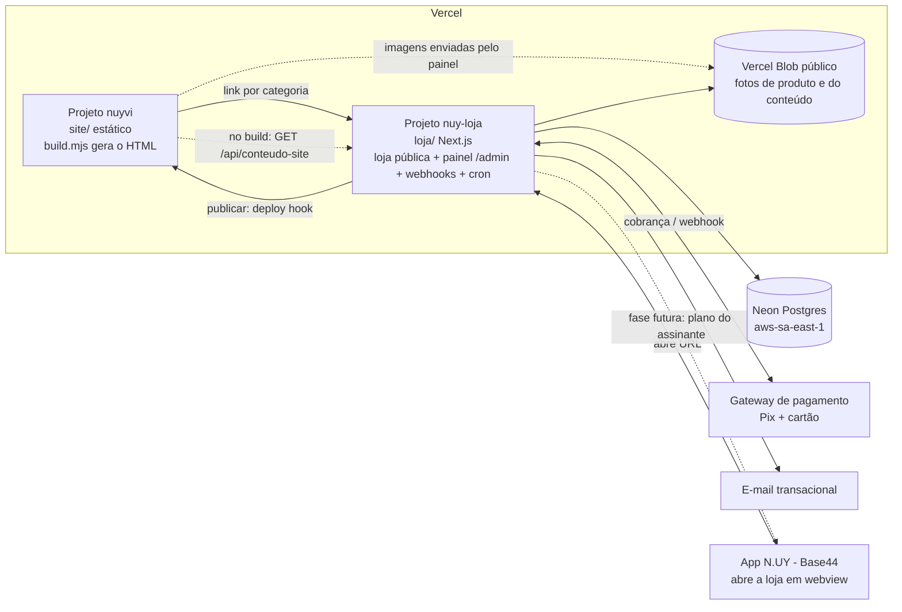

# Arquitetura: loja N.UY

Desenho macro da loja (`loja/`) e do painel único. Decisão de stack e alternativas: [ADR-0004](../adr/ADR-0004-stack-loja.md). Conteúdo do site e publicação: [ADR-0006](../adr/ADR-0006-conteudo-do-site-no-banco-da-loja-com-rebuild.md) (aceito). Requisitos: [spec](../specs/loja.md). Este documento diz **onde cada coisa mora e quem fala com quem**. Schema físico, mecanismo de jobs e telas são dos especialistas indicados.

## 1. Visão geral



| Onde roda | O quê |
|---|---|
| Projeto Vercel `nuyvi` (ligado ao GitHub, Root Directory `site`) | Site estático. No build, o `build.mjs` busca a última versão publicada do conteúdo na loja e gera o HTML. Sem preço nem estoque (RN-LOJ-18) |
| Projeto Vercel da loja (Root Directory `loja/`) | Páginas da loja, painel único `/admin` (loja e conteúdo do site), leitura pública do conteúdo publicado, Route Handlers de webhook e de cron, Server Actions |
| Neon | Única fonte da verdade de catálogo, estoque, pedidos, pagamentos, contas da loja, auditoria e **versões do conteúdo do site** |
| Vercel Blob (público) | Fotos de produto e fotos do conteúdo do site enviadas pelo painel |
| Gateway | Dados de cartão (nunca passam pela loja, RNF-08), cobranças, estornos |

Sem servidor próprio, sem fila externa, sem Redis. Monolito modular.

## 2. Estrutura de `loja/`

```
loja/
  package.json  next.config.ts  drizzle.config.ts  .env.example   (nunca .env)
  drizzle/                     migrations geradas (dev-database)
  src/
    app/
      (loja)/                  páginas públicas: início, categoria/[slug], produto/[slug],
                               carrinho, checkout, pedido/[codigo], conta/
      admin/                   painel único: conteúdo do site (fase 1a), pedidos, produtos, estoque, frete, descontos, equipe
      api/
        auth/...               rota da biblioteca de auth (dev-auth)
        conteudo-site/         GET público: última versão publicada do conteúdo (lida pelo build do site)
        webhooks/pagamento/    entrada do gateway
        cron/                  expiração de pedidos e reenvio de e-mails
    modules/
      catalogo/   estoque/   carrinho/   frete/   checkout/
      pedidos/    pagamentos/   contas/   conteudo-site/
    db/                        cliente do banco e schema Drizzle (um arquivo por módulo)
    lib/                       dinheiro (centavos inteiros), env (lê e valida variáveis), datas
```

**Regras de dependência (as que importam):**

1. `app/` (páginas, Server Actions e Route Handlers) só valida a entrada, chama **uma** função de módulo e monta a resposta. Regra de negócio não fica em `app/`.
2. Cada módulo expõe funções no seu `index.ts`. Outro módulo não lê nem grava tabela alheia diretamente: chama a função do dono.
3. As funções que participam de uma transação recebem o executor do banco (`tx`) como parâmetro. É assim que o checkout reserva estoque e cria o pedido numa transação só, sem camada extra.
4. Fornecedor externo (gateway, e-mail, deploy hook da Vercel, e no futuro o Base44) só é importado dentro do seu módulo. Nenhum tipo do SDK sai dele.
5. "Admin" não é módulo: é a UI em `app/admin/`, que chama os mesmos módulos com o papel checado.

| Módulo | Responsabilidade | Regras da spec |
|---|---|---|
| `catalogo` | Produtos, variações, categorias, fotos, preço; leituras públicas | CA-LOJ-01 a 05, 40, 41 |
| `estoque` | **A única porta** para mudar saldo: entrada, ajuste, reserva, baixa, liberação, devolução; disponível = físico menos reservas ativas | RN-LOJ-09 a 11, CA-LOJ-24 a 27 |
| `carrinho` | Itens e quantidades em cookie httpOnly; sem tabela e sem reserva | RN-LOJ-09, CA-LOJ-06 |
| `frete` | Tabela de faixas de CEP/UF, valor, prazo, frete grátis | RN-LOJ-16, CA-LOJ-21 a 23 |
| `checkout` | Caso de uso `confirmarPedido`: recalcula tudo no servidor, reserva e cria a cobrança | CA-LOJ-10, 13, 16, 17, 19 |
| `pedidos` | Tabela de transições permitidas, histórico, "meus pedidos", acesso por link de visitante | Seção 8 da spec, CA-LOJ-28 a 39 |
| `pagamentos` | Adaptador do gateway (criar cobrança, consultar, estornar, validar webhook) e registro de pagamentos e eventos | CA-LOJ-14, 18, 36, 37 |
| `contas` | Sessão, papéis, dados do cliente, **ponto de extensão do plano** (seção 5) | CA-LOJ-28, 29, 43 |
| `conteudo-site` | Versões publicadas do conteúdo do site (9 blocos), validação, publicar (grava a versão e chama o deploy hook do site), histórico, upload de fotos para o Blob. Não conhece produto, preço nem pedido (RN-LOJ-18) | CA-LOJ-50 a 59, RN-LOJ-24 a 26 |

Sem interface com uma implementação só: `pagamentos/gateway.ts` é um módulo com funções que falam com **um** gateway. Uma interface só entra se aparecer um segundo gateway de verdade.

**Dinheiro:** inteiros em centavos (BRL). Arredondamento do desconto por item (RN-LOJ-06) numa função só, em `lib/dinheiro`. **Datas:** `timestamptz` no banco, exibição em `America/Sao_Paulo`.

## 3. Fluxo de pedido e pagamento

```mermaid
sequenceDiagram
  actor C as Comprador
  participant A as app/ (Server Action)
  participant K as checkout.confirmarPedido
  participant DB as Postgres
  participant G as Gateway
  C->>A: Confirmar (carrinho, CEP, meio de pagamento)
  A->>K: entrada validada + cliente (ou visitante)
  K->>K: preços do catálogo, frete da tabela, plano = contas.obterPlanoVigente()
  K->>DB: BEGIN; lock nas variações; checa disponível; cria pedido (AguardandoPagamento), itens congelados, reservas com expira_em; COMMIT
  K->>G: criar cobrança (chave de idempotência = id do pedido)
  G-->>K: Pix (código, QR, expiração) ou resposta do cartão
  K->>DB: grava pagamento pendente / aprovado
  K-->>C: pedido N + Pix, ou resultado do cartão
  G-->>A: webhook (pode repetir, fora de ordem)
  A->>A: valida autenticidade; consulta o status no gateway pela API
  A->>DB: BEGIN; INSERT evento (gateway, id_evento) ON CONFLICT DO NOTHING
  alt evento novo e pedido em AguardandoPagamento
    A->>DB: pedido → Pago; reservas → baixa; histórico; e-mail na fila de saída; COMMIT
  else repetido ou já processado
    A->>DB: COMMIT sem efeito
  end
  A-->>G: 200
```

Decisões estruturais deste fluxo:

- **O total nunca vem do navegador** (CA-LOJ-19): `confirmarPedido` recebe apenas ids de variação, quantidades, CEP e meio de pagamento.
- **Concorrência de estoque** (CA-LOJ-24): a reserva acontece dentro de uma transação com lock nas linhas das variações. Locking, isolamento, índices e restrições são do `dev-database`.
- **Expiração sem depender de horário de cron** (CA-LOJ-15): a reserva tem `expira_em`, e o disponível só conta as reservas vigentes. Mesmo que o cron atrase, o estoque volta na hora certa. O cron (a cada poucos minutos, no plano Pro) apenas consulta o gateway antes de marcar "Expirado" (RNF-05) e cancela o Pix.
- **Webhook idempotente** (CA-LOJ-18): chave única do evento, transição condicionada ao estado atual (a transição só vale se o pedido ainda estiver em AguardandoPagamento) e efeitos na mesma transação. O status é confirmado na API do gateway, sem confiar só no corpo recebido. Um e-mail de "pago" por pedido: o registro na fila de saída tem chave única (pedido, tipo).
- **Síncrono × assíncrono:** a criação da cobrança e a confirmação do pagamento são síncronas. O e-mail sai da requisição: é gravado na mesma transação e enviado logo depois, com reenvio pelo cron se falhar. O mecanismo exato (tabela de saída, `after()`, retentativas) é do `dev-integrations`.
- **Cartão recusado** (CA-LOJ-17): o pedido e a reserva continuam até `expira_em`; uma nova tentativa reaproveita o pedido. O limite de tentativas (RN-LOJ-20) fica no `checkout`.

## 4. Identidade e papéis

- Uma instância de autenticação (biblioteca indicada ao `dev-auth` no ADR-0004) atende clientes e equipe. Papéis: `cliente`, `operador`, `admin`.
- **A permissão é checada na camada de módulo** (cada função de `/admin` recebe o usuário e verifica o papel), além do bloqueio de rota em `app/admin/`. Bloquear só a rota não basta (CA-LOJ-43). Matriz: seção 3 da spec.
- **Visitante:** o pedido fica sem conta, com nome, e-mail, CPF e endereço; o acesso ao pedido é por um link com código aleatório longo enviado por e-mail (CA-LOJ-29). Desenho do código e da expiração: `dev-auth`/`dev-security`.
- **Dentro do app (webview):** no MVP o comprador entra na loja normalmente. Login automático vindo do app depende do Base44 (P-02).

## 5. Ponto de extensão: plano do assinante

A única fronteira para "qual o plano deste cliente":

```ts
// loja/src/modules/contas/plano-assinante.ts
type PlanoVigente = { codigo: 'silver' | 'gold' | 'premium'; percentualDesconto: number } | null;
export async function obterPlanoVigente(clienteId: string | null): Promise<PlanoVigente>;
```

- **No MVP:** a função retorna `null` sempre, então não há desconto. Sem interface, sem fábrica, sem flag.
- **Quem chama:** só `checkout.confirmarPedido` (para cobrar) e, quando houver, a estimativa no catálogo e no carrinho (CA-LOJ-04). Ninguém mais conhece o Base44.
- **O que já existe desde o MVP:** o cálculo de totais recebe o percentual como dado (0 no MVP) e o pedido grava, por item, o desconto aplicado e, no cabeçalho, o plano e o percentual usados (vazios no MVP). O formato do pedido não muda quando o desconto entrar (RN-LOJ-08).
- **Para plugar depois:**
  1. `dev-integrations` verifica o Base44 (endpoint ou exportação, autenticação, latência);
  2. `dev-auth` decide como ligar a conta da loja à conta N.UY (ex.: vínculo verificado por e-mail ou login federado);
  3. só então o `dev-database` adiciona a referência da conta N.UY ao cliente;
  4. a implementação substitui o corpo de `obterPlanoVigente`.
  Falha na consulta: retorna `null`, e o checkout segue RN-LOJ-07 (nunca há desconto sem verificação).
- **Onde vive o percentual** (P-05): fica no painel da loja (premissa da spec) até o cliente responder. Se passar a vir do app, muda só esta função.

## 6. Conteúdo do site e ligação site → loja

Decisão: [ADR-0006](../adr/ADR-0006-conteudo-do-site-no-banco-da-loja-com-rebuild.md) (aceito). O Sveltia foi descartado (D-04).

```mermaid
sequenceDiagram
  actor A as Admin (painel)
  participant P as conteudo-site.publicar
  participant DB as Postgres
  participant H as Deploy hook (projeto nuyvi)
  participant V as Build do site (build.mjs)
  A->>P: bloco editado + versaoBase
  P->>P: exigirPapel + valida (mesmas regras do build.mjs)
  P->>DB: BEGIN; confere versaoBase; grava versão completa N+1 (autor, blocos alterados); COMMIT
  P->>H: POST (timeout curto)
  alt hook aceitou
    P-->>A: Publicado (aparece no site em poucos minutos)
    H->>V: build da branch de produção
    V->>P: GET /api/conteudo-site (última versão publicada)
    V->>V: valida, gera index.html; erro para o build e o deploy anterior continua
  else hook falhou
    P->>DB: marca a versão N+1 como não publicada (nunca servida)
    P-->>A: Não foi possível publicar, tente de novo (edição mantida)
  end
```

- **Fonte da verdade:** tabela de versões no Neon; cada versão é o conteúdo **inteiro** (os 5 documentos no formato de `site/conteudo/*.json` + `destino` dos cartões da Loja). Nunca há metade nova e metade antiga (CA-LOJ-55). Histórico de CA-LOJ-57 vem da mesma tabela; quem publicou fica só no banco (dado pessoal fora do Git, RNF-13).
- **Site para quem visita:** HTML estático na Vercel, sem chamada à loja em tempo de execução (RNF-14). Loja fora do ar impede apenas um build novo.
- **Fotos:** as já existentes continuam em `site/img/`; as enviadas pelo painel vão ao Blob público (prefixo `conteudo/`) e entram no site por URL absoluta, só do host configurado.
- **Botão da seção Loja:** o campo `destino` do cartão aponta para `https://<subdomínio da loja>/categoria/<slug>` (CA-LOJ-58). Preço e estoque nunca entram no conteúdo.
- **`site/` depois do corte:** `index.html`, `build.mjs` (busca o conteúdo em `CONTEUDO_URL`), `vercel.json`, CSS, JS e `img/`. `site/conteudo/` e `site/admin/` saem do repositório.
- **Fase 2:** se o site mostrar destaques do catálogo, eles seguem o mesmo caminho (lidos da loja no build). Fica para quando a fase 2 for aprovada.

## 7. Ambientes e segredos

| Ambiente | Banco | Gateway | Onde ficam as chaves |
|---|---|---|---|
| Local | Branch do Neon ou Postgres local (escolha do `dev-devops`) | Sandbox | `.env.local` (no `.gitignore`) |
| Preview (PR) | Branch do Neon, nunca a produção | Sandbox | Variáveis de ambiente da Vercel (Preview) |
| Produção | Neon `main` | Produção | Variáveis de ambiente da Vercel (Production) |

O repositório é público: somente `.env.example` com nomes e sem valores. Os segredos de webhook e de cron também ficam fora do Git.

Conteúdo do site (ADR-0006):

| Variável | Projeto | Ambiente | Segredo? |
|---|---|---|---|
| `SITE_DEPLOY_HOOK_URL` | loja | **só Production** (em Preview, publicar não atualiza o site) | Sim: quem tem a URL dispara builds do site |
| Credencial do Blob (OIDC da Vercel; `BLOB_READ_WRITE_TOKEN` só se precisar) | loja | Production e Preview (prefixo ou store separado) | Sim |
| `CONTEUDO_URL` | nuyvi | Production e Preview | Não (aponta para a leitura pública da loja) |
| `BLOB_PUBLIC_HOST` | nuyvi | Production e Preview | Não (host do store Blob; sem ele o build só aceita `img/...`) |
| `NEXT_PUBLIC_BLOB_HOST` | loja | todos | Não (o mesmo host, para validar as imagens do conteúdo) |
| `LOJA_URL` | nuyvi | Production e Preview | Não (destino dos botões da seção Loja; sem ela, `#baixar`) |
| `SITE_PUBLIC_URL` | loja | todos | Não (só miniaturas no painel; opcional) |
| `VERCEL_ENV` | loja | automática (Vercel) | Não; distingue Production de Preview para o hook |

Sem `SITE_DEPLOY_HOOK_URL`: fora de produção a versão é gravada como aceita com `disparo_erro = 'sem hook configurado'` e o painel avisa que o site não foi atualizado; em produção a publicação falha. O upload de foto é um Route Handler (`POST /api/conteudo-site/foto`), não Server Action, para não elevar o limite de corpo (1 MB) de todas as actions. O valor guardado em `destino` dos cartões da Loja é `inicio` (futuro `categoria/<slug>`); o build monta `LOJA_URL` + valor.

Nenhuma credencial do GitHub é usada pela aplicação.

## 8. Degradação

| Falha | O que continua | O que para |
|---|---|---|
| Gateway fora do ar | Catálogo e carrinho | Confirmação de pedido (mensagem clara; nada cobrado; nada duplicado) |
| Webhook atrasado ou perdido | Pedido em AguardandoPagamento | Resolvido pelo cron, que consulta o gateway antes de expirar |
| Provedor de e-mail fora do ar | Pedido e pagamento | E-mail, reenviado pelo cron; a falha aparece para o operador |
| Neon fora do ar | Nada da loja (o site estático segue no ar) | Tudo; o RTO depende do Neon |
| Loja ou Neon fora do ar (conteúdo) | Site no ar com o último conteúdo publicado | Edição e publicação do conteúdo; qualquer build novo do site falha e o deploy anterior continua |
| Deploy hook ou build da Vercel falhando | Site com a versão anterior | Publicação: o painel mostra o erro; versão não servida |
| Vercel Blob fora do ar | Site e imagens de `site/img/` | Imagens enviadas pelo painel e fotos de produto |
| Base44 (futuro) | Compra pelo preço cheio | Desconto (RN-LOJ-07) |

## 9. Gatilhos de crescimento

- Consulta de catálogo lenta medida (RNF-02 acima de 2,5 s): cache das páginas públicas pelo Next.js com invalidação ao salvar no `/admin` (`dev-performance-seo`). Não antes de medir.
- Mais de ~500 pedidos/dia ou contenção de lock medida em data de pico: revisar a reserva com o `dev-database`.
- Trabalho em segundo plano que não cabe em função (mais de 300 s ou contínuo): worker separado (`dev-integrations`).
