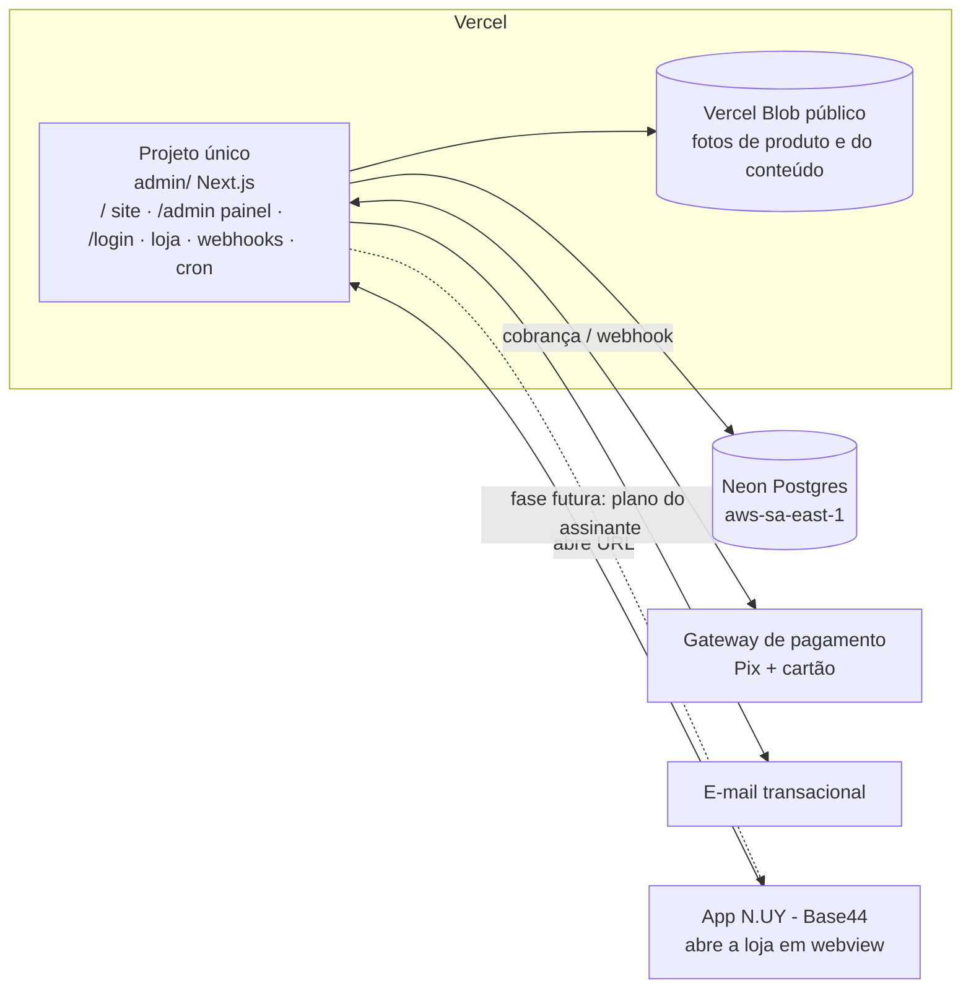

# Arquitetura: loja N.UY

Desenho macro do app único `admin/`: site da N.UY em `/`, painel único em `/admin` e loja. Decisão de stack e alternativas: [ADR-0004](../adr/ADR-0004-stack-loja.md). Conteúdo do site: [ADR-0006](../adr/ADR-0006-conteudo-do-site-no-banco-da-loja-com-rebuild.md) (versões no banco) e [ADR-0007](../adr/ADR-0007-site-e-painel-num-unico-app-next.md) (um app só; `/` montado do template com cache invalidado ao publicar; substitui o deploy hook). Até o corte do ADR-0007, `site/` e o projeto `nuyvi` continuam no ar como hoje. Requisitos: [spec](../specs/loja.md). Este documento diz **onde cada coisa mora e quem fala com quem**. Schema físico, mecanismo de jobs e telas são dos especialistas indicados.

## 1. Visão geral



| Onde roda | O quê |
|---|---|
| Projeto Vercel único (Root Directory `admin/`) | `/`: página do site montada do template com o conteúdo publicado (prerender, regenerado ao publicar). `public/`: imagens, vídeos, JS, CSS e páginas legais do site. `/admin`: painel único (conteúdo do site e loja). `/login` e páginas de cliente. Route Handlers de webhook, cron e upload; Server Actions |
| Neon | Única fonte da verdade de catálogo, estoque, pedidos, pagamentos, contas, auditoria e **versões do conteúdo do site** |
| Vercel Blob (público) | Fotos de produto e fotos do conteúdo do site enviadas pelo painel |
| Gateway | Dados de cartão (nunca passam pela loja, RNF-08), cobranças, estornos |

Sem servidor próprio, sem fila externa, sem Redis. Monolito modular. Site, painel e loja sobem no mesmo deploy (consequência aceita no ADR-0007).

## 2. Estrutura de `admin/`

```
site/                          fonte versionada do site: index.html e loja.html (templates com <!--cms:CHAVE-->), img/ video/ js/ css/ e páginas .html
                               copiada para admin/ por admin/scripts/copiar-site.mjs (predev, prebuild, pretest)
admin/
  package.json  next.config.ts  drizzle.config.ts  .env.example   (nunca .env)
  drizzle/                     migrations geradas (dev-database)
  public/                      GERADO de ../site/ (ignorado pelo Git): img/ video/ js/ css/ e páginas .html; js/conta.js (sessão no site)
  scripts/conteudo-inicial/    os 5 JSON de site/conteudo/ (versão 1 do conteúdo e dados de teste)
  src/
    app/
      route.ts                 GET / : página do site (paginaDoSite(): 'use cache' + cacheTag + cacheLife('max'))
      loja/route.ts            GET /loja : vitrine básica (template loja.html + catalogo/vitrine.ts, tag catalogo) (ADR-0007 A3)
      loja/...                 fase 1b: categoria/[slug], produto/[slug], carrinho, checkout, pedido/[codigo]
      login/  cadastrar/  confirmar-email/  esqueci-senha/  redefinir-senha/  vincular-pedidos/
      admin/                   painel único: conteúdo do site (fase 1a), pedidos, produtos, estoque, frete, descontos, equipe
      api/
        auth/...               rota da biblioteca de auth (dev-auth)
        conteudo-site/foto/    POST: upload de foto do conteúdo (o GET público sai no ADR-0007)
        webhooks/pagamento/    entrada do gateway
        cron/                  expiração de pedidos e reenvio de e-mails
    modules/
      catalogo/   estoque/   carrinho/   frete/   checkout/
      pedidos/    pagamentos/   contas/   conteudo-site/
    site/index.html loja.html  GERADO de ../site/ (ignorado pelo Git); fora de public/ para não ser servido cru
    db/                        cliente do banco e schema Drizzle (um arquivo por módulo)
    lib/                       dinheiro (centavos inteiros), env (lê e valida variáveis), datas
```

**Regras de dependência (as que importam):**

1. `app/` (páginas, Server Actions e Route Handlers) só valida a entrada, chama **uma** função de módulo e monta a resposta. Regra de negócio não fica em `app/`.
2. Cada módulo expõe funções no seu `index.ts`. Outro módulo não lê nem grava tabela alheia diretamente: chama a função do dono.
3. As funções que participam de uma transação recebem o executor do banco (`tx`) como parâmetro. É assim que o checkout reserva estoque e cria o pedido numa transação só, sem camada extra.
4. Fornecedor externo (gateway, e-mail, e no futuro o Base44) só é importado dentro do seu módulo. Nenhum tipo do SDK sai dele.
5. "Admin" não é módulo: é a UI em `app/admin/`, que chama os mesmos módulos com o papel checado.
6. Nenhuma rota do app com nome de pasta de `public/` (`img`, `video`, `js`, `css`) e nenhum arquivo em `public/` com nome de rota (`admin`, `api`, `login`, `loja`, `_next`).

| Módulo | Responsabilidade | Regras da spec |
|---|---|---|
| `catalogo` | Produtos, variações, categorias, fotos, preço; leituras públicas; `vitrine.ts` (produtos ativos, primeira foto, menor preço; `'use cache'` + tag `catalogo`) | CA-LOJ-01 a 05, 40, 41 |
| `estoque` | **A única porta** para mudar saldo: entrada, ajuste, reserva, baixa, liberação, devolução; disponível = físico menos reservas ativas | RN-LOJ-09 a 11, CA-LOJ-24 a 27 |
| `carrinho` | Itens e quantidades em cookie httpOnly; sem tabela e sem reserva | RN-LOJ-09, CA-LOJ-06 |
| `frete` | Tabela de faixas de CEP/UF, valor, prazo, frete grátis | RN-LOJ-16, CA-LOJ-21 a 23 |
| `checkout` | Caso de uso `confirmarPedido`: recalcula tudo no servidor, reserva e cria a cobrança | CA-LOJ-10, 13, 16, 17, 19 |
| `pedidos` | Tabela de transições permitidas, histórico, "meus pedidos", acesso por link de visitante | Seção 8 da spec, CA-LOJ-28 a 39 |
| `pagamentos` | Adaptador do gateway (criar cobrança, consultar, estornar, validar webhook) e registro de pagamentos e eventos | CA-LOJ-14, 18, 36, 37 |
| `contas` | Sessão, papéis, dados do cliente, **ponto de extensão do plano** (seção 5) | CA-LOJ-28, 29, 43 |
| `conteudo-site` | Versões publicadas do conteúdo do site (9 blocos), validação, publicar (grava a versão), histórico, upload de fotos para o Blob, `montar()` (template + conteúdo → HTML, com escape) e a tag de cache do site. Não conhece produto, preço nem pedido (RN-LOJ-18) | CA-LOJ-50 a 59, RN-LOJ-24 a 26 |

Sem interface com uma implementação só: `pagamentos/gateway.ts` é um módulo com funções que falam com **um** gateway. Uma interface só entra se aparecer um segundo gateway de verdade.

**Dinheiro:** inteiros em centavos (BRL). Arredondamento do desconto por item (RN-LOJ-06) numa função só, em `lib/dinheiro`. **Datas:** `timestamptz` no banco, exibição em `America/Sao_Paulo`.

## 3. Fluxo de pedido e pagamento

```mermaid
sequenceDiagram
  actor C as Comprador
  participant A as app/ (Server Action)
  participant K as checkout.confirmarPedido
  participant DB as Postgres
  participant G as Gateway
  C->>A: Confirmar (carrinho, CEP, meio de pagamento)
  A->>K: entrada validada + cliente (ou visitante)
  K->>K: preços do catálogo, frete da tabela, plano = contas.obterPlanoVigente()
  K->>DB: BEGIN; lock nas variações; checa disponível; cria pedido (AguardandoPagamento), itens congelados, reservas com expira_em; COMMIT
  K->>G: criar cobrança (chave de idempotência = id do pedido)
  G-->>K: Pix (código, QR, expiração) ou resposta do cartão
  K->>DB: grava pagamento pendente / aprovado
  K-->>C: pedido N + Pix, ou resultado do cartão
  G-->>A: webhook (pode repetir, fora de ordem)
  A->>A: valida autenticidade; consulta o status no gateway pela API
  A->>DB: BEGIN; INSERT evento (gateway, id_evento) ON CONFLICT DO NOTHING
  alt evento novo e pedido em AguardandoPagamento
    A->>DB: pedido → Pago; reservas → baixa; histórico; e-mail na fila de saída; COMMIT
  else repetido ou já processado
    A->>DB: COMMIT sem efeito
  end
  A-->>G: 200
```

Decisões estruturais deste fluxo:

- **O total nunca vem do navegador** (CA-LOJ-19): `confirmarPedido` recebe apenas ids de variação, quantidades, CEP e meio de pagamento.
- **Concorrência de estoque** (CA-LOJ-24): a reserva acontece dentro de uma transação com lock nas linhas das variações. Locking, isolamento, índices e restrições são do `dev-database`.
- **Expiração sem depender de horário de cron** (CA-LOJ-15): a reserva tem `expira_em`, e o disponível só conta as reservas vigentes. Mesmo que o cron atrase, o estoque volta na hora certa. O cron (a cada poucos minutos, no plano Pro) apenas consulta o gateway antes de marcar "Expirado" (RNF-05) e cancela o Pix.
- **Webhook idempotente** (CA-LOJ-18): chave única do evento, transição condicionada ao estado atual (a transição só vale se o pedido ainda estiver em AguardandoPagamento) e efeitos na mesma transação. O status é confirmado na API do gateway, sem confiar só no corpo recebido. Um e-mail de "pago" por pedido: o registro na fila de saída tem chave única (pedido, tipo).
- **Síncrono × assíncrono:** a criação da cobrança e a confirmação do pagamento são síncronas. O e-mail sai da requisição: é gravado na mesma transação e enviado logo depois, com reenvio pelo cron se falhar. O mecanismo exato (tabela de saída, `after()`, retentativas) é do `dev-integrations`.
- **Cartão recusado** (CA-LOJ-17): o pedido e a reserva continuam até `expira_em`; uma nova tentativa reaproveita o pedido. O limite de tentativas (RN-LOJ-20) fica no `checkout`.

## 4. Identidade e papéis

- Uma instância de autenticação (biblioteca indicada ao `dev-auth` no ADR-0004) atende clientes e equipe. Papéis: `cliente`, `operador`, `admin`.
- **A permissão é checada na camada de módulo** (cada função de `/admin` recebe o usuário e verifica o papel), além do bloqueio de rota em `app/admin/`. Bloquear só a rota não basta (CA-LOJ-43). Matriz: seção 3 da spec.
- **Visitante:** o pedido fica sem conta, com nome, e-mail, CPF e endereço; o acesso ao pedido é por um link com código aleatório longo enviado por e-mail (CA-LOJ-29). Desenho do código e da expiração: `dev-auth`/`dev-security`.
- **Dentro do app (webview):** no MVP o comprador entra na loja normalmente. Login automático vindo do app depende do Base44 (P-02).

## 5. Ponto de extensão: plano do assinante

A única fronteira para "qual o plano deste cliente":

```ts
// admin/src/modules/contas/plano-assinante.ts
type PlanoVigente = { codigo: 'silver' | 'gold' | 'premium'; percentualDesconto: number } | null;
export async function obterPlanoVigente(clienteId: string | null): Promise<PlanoVigente>;
```

- **No MVP:** a função retorna `null` sempre, então não há desconto. Sem interface, sem fábrica, sem flag.
- **Quem chama:** só `checkout.confirmarPedido` (para cobrar) e, quando houver, a estimativa no catálogo e no carrinho (CA-LOJ-04). Ninguém mais conhece o Base44.
- **O que já existe desde o MVP:** o cálculo de totais recebe o percentual como dado (0 no MVP) e o pedido grava, por item, o desconto aplicado e, no cabeçalho, o plano e o percentual usados (vazios no MVP). O formato do pedido não muda quando o desconto entrar (RN-LOJ-08).
- **Para plugar depois:**
  1. `dev-integrations` verifica o Base44 (endpoint ou exportação, autenticação, latência);
  2. `dev-auth` decide como ligar a conta da loja à conta N.UY (ex.: vínculo verificado por e-mail ou login federado);
  3. só então o `dev-database` adiciona a referência da conta N.UY ao cliente;
  4. a implementação substitui o corpo de `obterPlanoVigente`.
  Falha na consulta: retorna `null`, e o checkout segue RN-LOJ-07 (nunca há desconto sem verificação).
- **Onde vive o percentual** (P-05): fica no painel da loja (premissa da spec) até o cliente responder. Se passar a vir do app, muda só esta função.

## 6. Conteúdo do site e página `/`

Decisões: [ADR-0006](../adr/ADR-0006-conteudo-do-site-no-banco-da-loja-com-rebuild.md) (versões no banco, publicação por bloco) e [ADR-0007](../adr/ADR-0007-site-e-painel-num-unico-app-next.md) (página montada no próprio app, sem deploy hook). O Sveltia foi descartado (D-04).

```mermaid
sequenceDiagram
  actor A as Admin (painel)
  participant S as Server Action (app/admin/conteudo)
  participant P as conteudo-site.publicar
  participant DB as Postgres
  participant C as Cache do Next (tag conteudo-site)
  actor V as Visitante
  A->>S: bloco editado + versaoBase
  S->>P: publicar(...)
  P->>P: exigirPapel + valida (mesmas regras do montar)
  P->>DB: BEGIN; confere versaoBase; grava versão completa N+1 (autor, blocos alterados); COMMIT
  P-->>S: publicado
  S->>C: updateTag(conteudo-site)
  S-->>A: Publicado (já está no site)
  V->>C: GET /
  alt entrada válida
    C-->>V: HTML em cache (não toca o banco)
  else tag expirada
    C->>DB: obterPublicado()
    C->>C: montar(template, versão N+1)
    C-->>V: HTML novo (fica em cache)
  end
```

- **Fonte da verdade:** tabela de versões no Neon; cada versão é o conteúdo **inteiro** (os 5 documentos + `destino` dos cartões da Loja). Nunca há metade nova e metade antiga (CA-LOJ-55). Histórico (CA-LOJ-57) da mesma tabela; quem publicou fica só no banco (RNF-13).
- **Página `/`:** `app/route.ts` devolve `paginaDoSite()`: template `src/site/index.html` + `obterPublicado()` + `montar()`, em função com `'use cache'`, `cacheTag` e `cacheLife('max')`. Prerenderizada no build; regenerada só quando a tag é expirada. Root layout do Next não se aplica (Route Handler), então o documento é o do site, com os mesmos scripts.
- **Sem versão publicada** (tabela vazia: CI, preview novo): o template sai como está; ele já traz o conteúdo do último `build.mjs` embutido.
- **Banco fora:** o `/` em cache segue servido. Erro do banco nunca é capturado dentro de `paginaDoSite()`, para uma regeneração com falha não substituir a versão boa (hipóteses H1 a H4 do ADR-0007, verificadas antes do corte).
- **Fotos:** as existentes em `public/img/`; as enviadas pelo painel no Blob público (prefixo `conteudo/`), aceitas só do host de `NEXT_PUBLIC_BLOB_HOST`.
- **Botão da seção Loja:** `destino` = `inicio` (→ `/loja`) ou `categoria/<slug>` (→ `/loja/categoria/<slug>`). Preço e estoque nunca entram no conteúdo.
- **Tudo que o visitante vê vem do banco** (ADR-0007, adendo A1): campos de seção nos blocos da seção; blocos novos `videos`, `geral` (SEO, menu, links das lojas de apps, rodapé/newsletter) e `pagina-loja`, todos dentro do documento `textos` (sem chave nova no topo). Texto em atributo ou em `<title>` é gerado com o elemento inteiro, com o marcador em volta. Links externos só `https:`; internos de lista fechada. Vídeo = `video/…` ou Blob `conteudo/` (mp4/webm, 4,5 MB, sem reencodar).
- **Sessão no site** (A2): `/` e `/loja` não leem cookie; `public/js/conta.js` consulta `/api/auth/get-session` e troca "Entrar na NUY" por nome + Sair (+ "Painel" para `operador`/`admin`). `/login?volta=` só aceita caminho interno, validado no servidor.
- **`/loja`** (A3): template `loja.html` + textos do bloco `pagina-loja` + `catalogo/vitrine.ts` (tag `catalogo`, invalidada por `updateTag('catalogo')` nas actions do catálogo). Sem carrinho nem checkout até a fase 1b.
- **Fase 2:** destaques do catálogo no site seguem o mesmo caminho (lidos no `paginaDoSite()`, com tag própria do catálogo). Só quando aprovada.

## 7. Ambientes e segredos

| Ambiente | Banco | Gateway | Onde ficam as chaves |
|---|---|---|---|
| Local | Branch do Neon ou Postgres local (escolha do `dev-devops`) | Sandbox | `.env.local` (no `.gitignore`) |
| Preview (PR) | Branch do Neon, nunca a produção | Sandbox | Variáveis de ambiente da Vercel (Preview) |
| Produção | Neon `main` | Produção | Variáveis de ambiente da Vercel (Production) |

O repositório é público: somente `.env.example` com nomes e sem valores. Os segredos de webhook e de cron também ficam fora do Git.

Conteúdo do site (ADR-0006 e ADR-0007):

| Variável | Ambiente | Segredo? |
|---|---|---|
| Credencial do Blob (OIDC da Vercel; `BLOB_READ_WRITE_TOKEN` só se precisar) | Production e Preview (prefixo ou store separado) | Sim |
| `NEXT_PUBLIC_BLOB_HOST` | todos | Não (host do store; valida as imagens do conteúdo no painel e no `montar`) |
| `BETTER_AUTH_URL` | todos | Não; em produção passa a ser o domínio do site |

Saem com o ADR-0007: `SITE_DEPLOY_HOOK_URL`, `CONTEUDO_URL`, `LOJA_URL`, `BLOB_PUBLIC_HOST` e `SITE_PUBLIC_URL`. O upload de foto continua num Route Handler (`POST /api/conteudo-site/foto`), não em Server Action, para não elevar o limite de corpo (1 MB) de todas as actions.

Como `next build` prerenderiza `/` lendo o banco, as migrations rodam **antes** do deploy, e o build do CI usa o Postgres do service depois do `db:migrate`.

Nenhuma credencial do GitHub é usada pela aplicação.

## 8. Degradação

| Falha | O que continua | O que para |
|---|---|---|
| Gateway fora do ar | Catálogo e carrinho | Confirmação de pedido (mensagem clara; nada cobrado; nada duplicado) |
| Webhook atrasado ou perdido | Pedido em AguardandoPagamento | Resolvido pelo cron, que consulta o gateway antes de expirar |
| Provedor de e-mail fora do ar | Pedido e pagamento | E-mail, reenviado pelo cron; a falha aparece para o operador |
| Neon fora do ar | `/` em cache com o último conteúdo publicado; arquivos de `public/` | Loja, login, painel e publicação; qualquer deploy novo (o build lê o banco) falha e o anterior continua. Risco residual: banco cair logo depois de uma publicação, antes da primeira visita (ADR-0007, opção 2A); entrada fria no cache com o banco fora depende de H2/H3 |
| Build da Vercel falhando | Deploy anterior inteiro (site, painel e loja) | Mudanças de código e de qualquer parte do app |
| Erro de runtime em código compartilhado (`next.config.ts`, headers) | Depende do erro | Pode atingir `/` junto com o app (destino comum, ADR-0007) |
| Vercel Blob fora do ar | Site e imagens de `public/img/` | Imagens enviadas pelo painel e fotos de produto |
| Base44 (futuro) | Compra pelo preço cheio | Desconto (RN-LOJ-07) |

## 9. Gatilhos de crescimento

- Consulta de catálogo lenta medida (RNF-02 acima de 2,5 s): cache das páginas públicas pelo Next.js com invalidação ao salvar no `/admin` (`dev-performance-seo`). Não antes de medir.
- Mais de ~500 pedidos/dia ou contenção de lock medida em data de pico: revisar a reserva com o `dev-database`.
- Trabalho em segundo plano que não cabe em função (mais de 300 s ou contínuo): worker separado (`dev-integrations`).

## 10. Plano de execução do ADR-0007 (com o adendo A)

Um commit por passo, na ordem. Rede de segurança: os 132 testes do Vitest, mais o teste de caracterização do HTML do passo 1. Nada vai para produção nesta etapa: H1 a H4, o corte e a remoção do `nuyvi` ficam para depois do passo 13.

| # | Passo | Pronto quando | Teste antes | Dono |
|---|---|---|---|---|
| 0 | CI: `working-directory` → `admin` | Feito em `ab34ac4` | — | dev-devops |
| 1 | `git mv site/conteudo admin/scripts/conteudo-inicial`; `conteudo:migrar` e testes leem dali; teste de caracterização: `montar(site/index.html, conteúdo inicial)` = `site/index.html` versionado | 132+ verdes; nenhum teste lê `site/conteudo/` | — (é a rede) | dev-tests (dev-react ajusta o script) |
| 2 | `montar` em TypeScript em `modules/conteudo-site/pagina.ts`, mesma lógica | Mesmos testes verdes; saída idêntica à do `build.mjs` | Passo 1 | dev-react + dev-tests |
| 3 | CI: build contra o Postgres do service depois do `db:migrate`; `site/**` sai dos `paths` com o passo 5 | Build do CI conecta ao banco e passa | — | dev-devops |
| 4 | `app/route.ts` + `paginaDoSite()`; template em `src/site/index.html`, arquivos em `public/`; `outputFileTracingIncludes`; redirect `/index.html` → `/`; sai `app/page.tsx` | `localhost:3000/` igual a `127.0.0.1:8765` lado a lado; teste do handler | Passos 1 e 2 | dev-react; dev-tests |
| 5 | `updateTag` ao publicar; saem `deploy-hook.ts`, `SITE_DEPLOY_HOOK_URL`, `GET /api/conteudo-site`, `SITE_PUBLIC_URL` e `site/` | Publicar e recarregar `/` mostra o novo; teste de que a action chama `updateTag` | Passo 4 | dev-react; dev-tests; dev-uiux (texto) |
| 6 | `/entrar` → `/login` com redirect permanente | Entrar, sair, confirmar e-mail e sessão expirada levam a `/login` | Testes de `exigirPapel` e das actions ajustados antes | dev-react; dev-tests |
| 7 | **A1, schema:** migration de `conteudo_versoes_blocos_ck` (+`videos`, `geral`, `pagina-loja`; `1..12`) e `CONTEUDO_BLOCOS` | Migration aplica sobre as versões existentes; teste de CHECK com bloco novo e com bloco inválido | — | dev-database; dev-tests |
| 8 | **A1, conteúdo:** campos novos no zod e nos 3 blocos novos; funções de bloco que geram `<title>`/`<meta>`, menu, links das lojas de apps, `<video>`; marcadores no template; validação de links (`https:` / lista interna) e de vídeo; script idempotente da versão `migracao` com o texto atual do HTML | Saída de `montar` com a versão `migracao` = HTML atual (teste de caracterização); testes de link e vídeo inválidos | Passos 1, 2 e 7 | dev-react; dev-tests |
| 9 | **A1, painel e upload:** telas dos campos e blocos novos (campo de vídeo, lista de links); rota de upload aceita mp4/webm sem reencodar, 4,5 MB, tipo pelo conteúdo | Editar e publicar cada campo novo aparece em `/`; testes da rota com vídeo válido, falso e grande | Passo 8 | dev-uiux (especifica); dev-react; dev-tests |
| 10 | **A2, sessão:** `public/js/conta.js` nos templates; `volta` validado no servidor de `/login`; destino padrão por papel | Cliente, operador e admin veem nome + Sair em `/` e `/loja`; "Painel" só para a equipe; `volta=//x`, `volta=https://x` e `volta=/\x` caem no padrão (teste) | Passo 6 | dev-react; dev-tests; dev-auth (revisa) |
| 11 | **A3, vitrine:** `modules/catalogo/vitrine.ts` (`'use cache'` + tag `catalogo`), `app/loja/route.ts`, template `loja.html`, texto de "em breve"; `lojaUrl` = `/loja` no `montar` | `/loja` com o visual do site lista os produtos ativos (primeira foto, menor preço das variações ativas); inativos e variações inativas não aparecem; botões da seção Loja levam a `/loja` | Testes de `vitrine.ts` contra o Postgres de teste antes da rota | dev-react; dev-tests |
| 12 | **Headers e CSP por caminho** em `next.config.ts` (`/`, `/loja`, páginas legais com scripts e `<style>` embutidos; app com M-02; `img-src`/`media-src` do Blob) | Headers conferidos por caminho; site sem erro de CSP no console | Passos 4, 9 e 11 | dev-react + dev-security |
| 13 | **Revisão e docs:** dev-reviewer no conjunto; dev-security (upload de vídeo, links, `volta`, `conta.js`, CSP); `admin/README.md` (rotas, variáveis, scripts, CI); `BRIEFING.md` (onde o site mora, painel com todos os campos) | Revisões sem bloqueio; docs atualizados | — | dev-reviewer, dev-security, docs-handoff |
| depois | Verificar H1 a H4 em Preview; corte (migrations + `conteudo:migrar` + versão `migracao` em produção, domínio, merge na `main`); remover o `nuyvi` após o período de rollback | — | — | dev-devops, dev-infra, desenvolvedor |
